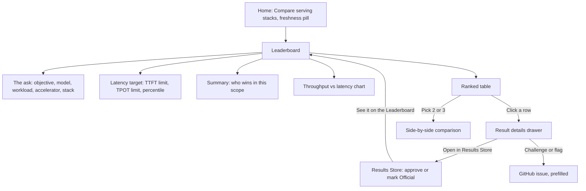

# UX brief: the Prism Leaderboard

**Platform:** Prism (`llm-d-prism`): llm-d Prism, Internal Prism, and any other instance
**Document version:** 2.0.0 (November 2026)
**Reflects:** `feat/next-gen-framing`, on top of `feat/leaderboard-integrity` and `feat/prism-instances`
**Target audience:** Product, design and engineering

> Version 2.0 replaces the earlier brief, which described tiers, badges, karma, certificates, upvotes and milestone prizes. None of that exists any more: it was taken out in `0876af2` because a leaderboard people trust ranks evidence, not people. If you're reading [`leaderboard_spec.md`](../leaderboard_spec.md), treat it as history.

---

## 1. What the Leaderboard is for

Someone has a model to serve and a workload to serve it for. They want to know which accelerator and serving stack will do it fastest, or cheapest, at a latency their users will accept. The Leaderboard answers that question with real runs, and it shows enough of each run that they can trust the answer and repeat it.

Prism has two front doors. **The Leaderboard is for people choosing a stack. The Results Store is for everybody producing, checking and approving results.** The Leaderboard only shows what made it through the Results Store.

### What we promise

1. **Every number has a run behind it.** Rows are Results Store results that an approver *published* (llm-d Prism) or *marked Official* (Internal Prism). Illustrative samples appear only while nothing has been published yet, and they're always labelled.
2. **Runs rank where they can actually serve.** By default, each run is ranked at its highest-throughput point whose median time to first token (TTFT P50) is at most 2 seconds, the same rule the Results Store uses. A run that only "wins" by queueing requests never ranks first, and overloaded points never rank at all.
3. **Like is compared with like.** When you look across models or workloads, ranks restart within each model and workload, so an 8B model is never ranked above a 70B one. Comparisons say plainly when two runs differ in something other than the stack.
4. **You can see who vouched for it.** A result says who approved it and when, and who submitted or asked for it.
5. **You can run it yourself.** Every result comes with its recipe: an inference-perf config plus Docker, Helm, Kubernetes and Python versions.
6. **We don't make things up.** If a run didn't record its engine, parallelism, region or price, the page says *Not reported*. It doesn't guess.

---

## 2. Who uses it

| Person | What they want | Where they spend time |
| :--- | :--- | :--- |
| **Customer or consumer** choosing a stack | The best setup for their model and workload, at their latency target | The ask, the table, the result details |
| **Solutions architect or customer engineer** | What it'll really cost, at their discount | Pricing, the cheapest objective, $/1M tokens |
| **Stack operator** | A recipe that runs the first time | The result details: config tabs, environment, run command |
| **Feature developer** | Where an optimization lands among real stacks | The chart and the table. Validating the optimization itself happens in Results Store Compare. |
| **Contributor and approver** (EPAM engineer, internal teammate, maintainer) | To see their approved result ranked, with their names on it | *See it on the Leaderboard* from the Results Store, then the lineage note |

---

## 3. How it fits together

The URL keeps the whole view: scope, latency target, chart axes and the open result. A shared link opens exactly what the sender saw.

---

## 4. The pieces

### A. The ask
[`LeaderboardAsk.jsx`](../src/components/Leaderboard/LeaderboardAsk.jsx)

The page opens with a sentence you fill in:

> Show me the **fastest** · to serve model **Llama 3.1 70B** · for workload **RAG** · on accelerator **any** · with stack components **any**

- The **objectives** are *fastest* (throughput per chip), *most responsive* (TTFT), *smoothest* (time per output token) and *cheapest* (cost per 1M tokens).
- Each choice shows how many runs it would leave, so nobody filters themselves into an empty page.
- The five slots are a fixed grid. Choosing something never makes the layout jump.
- **Show samples / Hide samples** sits here too, next to where the rows come from.

### B. The latency target
[`MetricFiltersBar.jsx`](../src/components/Leaderboard/MetricFiltersBar.jsx)

- **TTFT limit:** *Any*, ≤ 250 ms, ≤ 500 ms, ≤ 1 s or ≤ 2 s. The default is ≤ 2 s.
- **TPOT limit** (optional): ≤ 25, 50, 100 or 200 ms.
- **Percentile:** P50, P90 or P99. One percentile drives the limit and every latency on the page, including the table, the cards, the chart axis and its dashed limit line. A row never shows "36 ms" next to a badge saying it missed a 50 ms limit.

### C. Summary
[`LeaderboardSummaryCards.jsx`](../src/components/Leaderboard/LeaderboardSummaryCards.jsx)

This is the winner for the current question: its throughput per chip, its TTFT and its cost per 1M tokens, with *Inspect recipe* one click away. A small badge shows which prices are in use, and it opens Pricing.

### D. Throughput vs latency
[`ParetoCurveChart.jsx`](../src/components/Leaderboard/ParetoCurveChart.jsx)

- Each run is drawn as the curve of the points it was actually measured at.
- The operating point it's ranked at is marked, and the frontier points are tagged.
- The limit sits on the chart as a dashed line, at the same percentile as everything else.
- The selected result is highlighted, and hovering a point shows its load, latency, throughput and cost.
- Sample curves are dashed, and they stop at the sample's stated point. They're never extended past it.
- *Export SVG* and *Axes & scale* live in the chart header.

### E. The ranked table
[`LeaderboardTable.jsx`](../src/components/Leaderboard/LeaderboardTable.jsx)

- **Columns:**
  - Rank, model and recipe, contributor, hardware and stack components.
  - **Tok/s/chip**, with the total and the load it's ranked at inline (for example, *≈43,963 total · 8c*). Estimated totals carry ≈.
  - TTFT and TPOT at the active percentile, and $/1M tokens.
  - Status: *Published*, *Official* or *Sample*.
- **Order:**
  1. Rows that meet the limit rank first.
  2. Then rows that miss it, shown at the point that comes closest to the limit.
  3. Then rows that can't be checked because the run never recorded that percentile, shown at their peak for reference.
- **Across models or workloads,** rows group by model × workload and ranks restart inside each group.
- **Baseline.** *Set as baseline* from a row's menu adds live % differences to every row in the same group, and *Compare with baseline* opens the comparison.
- **Compare.** Tick up to three rows to compare them. A fourth checkbox explains the limit. If the picks ran different models or workloads, a note says so before you compare.
- *Export CSV*.

### F. Result details
[`RecipeDetailDrawer.jsx`](../src/components/Leaderboard/RecipeDetailDrawer.jsx)

This drawer slides in from the right when you click a row. From top to bottom:

1. **Where it came from.** For a Results Store result, a green note gives:
   - its status (Official or Published), how many points were measured, and how many were overloaded and kept out of ranking;
   - who approved it and when, and who asked or submitted. For example: *Marked official by @raj on Nov 5, 2026 · requested by @ana*, or *Approved by @maintainer · submitted by @epam-demo*;
   - an **Open in Results Store →** link.

   For a sample, a plain note says it's illustrative and not to quote it.
2. **Contributor**, and **Share**, which copies a link to this result at the current latency target.
3. **Headline numbers:** throughput per chip, TTFT, TPOT and cost per 1M tokens.
4. **Load sweep and operating point.**
   - Every measured point is listed, tagged *Ranked here* or *Overloaded*.
   - Click any row to preview the run at that load. The numbers and the recipe below follow.
5. **Serving stack**, then **workload and traffic profile**, then **environment and provenance**. Missing fields say *Not reported*. You can download the entry as Report v0.2 JSON.
6. **The recipe.**
   - Tabs for the inference-perf YAML (with its run command), Docker, Helm, Kubernetes and Python.
   - Each tab has *Download* and *Copy*.
   - The code window keeps a usable height even on a laptop screen.
7. **"Numbers or workload look off? Challenge or flag this run."** This opens a prefilled GitHub issue.

### G. Side-by-side comparison
[`RecipeComparisonPage.jsx`](../src/components/Leaderboard/RecipeComparisonPage.jsx)

- Compares two or three setups at the **same latency target** as the Leaderboard. The target travels in the URL, so the numbers match the rows you clicked from.
- **Like-for-like check:** the workload and harness have to match wherever both runs recorded them. Anything that differs is listed as a workload confounder, so a throughput gap isn't mistaken for a stack win.
- Stack differences are spelled out: topology, routing, precision and speculative decoding.
- Shows % differences against the baseline, and per-chip numbers so cluster size doesn't skew the picture.
- **Copy comparison for AI analysis** gives you a prompt with the whole comparison.

### H. Pricing
[`PricingConfigModal.jsx`](../src/components/Leaderboard/PricingConfigModal.jsx) · [`pricingEngine.js`](../src/utils/pricingEngine.js)

- Starts from Google Cloud list prices per chip-hour.
- Presets: on-demand, 1-year CUD (37% off), 3-year CUD (55% off) and spot (65% off). You can also type your own rate.
- Saved rates update every $/1M tokens and tokens-per-dollar figure on the page.
- An accelerator without a list price shows *—* rather than a made-up number.

### I. Asking for more
[`LeaderboardFeedbackModal.jsx`](../src/components/Leaderboard/LeaderboardFeedbackModal.jsx)

When a model or workload is missing, or a number looks wrong, people can say so in a couple of fields. Prism opens a prefilled GitHub issue (*[Leaderboard Request]* or *[Leaderboard Challenge]*), so the conversation happens in the open.

---

## 5. Where the rows come from

| Source | When it shows | How it's labelled |
| :--- | :--- | :--- |
| **Published results** (llm-d Prism) | After a maintainer approves a submission in the Results Store | *Published*, with lineage |
| **Official results** (Internal Prism) | After any one approver marks a result Official | *Official*, with lineage |
| **Illustrative samples** | Only while nothing is published, or when someone chooses *Show samples* (also `samples=1`) | *Sample* on every row, a note in the drawer, dashed curves |

- [`leaderboardSources.js`](../src/utils/leaderboardSources.js) reads published and Official results.
  - Today they're kept in the browser that approved them. Every result says *saved in this browser only*, until results are stored on the server. That swap happens inside this one file.
  - Home's freshness pill counts exactly what the Leaderboard ranks. It never counts samples or drafts.
- [`leaderboardData.js`](../src/utils/leaderboardData.js) normalizes each entry and picks its operating point at the active target (`evaluateDatasetAtSlo`).
  - It flags overloaded points: latency jumps for very little extra throughput.
  - Fields a run didn't record stay empty, never invented.
- [`runParity.js`](../src/utils/runParity.js) decides what counts as like-for-like.
- [`leaderboardFacets.js`](../src/utils/leaderboardFacets.js) holds the shared vocabulary: objectives, workloads, latency presets, and how numbers are formatted (for example, request rates to three significant figures).

The instance changes the words, not the page. Internal Prism says *Official* and "Nothing official yet". llm-d Prism says *Published* and "Nothing published yet". Each empty state offers a way forward: go to the Results Store, or show the samples.

---

## 6. Core journeys

**1. Choose a stack (customer).** From Home, *Compare serving stacks* opens the Leaderboard.
1. Fill in the ask: *the cheapest, to serve Llama 3.1 70B, for RAG*.
2. Keep the 2-second target, or tighten it to 1 s.
3. Open the top row and check who approved it.
4. Copy the Helm values and run them.

**2. See your result ranked (contributor and approver).**
1. In the Results Store, an approver approves EPAM's submission, or marks a teammate's result Official.
2. *See it on the Leaderboard* lands on that result's model and workload, with its details open.
3. The note reads *Approved by you · submitted by @epam-demo*.
4. *Open in Results Store →* leads back to the runs.

**3. Price a deployment (solutions architect).**
1. Choose *cheapest* and open Pricing.
2. Apply the customer's 3-year CUD.
3. Read $/1M tokens across accelerators at the customer's latency target.
4. Share the link with the exact view.

**4. Question a number (anyone).** From the result details, *Challenge or flag this run* opens a GitHub issue with the run's details filled in.

---

## 7. Words we use, and words we don't

- **Use:**
  - *Published* (llm-d Prism), *Official* (Internal Prism) and *Sample*.
  - *Ranked here*, *Overloaded*, *misses the limit* and *Not reported*.
  - *Throughput per chip*, *time to first token* and *cost per 1M tokens*.
- **Say the percentile** whenever a latency is shown (TTFT P50, TPOT P90).
- **Don't use:**
  - Tiers, badges, karma, certificates, upvotes or "SOTA" trophies.
  - *Verified* on anything that isn't a real, approved result.
  - Superlatives the data can't back.

---

## 8. Component map

| Component | File | What it does |
| :--- | :--- | :--- |
| Page | [`LeaderboardDashboard.jsx`](../src/components/Leaderboard/LeaderboardDashboard.jsx) | Holds scope, latency target and selection, keeps them in the URL, and lays out the page |
| The ask | [`LeaderboardAsk.jsx`](../src/components/Leaderboard/LeaderboardAsk.jsx) | Objective, model, workload, accelerator and stack, with run counts and the samples toggle |
| Latency target | [`MetricFiltersBar.jsx`](../src/components/Leaderboard/MetricFiltersBar.jsx) | TTFT and TPOT limits, and the percentile |
| Summary | [`LeaderboardSummaryCards.jsx`](../src/components/Leaderboard/LeaderboardSummaryCards.jsx) | The winner in scope and the active prices |
| Chart | [`ParetoCurveChart.jsx`](../src/components/Leaderboard/ParetoCurveChart.jsx) | Measured curves, operating points, the limit line, SVG export |
| Table | [`LeaderboardTable.jsx`](../src/components/Leaderboard/LeaderboardTable.jsx) | Ranking order, groups, baseline deltas, compare selection, CSV |
| Result details | [`RecipeDetailDrawer.jsx`](../src/components/Leaderboard/RecipeDetailDrawer.jsx) | Lineage, numbers, load sweep preview, stack and environment, recipes |
| Comparison | [`RecipeComparisonPage.jsx`](../src/components/Leaderboard/RecipeComparisonPage.jsx) | Like-for-like check, differences, deltas, AI prompt |
| Pricing | [`PricingConfigModal.jsx`](../src/components/Leaderboard/PricingConfigModal.jsx) | List prices, discount presets, custom rates |
| Feedback | [`LeaderboardFeedbackModal.jsx`](../src/components/Leaderboard/LeaderboardFeedbackModal.jsx) | Request a workload or challenge a result through GitHub |
| Sources | [`leaderboardSources.js`](../src/utils/leaderboardSources.js) | Published and Official results, and lineage |
| Data | [`leaderboardData.js`](../src/utils/leaderboardData.js) | Normalization, operating points, overload detection, samples |
| Vocabulary | [`leaderboardFacets.js`](../src/utils/leaderboardFacets.js) | Objectives, workloads, presets, formatting |
| Parity | [`runParity.js`](../src/utils/runParity.js) | Like-for-like rules and run dates |
| Prices | [`pricingEngine.js`](../src/utils/pricingEngine.js) | Hourly rates, discounts, cost per token |

Tests: [`leaderboardData.test.js`](../src/utils/leaderboardData.test.js), [`leaderboardSources.test.js`](../src/utils/leaderboardSources.test.js), [`pricingEngine.test.js`](../src/utils/pricingEngine.test.js).

---

## 9. What's next

1. **Results on the server.** Approvals have to work between two people, not inside one browser. Only `leaderboardSources.js` changes; the lineage you see stays the same.
2. **Tell approvers when something's waiting.** The header pill is the first step. Email or chat comes later.
3. **Agentic results.** SemiAnalysis-style agentic runs go through the same Results Store path and rank in their own workload.
4. **Reports.** The well-lit paths become reports that each instance pins to its Home.
5. **Richer runs.** Encourage TPOT and P90/P99 recording, so fewer rows land in *can't be checked*.
