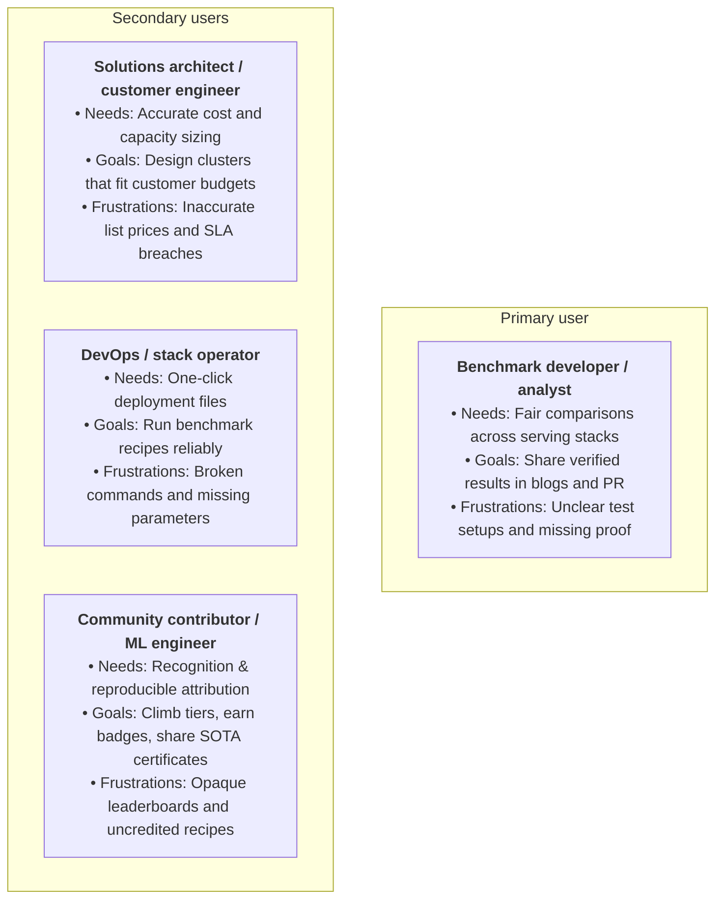
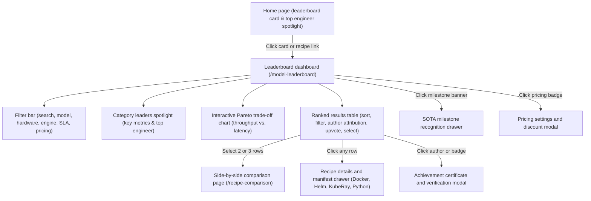
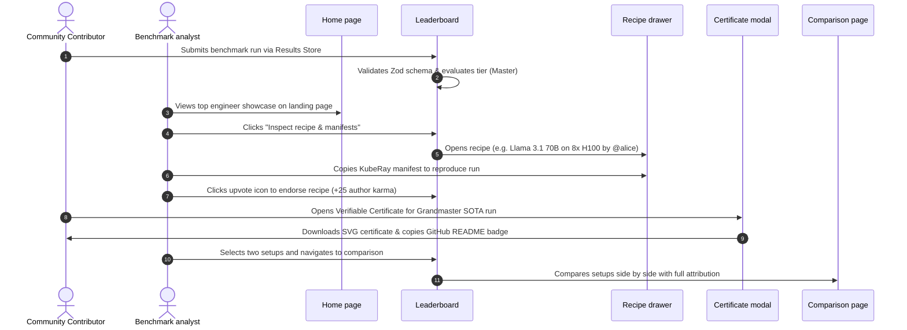
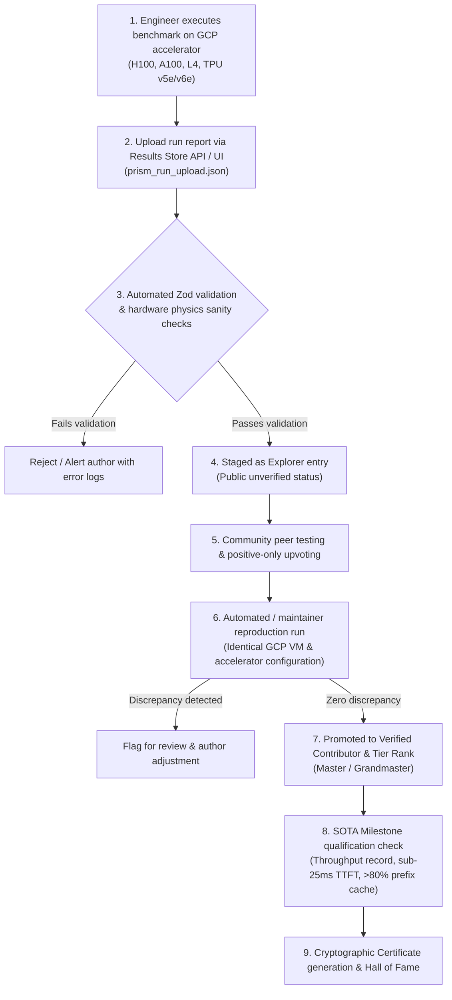

# UX brief: AI model and serving leaderboard experience
**Platform:** Prism (`llm-d-prism`) • Google Cloud distributed AI inference  
**Document version:** 1.2.0  
**Target audience:** Product, design, and engineering teams  

---

## 1. Executive summary and vision

The **Prism AI model and serving leaderboard** is a community-driven benchmarking tool. It helps engineers and teams find the fastest, most reliable, and most cost-effective ways to run large language models (LLMs) on Google Cloud hardware, including NVIDIA GPUs (H100, A100, L4) and Google TPUs (v6e Trillium, v5e).

### Why this matters
* **Clear, honest performance data**: Instead of relying on one-off benchmark claims, users can look at tested setups and trade-off curves that show both speed and latency together.
* **Ready to run in production**: Users can go from viewing a winning benchmark to copying ready-to-use Kubernetes and Docker configuration files in under a minute.
* **Realistic cloud pricing**: Users can plug in their own Google Cloud pricing discounts (such as committed use discounts and spot pricing) to see what a setup will actually cost.
* **Democratized community ecosystem**: Engineers across Google Cloud, open-source AI teams, and customer engineering can contribute recipes, earn peer recognition, and showcase verified SOTA milestones.

---

## 2. Target users and their goals



### User profiles
1. **Benchmark developer and analyst (primary)**:
   * *Focus*: Key performance indicators (throughput, first-token latency, cost per 1 million tokens), speedup gains, and Pareto curves.
   * *Tasks*: Export charts for presentations, share links to exact filter states, and check per-chip efficiency.
2. **Solutions architect and customer engineer (secondary)**:
   * *Focus*: Custom pricing discounts (1-year CUD at 37% off, 3-year CUD at 55% off, and spot rates) and strict response time limits (such as TTFT under 25 ms).
   * *Tasks*: Compare hardware choices and calculate tokens delivered per dollar.
3. **Stack operator and DevOps engineer (secondary)**:
   * *Focus*: Test validity details (warmup passes, memory usage, out-of-memory safety margin, and Git commit IDs).
   * *Tasks*: Copy Docker CLI commands, Helm `values.yaml` files, and KubeRay CRD manifests.
4. **Community contributor and ML engineer (secondary)**:
   * *Focus*: Profile attribution, achievement badges (`👑 SOTA Master`, `⚡ Speed Demon`, `🛡️ Verified Contributor`), and community karma points.
   * *Tasks*: Submit benchmark recipes via Results Store, submit verification logs, generate cryptographic achievement certificates, and share embeddable badges to GitHub profile READMEs.

---

## 3. Page layout and user flow



---

## 4. Key user interface components and design patterns

### A. Category leaders spotlight
* **File location**: [LeaderboardSummaryCards.jsx](file:///Users/rajithal/Documents/work/llm-d-prism/src/components/Leaderboard/LeaderboardSummaryCards.jsx)
* **What it does**: Highlights top-performing setups across four key categories so users can switch views with one click:
  1. `👑 #1 Ranked`: The top overall setup based on the current sort order.
  2. `⚡ Max Tput`: The setup with the highest total token throughput.
  3. `⏱️ Low Latency`: The setup with the fastest time to first token (TTFT).
  4. `💰 Best Value`: The setup that produces the most tokens per dollar.
* **Visual style**: Three prominent metric cards displaying total throughput (amber), first-token latency (cyan), and cost per 1 million tokens (emerald), accompanied by top contributor badges.

### B. Interactive Pareto trade-off chart
* **File location**: [ParetoCurveChart.jsx](file:///Users/rajithal/Documents/work/llm-d-prism/src/components/Leaderboard/ParetoCurveChart.jsx)
* **What it does**:
  * Displays an optimal boundary curve where higher throughput and lower latency meet.
  * Shows colored dots for each hardware type (NVIDIA H100 in gold, TPU v6e in green, NVIDIA A100 in purple, NVIDIA L4 in cyan).
  * Nodes feature rich interactive tooltips showing author GitHub attribution, engine configurations, and performance deltas.
  * Includes a header showing the active Google Cloud machine type, accelerator count, and model details.
  * Provides a collapsible filters tray to change chart axes and an export button to save vector SVG images.

### C. Side-by-side recipe comparison
* **File location**: [RecipeComparisonPage.jsx](file:///Users/rajithal/Documents/work/llm-d-prism/src/components/Leaderboard/RecipeComparisonPage.jsx)
* **What it does**:
  * Displays an apples-to-apples comparison of up to three selected setups.
  * Explains why one setup is faster than another (such as speculative decoding, prefix caching, or FP8 quantization).
  * Shows color-coded percentage differences against the chosen baseline.
  * Includes a normalized **per-chip throughput** metric (`tokens/s/chip`) so small and large clusters can be evaluated fairly.
  * Clearly attributes each recipe column to its submitting engineer with author badges and GitHub links.

### D. One-click deployment drawer
* **File location**: [RecipeDetailDrawer.jsx](file:///Users/rajithal/Documents/work/llm-d-prism/src/components/Leaderboard/RecipeDetailDrawer.jsx)
* **What it does**:
  * Slides out from the right side of the screen when a user clicks on any recipe row.
  * Prominently displays author identity, verification status (`🛡️ Verified Contributor`), and date of submission.
  * Provides ready-to-use tabs for Docker CLI, Helm `values.yaml`, KubeRay CRD manifests, and Python OpenAI SDK scripts.
  * Includes copy buttons with instant visual checkmark feedback.
  * Displays audit information, including warmup runs, token counts, and memory headroom.

### E. Ranked leaderboard table & community upvoting
* **File location**: [LeaderboardTable.jsx](file:///Users/rajithal/Documents/work/llm-d-prism/src/components/Leaderboard/LeaderboardTable.jsx)
* **What it does**:
  * Displays ranked recipes with sortable columns, tier indicators, and hardware badges.
  * Dedicated **Author** column with GitHub avatar, username link, and tier badge.
  * Positive-only **Upvote** button allowing community members to endorse recipes and boost author karma.
  * Direct action buttons to inspect manifests, add to side-by-side comparison, or view verifiable achievement certificates.

---

## 5. Critical user journeys



---

## 6. Strategy for community contribution and attribution

### 6.1 Strategic vision: Democratizing AI inference benchmarking
* **Open, peer-verified performance commons**: Traditional AI benchmarks often rely on closed vendor claims or opaque marketing numbers. Prism transforms benchmarking into an open, community-governed commons where every benchmark is submitted by field practitioners and validated through reproducible code.
* **Proof-of-Reproduction (PoR)**: A submission is not just a row of numbers—it is a complete, runnable recipe. Every accepted contribution must package full deployment manifests (Docker CLI flags, Helm `values.yaml`, KubeRay CRD specifications, Git commit SHAs, and memory headroom parameters) so that any engineer with matching Google Cloud hardware can replicate the run in under 15 minutes.
* **Frictionless contribution pipeline**: Contributors can upload raw benchmark runs using Prism's Results Store ingestion API (`prism_run_upload.json`), automated CLI tools, or web upload workflows. Ingested runs undergo real-time validation via TypeScript/Zod schemas to ensure structural and data integrity.

### 6.2 Contributor identity and attribution hierarchy
* **GitHub-linked author profiles**: Every recipe is permanently attributed to its author through their GitHub identity (`github_id`, display name, avatar, and optional company or team affiliation). Clicking an author handle links to their community profile and GitHub presence.
* **Top engineer hero showcase**: The lead engineer currently holding the #1 overall SOTA record or Pareto frontier breakthrough is prominently featured in the Prism Home Hero (`PrismHome.jsx`) and Leaderboard dashboard header, spotlighting their avatar, GitHub handle, Grandmaster badge, and number of verified recipes.
* **Consistent attribution across all views**:
  * **Leaderboard table**: Author column displays the contributor's avatar, clickable GitHub handle, tier badge, and current community upvote count.
  * **Pareto trade-off chart**: Node tooltips prominently feature the author handle alongside performance statistics.
  * **Side-by-side comparison**: Comparative table headers give full credit to the author of each configuration, documenting custom flags and architectural innovations.
  * **Recipe detail drawer**: Highlights contributor credentials, submission timestamp, and direct links to reproduction instructions.
* **Four-tier progression system**:
  1. `👑 Grandmaster (GM)`: Author of a #1 ranked model track recipe or verified Pareto-optimal frontier record. Includes holographic gold badge styling.
  2. `🥈 Master (M)`: Author of a top-3 ranking recipe in a track or achieving 90%+ Pareto curve efficiency. Includes purple/violet styling.
  3. `🥉 Contender (C)`: Author of a top-10 verified benchmark recipe submission. Includes cyan/blue styling.
  4. `✨ Explorer (E)`: Community contributor with an uploaded and staged benchmark recipe.

### 6.3 Community contribution & verification lifecycle



* **Stage 1: Staging & automated validation**:
  * Ingested benchmark data is validated against `LeaderboardEntrySchema` and `ServingStackConfigSchema`.
  * Physical boundary checks verify that reported token throughput and memory bandwidth do not exceed physical hardware limits (e.g. H100 SXM5 3.35 TB/s HBM3 bandwidth).
* **Stage 2: Community peer reproduction**:
  * Other engineers can launch the exact manifests on Google Cloud (e.g. GKE cluster or Vertex AI workbench) and verify output tokens per second, TTFT, and ITL metrics.
  * Community members endorse verified recipes using positive upvotes.
* **Stage 3: Official maintainer verification & promotion**:
  * Automated testing harnesses or maintainers run the configuration on a dedicated GCP verification pool.
  * Upon confirming numbers within a ±3% tolerance window, the recipe is marked `verification_status: "verified"` and granted the `🛡️ Verified Contributor` badge.
* **Stage 4: SOTA milestones & Hall of Fame induction**:
  * Qualifying runs that break established performance thresholds are highlighted on the SOTA Milestone tracks and permanently archived in the Hall of Fame.

### 6.4 Gamification, badges, and karma scoring
* **Merit-based community badges**:
  * `👑 SOTA Master`: Published a #1 ranked or Pareto-optimal frontier recipe.
  * `⚡ Speed Demon`: Engineered >4,000 tok/s total inference throughput on production hardware.
  * `⏱️ Low-Latency Ace`: Achieved sub-25ms TTFT prefill latency on flagship 70B+ models.
  * `🧩 Radix Pioneer`: Demonstrated >80% prefix caching hit rate in agentic multi-turn workloads.
  * `🌟 Community Favorite`: Received strong positive community upvotes (≥30 upvotes).
  * `🛡️ Verified Contributor`: Passed automated zero-discrepancy reproduction audit.
* **Positive-only engagement & anti-toxicity design**:
  * Only positive upvotes are supported (no downvote buttons), preventing toxic brigading or negative competitive manipulation.
  * Upvotes are authenticated through GitHub OAuth to eliminate sybil manipulation.
* **Transparent contributor karma formula**:
  $$\text{Contributor Karma} = (\text{Upvotes} \times 25) + (\text{Views} \times 2) + (\text{SOTA Records} \times 150) + (\text{Verified Recipes} \times 50)$$
  * Karma directly informs contributor standing, profile badges, and eligibility for community leadership spotlights.

### 6.5 Verifiable achievement certificates and viral sharing
* **Cryptographic achievement certificates ([CertificateModal.jsx](file:///Users/rajithal/Documents/work/llm-d-prism/src/components/Leaderboard/CertificateModal.jsx))**:
  * Grandmaster, Master, and SOTA record-holders can generate a cryptographically-formatted achievement certificate.
  * Certificates feature the author's name, GitHub handle, model, accelerator topology, verified performance metrics, and a tamper-evident verification hash (`PRISM-VERIFIED-[ID]-[HEX]`).
* **Viral developer distribution loops**:
  * **Vector SVG & High-Res PNG download**: Instant export for technical portfolios, blog posts, and slide decks.
  * **GitHub README badges**: Pre-rendered markdown snippet ready to copy-paste into personal GitHub profile READMEs:
    ```markdown
    [](https://prism.run/recipe/llama3-70b-h100)
    ```
  * **Social deep links**: One-click sharing to LinkedIn and X pre-populated with performance stats and deep links to the filtered Pareto chart view.

### 6.6 Integrity, anti-gaming guardrails, and auditability
* **Theoretical hardware limits**: Submissions with impossible token throughput or latency numbers that violate physical accelerator limits are flagged and rejected immediately.
* **Full environment telemetry**: All submissions must record and disclose exact hardware topology, host machine type, accelerator count, CUDA driver version, container image SHA, and warmup passes.
* **Dispute and re-verification workflow**: Any maintainer or community contributor can trigger an audit reproduction request from the Recipe Detail Drawer if a recipe cannot be replicated in a standard GCP environment.

---

## 7. Technical component mapping

| Component | Source file | Main responsibilities |
| :--- | :--- | :--- |
| **Main dashboard** | [LeaderboardDashboard.jsx](file:///Users/rajithal/Documents/work/llm-d-prism/src/components/Leaderboard/LeaderboardDashboard.jsx) | Manages filters, URL query state, active tab switching, and modal dialogs |
| **Spotlight cards** | [LeaderboardSummaryCards.jsx](file:///Users/rajithal/Documents/work/llm-d-prism/src/components/Leaderboard/LeaderboardSummaryCards.jsx) | Shows category leaders, key metric tiles, active pricing badges, and top contributor flair |
| **Pareto chart** | [ParetoCurveChart.jsx](file:///Users/rajithal/Documents/work/llm-d-prism/src/components/Leaderboard/ParetoCurveChart.jsx) | Draws the trade-off curve, exports SVG files, and displays hardware headers with author tooltips |
| **Ranked table** | [LeaderboardTable.jsx](file:///Users/rajithal/Documents/work/llm-d-prism/src/components/Leaderboard/LeaderboardTable.jsx) | Displays sortable columns, author attribution, positive upvote buttons, and row selection |
| **Comparison page** | [RecipeComparisonPage.jsx](file:///Users/rajithal/Documents/work/llm-d-prism/src/components/Leaderboard/RecipeComparisonPage.jsx) | Compares setups side by side with percentage deltas, per-chip metrics, and author badges |
| **Manifest drawer** | [RecipeDetailDrawer.jsx](file:///Users/rajithal/Documents/work/llm-d-prism/src/components/Leaderboard/RecipeDetailDrawer.jsx) | Generates Docker, Helm, KubeRay, and Python snippets with author credentials and audit details |
| **Certificate modal** | [CertificateModal.jsx](file:///Users/rajithal/Documents/work/llm-d-prism/src/components/Leaderboard/CertificateModal.jsx) | Renders cryptographic achievement certificates with SVG export, README badges, and social shares |
| **Milestone recognition drawer** | [PrizeClaimDrawer.jsx](file:///Users/rajithal/Documents/work/llm-d-prism/src/components/Leaderboard/PrizeClaimDrawer.jsx) | Displays SOTA milestone tracks, audit reproduction log submission, and Hall of Fame recognition |
| **Community rewards engine** | [communityRewards.js](file:///Users/rajithal/Documents/work/llm-d-prism/src/utils/communityRewards.js) | Manages badge registry, positive upvote toggle, view counts, and author karma score calculations |
| **Gamification engine** | [gamificationEngine.js](file:///Users/rajithal/Documents/work/llm-d-prism/src/utils/gamificationEngine.js) | Evaluates ranking tiers (Grandmaster to Explorer), SOTA milestone tracks, and certificate hashes |
| **Pricing engine** | [pricingEngine.js](file:///Users/rajithal/Documents/work/llm-d-prism/src/utils/pricingEngine.js) | Calculates hourly costs, discount presets (37% and 55% off), and spot rates |

---

## 8. Future recommendations

1. **Hardware topology diagram**: Add an interactive diagram showing NVLink and PCIe connections inside the recipe drawer.
2. **Direct Google Cloud Shell launch**: Add a button to open and deploy the KubeRay manifest directly in Google Cloud Shell.
3. **Live telemetry stream**: Connect real-time GPU memory, power usage, and temperature metrics from active test clusters.
4. **Automated reproduction bot**: Deploy a GitHub Actions bot that automatically provisions ephemeral GKE clusters to replicate submitted recipes on pull request.
