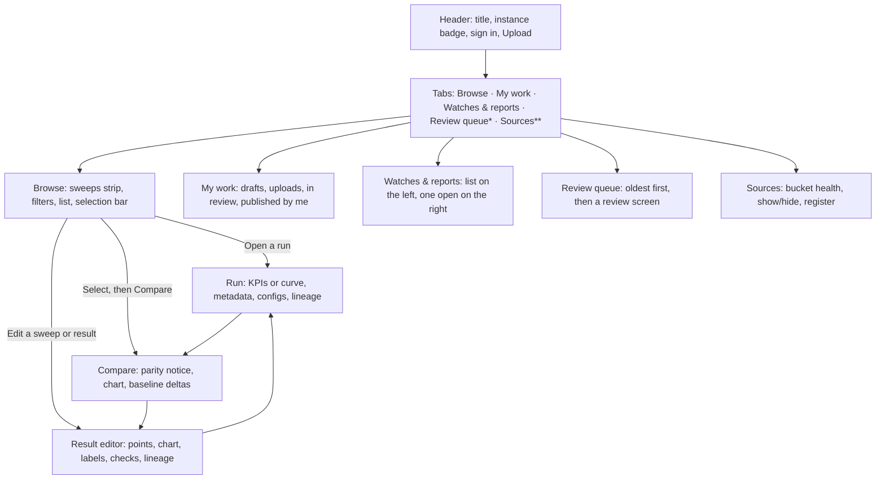

# UX brief: Results store
**Platform:** Prism (`llm-d-prism`) • llm-d benchmarking
**Document version:** 1.0.0
**Author:** Staff UX design
**Audience:** Product, design, engineering, and the llm-d community team
**Status:** Built on the `prism2.0` branch. Open items are in section 9.

---

## 1. In one paragraph

The Results store is where benchmark data turns into something you can act on. People bring raw benchmark runs in. They leave with one of four things: a curve they can publish, a comparison they can paste into a pull request, a cost table they can hand to a customer, or a watch that tells them when a nightly run gets slower. The design job is to make those four outcomes quick, fair and honest, for busy engineers who don't want to learn a new tool.

---

## 2. Who it's for

Four kinds of people, each with one question. They come from the persona files in [`users/`](../users/README.md).

| Person | Their question | What they bring | What they want to leave with |
| :--- | :--- | :--- | :--- |
| **Feature developer** | "Is my change faster than the baseline, and can I prove it?" | A handful of runs from a branch | A fair comparison with percentages, pasted into a PR |
| **Benchmark developer / analyst** | "Can I publish a fair, reproducible result?" | A sweep of runs at different load levels | A clean, named curve that passed its checks and is published |
| **Solutions architect / config tuner** | "Which setup meets the customer's latency target for the least money?" | A shortlist of candidate results | A cost table at a latency limit, as CSV or Markdown |
| **Stack operator** | "Did last night's run get worse?" | A setup that runs every night | A watch that flags drops, and a fast path to the bad run |

Two more roles keep the place running:

- **Reviewers** approve or send back community submissions on the public instance.
- **Admins** connect cloud buckets and check that data is still arriving.

What everyone has in common: they're technical, they're in a hurry, and they don't trust a number that doesn't say where it came from.

---

## 3. The words we use

We use the same short word for the same thing everywhere: in buttons, headings, notices and share links.

| Word | Meaning | Can it be edited? |
| :--- | :--- | :--- |
| **Run** | One benchmark that was measured. | No. Measured values are read-only. |
| **Sweep** | Several runs of one setup at different load levels. Prism finds these for you. | It becomes a Result when you save it. |
| **Result** | A curve someone curated from a sweep or a multi-point run. It has a name, labels and a version. | Yes. Editing a published Result makes a new version. |
| **Watch** | A rule that flags when a setup gets slower than a baseline. | Yes. |
| **Report** | A cost and throughput table for a few Results. | Yes. |
| **Source** | A cloud bucket we read runs from. | Admins only. |
| **Baseline** | The series everything else is measured against. | Pick any series. |

The metrics, in plain words. The UI uses the short form; this is what each one means.

- **Throughput (tok/s)**: how many tokens per second the system produced. **Per chip** divides that by the number of accelerators, so a 16-chip run and a 4-chip run can be compared.
- **TTFT**: how long until the first token appears.
- **TPOT**: the pause between tokens once the answer is streaming.
- **ITL**: the same idea as TPOT, measured per token gap.
- **E2E**: the time for the whole answer.
- **Mean**: the average. **p50**: the middle value; half of requests were faster. **p99**: slower than 99 out of 100 requests. It's the "bad day" number.
- **c=8**: eight requests in flight at once. We call this concurrency.

Two instance modes change a few words. On the **internal** instance, a published Result is **Official** and the button says **Mark official**. On the **public** instance it's **Published**, the button says **Submit for review**, and a **Review queue** tab appears for reviewers.

---

## 4. Design principles

These are the rules we use to settle arguments. Each one has a concrete example of what it changed.

1. **Say what the number is.**
   A chart never labels an average as a median. Every axis, KPI tile and point names its statistic: "TTFT mean (ms)", "TTFT p50 (ms)". If some series have a statistic and others don't, we say which ones are missing instead of drawing a mixed chart.

2. **Fair by default.**
   Compare checks that the model, accelerator, chip count, workload, harness and engine match. If they don't, a notice says exactly what differs and suggests **Per chip** when hardware differs. We warn; we don't block. Sometimes the difference *is* what you're testing.

3. **Measured data is read-only. Labels are editable.**
   You can fix a hardware label from `×1` to `×8`, and every per-chip number and cost updates. You can never change a measured latency. The editor makes that boundary visible: inputs for labels, plain text for measurements.

4. **Find the work for people.**
   Prism groups single runs of one setup into a sweep automatically and shows it at the top of Browse with a sparkline. Publishing a sweep is one click. Nobody should have to hunt for the eight runs that belong together.

5. **Checks explain themselves and offer the fix.**
   A failed check says what's wrong in a sentence ("c=64 had 7% failed requests") and offers the repair as a button ("Exclude point c=64"). No red icon without a next step.

6. **No dead ends.**
   Every screen has a Back button that goes to where you actually came from, a URL you can share, and at least one next action (Compare, Watch, Add to report, Publish).

7. **Works with a keyboard and a screen reader.**
   Tabs move with arrow keys. Every chart has a hidden data table with a caption. Every toggle group has a name. Status changes are announced. Deltas say "(better)" or "(worse)" out loud, not only in color.

8. **Tell the truth about where things are saved.**
   Right now, Results, Watches, Reports and Sources live in your browser only. We say so on every screen that creates one, in the publish dialog, and in the toast. We'd rather be plainly limited than quietly misleading.

---

## 5. The shape of it

One page, five tabs, three detail screens that open on top, and a few dialogs.

\* Reviewers on the public instance. \*\* Admins.

Three rules hold it together:

- **The tab you came from stays highlighted** while a detail screen is open, so you always know where Back will land.
- **Detail screens stack.** Browse → Compare → Result editor → Back → Back returns you to Browse with your filters intact.
- **Every screen has a URL.** `?run=`, `?compare=`, `?curve=` and `?tab=` all open the right thing directly. Compare links also carry the metric, statistic and throughput axis, so a shared chart looks the same for the person who opens it.

---

## 6. The screens, in plain language

### Browse
*What you see:* A strip of suggested sweeps at the top, three at a time. Below it, a search box, a sort menu, filter pills (source, harness, category, model, hardware, workload, date), a **Mine** toggle, and a list of runs, sweeps and results, forty at a time.
*What you can do:* Open anything. Check a few rows and a bar appears at the bottom with **Compare**, **Make result**, **Share view** and **Clear**. When your filters narrow to one setup, a **Watch for regressions** button appears.
*Design note:* The list mixes three kinds of things on purpose. A kind badge (`Run`, `Sweep · 6 pts`, `Result`) and a kind filter keep them apart without splitting the page in three.

### My work
*What you see:* Up to five short sections: Needs changes, Drafts, In review, Uploaded runs, and Official (or Published) by me. Empty sections don't appear.
*What you can do:* Edit, publish, fix, or view the run behind each item. Items in review show a four-step timeline.
*Design note:* It's a to-do list, not an archive. The first section is always the one that needs you most.

### Watches & reports
*What you see:* A list on the left, the open item on the right.
A **Watch** shows a line of percentage change per nightly batch, a dashed threshold line, and a table of batches with a status badge (`OK`, `Regression`, `Baseline batch`).
A **Report** shows the overlaid curves, a **Price at** choice (TTFT ≤ 1 s, 2 s, 5 s, or peak), one price box per accelerator type, and the cost table: output, $/chip-hour, $ per million output tokens, tokens per dollar.
*What you can do:* Click a flagged batch to open the run. Override a price. **Download CSV** or **Copy as Markdown**.
*Design note:* Price boxes start filled in with the GCP list price (and say so), or with your own Leaderboard rate if you set one. An empty price box used to mean an empty cost table. Now the table is useful on first open.

### Review queue (public instance, reviewers)
*What you see:* Submissions, oldest first, with who sent them and whether checks passed. Open one and you get the submitted curve drawn over the published results for the same setup, plus metadata, check results and lineage.
*What you can do:* **Approve**, **Request changes** or **Decline**. The last two open a short panel with reason chips and a note box.
*Design note:* Oldest first so nobody's submission starves. Reason chips so feedback is consistent and fast to write.

### Sources (admins)
*What you see:* A table of buckets with run counts, newest run, and a health chip (Healthy, Stale, Empty, Offline). A form to register another bucket.
*What you can do:* Hide a noisy bucket from Browse with a switch, without deleting anything.

### Run
*What you see:* The run's title, badges for harness, source, category, date and ID. A single-point run shows five KPI tiles with the statistic in the label ("TTFT mean"). A multi-point run shows a curve with metric, statistic and per-chip controls. Below: Metadata, Configs & logs, and Lineage tabs.
*What you can do:* **Compare with…**, **Watch this setup**, **Share**, **Make result** or **Edit sweep**, **Publish**.

### Compare
*What you see:* A parity notice first ("Like-for-like" or "Not like-for-like: chip count (16 vs 4), workload"). Then the chart with TTFT/TPOT/ITL/E2E, Mean/P50/P99, Output/Total and **Per chip** controls. Then **Against the baseline**: one row per series with peak throughput, latency at peak, and best latency, each with a signed percentage against the baseline row. Green is better, red is worse, and screen readers hear which.
*What you can do:* **Use as baseline** on any row. **Add baseline** overlays a published Result, dashed, and makes it the baseline. **Download CSV**, **Copy as Markdown**, **Share this view**, **Add to report**, **Save as result**.
*Design note:* The deltas live in a table, not on the chart. Curves show shape; the table gives the sentence you'll type in the PR.

### Result editor
*What you see:* A banner if the Result is in review, needs changes, or has been replaced by a newer version. Then the name, status, version. Left: the points, each with its throughput, its latency with the statistic named ("759 ms TTFT p50"), an error-rate badge if any, a link to the run, and an include/exclude toggle. Right: the live curve. Below: labels you can edit (model, hardware, workload, category, notes) and measurements you can't. Then Checks and Lineage side by side. An action bar along the bottom.
*What you can do:* Exclude a point and watch the curve redraw. Fix a label. Publish, watch, add to a report, share, discard, or edit as a new version.
*Design note:* Editing hardware from `×1` to `×8` recomputes per-chip numbers immediately. The feedback is the point: you can see what the label change does before you publish it.

---

## 7. The four journeys

Each journey is written as what the person does, then what "done" looks like.

### 7.1 Feature developer: prove the change is faster
1. Browse. Filter to the model and hardware, or tap **Mine**.
2. Check the candidate and the baseline. Tap **Compare**.
3. Read the parity notice. If chip counts differ, turn on **Per chip**.
4. If the baseline isn't the row you meant, tap **Use as baseline** on the right one. Read the percentages.
5. **Copy as Markdown**. Paste into the PR.

*Done:* a table in a PR that says "+18% peak tok/s per chip, −3% TTFT p50 at peak, like-for-like," with a link that opens the same view.

### 7.2 Benchmark developer: publish a clean curve
1. Browse. A suggested sweep is already at the top. Tap **Edit**.
2. Read the checks. If one point had too many failed requests, tap **Exclude point**.
3. Tidy the labels. **Add baseline** to overlay a published Result and sanity-check the shape.
4. Tap **Mark official** (internal) or **Submit for review** (public, with the DCO sign-off).

*Done:* a named, versioned Result that passed its checks, visible in Browse with an Official or In review badge.

### 7.3 Solutions architect: size a deployment for a latency target
1. From Compare or a Result, tap **Add to report**. Or make a new Report and pick Results.
2. Set **Price at** to the customer's limit, say TTFT ≤ 2 s.
3. Check the pre-filled prices. Override one if the customer has a discount.
4. **Download CSV** or **Copy as Markdown**.

*Done:* a table of $ per million tokens and tokens per dollar for each candidate, at the customer's latency limit, with the prices and their sources stated.

### 7.4 Stack operator: catch a nightly regression
1. Filter Browse to the setup. Tap **Watch for regressions**. Or tap **Watch this setup** on a run.
2. Pick the baseline (an Official Result, or a batch), the metric (peak, or at c=N), and the threshold (−3% to −15%).
3. Come back to Watches & reports. A batch below the line is badged **Regression**.
4. Tap the batch to open its run and look.

*Done:* a watch that shows the trend and names the bad night, two taps from the run that caused it.

---

## 8. Decisions we made, and why

| Decision | Why | What we gave up |
| :--- | :--- | :--- |
| Charts open on **Mean** unless every series has a real p50 | Most archive data only has means. Labelling a mean "p50" was the biggest trust problem in the old UI. | Some people expected p50 by default and now have to tap it. |
| **Per chip** is a toggle, not the default | Cluster totals are what most people measured and expect to see first. Per chip is the fair view, so we suggest it loudly when hardware differs. | A 1-chip vs 16-chip chart can still be drawn unfairly if someone ignores the notice. |
| Deltas in a **table**, not on the chart | A chart with percentage callouts gets unreadable at three series. The table is also what people paste. | One more scroll to the number. |
| Sweeps are **suggested**, not auto-published | Auto-grouping is right most of the time, not all of it. A human should name and check the curve. | One click more than fully automatic. |
| Compare **warns**, never blocks | Sometimes the mismatch is the experiment (same model, two accelerators). | People can ignore the warning. |
| Prices **pre-filled** from GCP list, always overridable | An empty price box meant an empty cost table. List prices are a defensible default and we say where they came from. | List prices aren't anyone's real price. Hence the override and the source note. |
| A p99 **smaller than its p50 is dropped**, not shown | It's a seconds-vs-milliseconds mix-up in the source data. Showing it would be wrong, hiding it silently would be worse, so the chart says the series lacks p99. | Some real p99s might be lost if a source has odd data. |
| Reviewers see the **chart against published results first** | The fastest way to spot a bad submission is its shape next to known-good curves. | Metadata is below the fold. |
| Single-point runs show **tiles**, not a one-dot chart | A chart with one point tells you nothing. Tiles with the statistic named tell you four things. | Visual inconsistency between single- and multi-point runs. |
| The **classic view** stays behind `?classic=1` | Some server-side flows (status of uploaded items) still live there. | Two UIs for a while. |

---

## 9. What's not finished

We'd rather list these than let people find them.

1. **Everything you make stays in this browser.** Results, Watches, Reports and registered Sources are saved locally. A teammate can't open your report, a reviewer can't see your curated Result, and a watch only helps the person looking at it.
   *Why:* the backend Results API stores **runs** only (`/api/results`). There is no server record yet for a curated curve, a watch, a report, or a registered source. These four are the layer people build *on top of* runs, and they're what the store is for. The UI was built ahead of that backend so the workflows could be designed and tested against real run data; local storage is the stand-in. The runs themselves are never browser-only, and share links for runs and comparisons work for everyone.
   *Fix:* a server-side record for each. Drafted in the [engineering design](../specs/changes/results-store-ui/design.md); this is the top item.
2. ~~**Two words for one idea.**~~ Done: the picker, the editor, the checks and Watches now all say **baseline**. *Reference* is gone from the UI.
3. **Watches only watch throughput.** A TTFT regression or a jump in failed requests is invisible. Nothing notifies anyone; you have to come and look.
4. **Jargon without a glossary.** `c=`, ISL/OSL, TPOT, harness and sweep are explained nowhere in the UI. A benchmark developer from outside the project will stall. Add short inline definitions and a link to *How we measure*.
5. **No "reproduce this" block.** Runs show a raw report and a bucket link, not the command, image and version someone needs to rerun it.
6. **Two regression tools.** Watches here and the nightly regressions dashboard elsewhere don't link to each other.
7. **Older saved Results have no p99 or per-chip values** until they're re-created from their runs. They chart as "TTFT (ms)" with a note.
8. **The run page shows less than the data has.** p99, TP, stack components and observability fields exist in the reports and aren't shown or filterable yet.

---

## 10. How we'll know it works

**Behavioural signals** (instrumented once storage is server-side):

| Signal | Why it matters | Target |
| :--- | :--- | :--- |
| Time from opening Browse to first Compare | Journey 7.1 should be fast | Under 60 seconds for a returning user |
| Share of Compares that are like-for-like, or per-chip when not | Principle 2 is working | Rising week over week |
| Sweeps published per week, and clicks from suggestion to publish | Principle 4 is working | Median ≤ 4 clicks |
| Reports exported (CSV + Markdown) | The deliverable is leaving the tool | Any growth from zero |
| Watches with at least one flagged batch that was opened | Watches lead to action, not noise | > 50% of flags opened |
| Review turnaround on the public instance | Queue design is working | Median under 3 days |

**Usability test** (five people, one per persona plus a reviewer, think-aloud, 30 minutes):

1. Compare your run with the baseline and tell me how much faster it is.
2. Publish this sweep as a Result.
3. Build a cost table at TTFT ≤ 2 s and export it.
4. Set a watch that flags a 5% drop, then find the bad night.
5. Explain what "TTFT p50" means on this chart. *(Checks the labelling, not the person.)*

Pass: four of five complete each task unaided, and nobody misreads a statistic.

---

## 11. Accessibility commitments

- One `<main>` per page. Headings go `h1` → `h2` → `h3` with no skips on every screen.
- Tabs are real tabs: arrow keys, `aria-selected`, and a named panel for each.
- Every toggle group has a name ("Latency statistic", "Throughput metric", "Price at latency target").
- Every chart has a hidden data table with a caption that names the axes and units.
- Deltas are never color-only: "(better)" and "(worse)" are in the accessible text.
- Errors, successes and clipboard actions are announced through live regions.
- Chart series use the 7-color palette validated for protan, deutan and tritan vision at ≥ 3:1 contrast (see `skills/style.md`).

---

## 12. Component map

| Screen or part | Source file |
| :--- | :--- |
| Page shell, tabs, URL state, dialogs | [ResultsStore.jsx](../src/components/ResultsStore.jsx) |
| Saved Results, Watches, Reports, Sources | [WorkspaceProvider.jsx](../src/components/ResultsStore/WorkspaceProvider.jsx) |
| Runs, sweeps, statistics, checks | [catalog.js](../src/components/ResultsStore/catalog.js) |
| Browse | [BrowseTab.jsx](../src/components/ResultsStore/BrowseTab.jsx) |
| My work | [MyWorkTab.jsx](../src/components/ResultsStore/MyWorkTab.jsx) |
| Watches & reports | [DashboardsTab.jsx](../src/components/ResultsStore/DashboardsTab.jsx) |
| Review queue | [ReviewQueueTab.jsx](../src/components/ResultsStore/ReviewQueueTab.jsx) |
| Sources | [SourcesTab.jsx](../src/components/ResultsStore/SourcesTab.jsx), [sourceHealth.js](../src/components/ResultsStore/sourceHealth.js) |
| Run | [RunDetail.jsx](../src/components/ResultsStore/RunDetail.jsx) |
| Compare | [CompareView.jsx](../src/components/ResultsStore/CompareView.jsx) |
| Result editor | [CurveEditor.jsx](../src/components/ResultsStore/CurveEditor.jsx) |
| Chart and its controls | [CurveChart.jsx](../src/components/ResultsStore/CurveChart.jsx), [useChartView.js](../src/components/ResultsStore/useChartView.js) |
| CSV and Markdown export | [exporters.js](../src/components/ResultsStore/exporters.js) |
| Publish dialog | [PublishDialog.jsx](../src/components/ResultsStore/PublishDialog.jsx) |
| Instance wording and the browser-only notice | [instance.js](../src/components/ResultsStore/instance.js) |
| Prices | [pricingEngine.js](../src/utils/pricingEngine.js) |
| Related specs | [UI spec](../specs/changes/results-store-ui/ui_spec.md), [Engineering design](../specs/changes/results-store-ui/design.md), [Leaderboard UX brief](leaderboard_ux_brief.md) |
