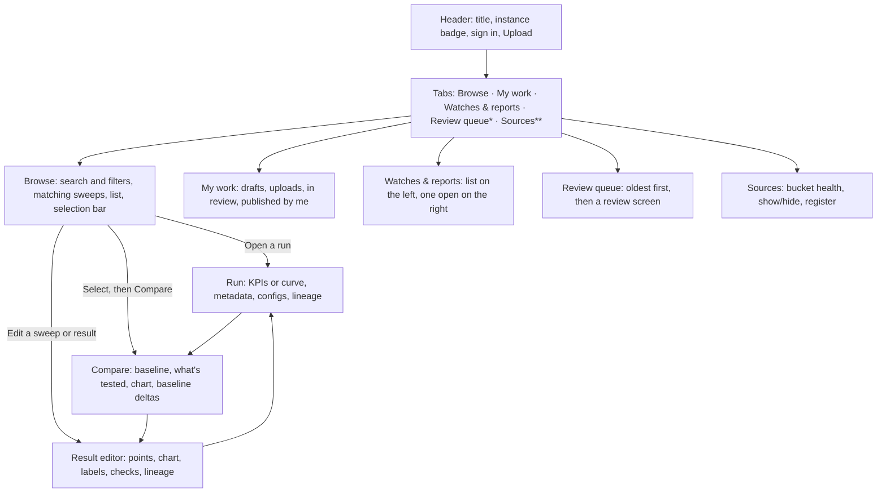

# UX brief: Results store
**Platform:** Prism (`llm-d-prism`) • llm-d benchmarking
**Document version:** 1.0.0
**Author:** Staff UX design
**Audience:** Product, design, engineering, and the llm-d community team
**Status:** Built on the `prism2.0` branch. Recommendations from the 2026-10-20 review, with what and why, are in section 9. Open items are in section 10.

---

## 1. In one paragraph

The Results store is where benchmark data turns into something you can act on. People bring raw benchmark runs in. They leave with one of four things: a curve they can publish, a comparison they can paste into a pull request, a cost table they can hand to a customer, or a watch that tells them when a nightly run gets slower. The design job is to make those four outcomes quick, fair and honest, for busy engineers who don't want to learn a new tool.

---

## 2. Who it's for

Four kinds of people, each with one question. They come from the persona files in [`users/`](../users/README.md).

| Person | Their question | What they bring | What they want to leave with |
| :--- | :--- | :--- | :--- |
| **Feature developer** | "Is my change faster than the baseline, and can I prove it?" | A handful of runs from a branch | A fair comparison with percentages, pasted into a PR |
| **Benchmark developer / analyst** | "Can I publish a fair, reproducible result?" | A sweep of runs at different load levels | A clean, named curve that passed its checks and is published |
| **Solutions architect / config tuner** | "Which setup meets the customer's latency target for the least money?" | A shortlist of candidate results | A cost table at a latency limit, as CSV or Markdown |
| **Stack operator** | "Did last night's run get worse?" | A setup that runs every night | A watch that flags drops, and a fast path to the bad run |

Two more roles keep the place running:

- **Reviewers** approve or send back community submissions on the public instance.
- **Admins** connect cloud buckets and check that data is still arriving.

What everyone has in common: they're technical, they're in a hurry, and they don't trust a number that doesn't say where it came from.

---

## 3. The words we use

We use the same short word for the same thing everywhere: in buttons, headings, notices and share links.

| Word | Meaning | Can it be edited? |
| :--- | :--- | :--- |
| **Run** | One benchmark that was measured. | No. Measured values are read-only. |
| **Sweep** | Several runs of one setup at different load levels. Prism finds these for you. | It becomes a Result when you save it. |
| **Result** | A curve someone curated from a sweep or a multi-point run. It has a name, labels and a version. | Yes. Editing a published Result makes a new version. |
| **Setup** | What was measured: model, hardware and chip count, workload, harness and deployment. Runs of one setup are repeats. Titles name all of it: `qwen3-32b · H100 ×8 · 7200/1000 · standard-k8s`. | No. It comes from the runs. |
| **Watch** | A rule that flags when a setup gets slower than a baseline. | Yes. |
| **Report** | A cost and throughput table for a few Results. | Yes. |
| **Source** | A cloud bucket we read runs from. | Admins only. |
| **Baseline** | The series everything else is measured against. | Pick any series. |

The metrics, in plain words. The UI uses the short form; this is what each one means. A **Glossary** button in the header says the same thing in the product.

- **Throughput (tok/s)**: how many tokens per second the system produced. **Per chip** divides that by the number of accelerators, so a 16-chip run and a 4-chip run can be compared.
- **At TTFT ≤ 2 s**: the most throughput while the first token still arrives within 2 seconds. It's what users actually get, so Browse, Compare and Watches lead with it. Peak throughput is often an overloaded point.
- **TTFT**: how long until the first token appears.
- **TPOT**: the pause between tokens once the answer is streaming.
- **ITL**: the same idea as TPOT, measured per token gap.
- **E2E**: the time for the whole answer.
- **Mean**: the average. **p50**: the middle value; half of requests were faster. **p99**: slower than 99 out of 100 requests. It's the "bad day" number.
- **c=8**: eight requests in flight at once. We call this concurrency.
- **Workload (ISL/OSL)**: input and output tokens per request, as configured where the source says. Otherwise the measured average, rounded so repeats share one label.

Two instance modes change a few words. On the **internal** instance, a published Result is **Official**, and only approvers (signed-in admins) see **Mark official**. On the **public** instance it's **Published**, the button says **Submit for review**, and a **Review queue** tab appears for reviewers. In a report, a Result that isn't Official or Published yet is marked **Unofficial** (internal) or **Unpublished** (public).

---

## 4. Design principles

These are the rules we use to settle arguments. Each one has a concrete example of what it changed.

1. **Say what the number is.**
   A chart never labels an average as a median. Every axis, KPI tile and point names its statistic: "TTFT mean (ms)", "TTFT p50 (ms)". If some series have a statistic and others don't, we say which ones are missing instead of drawing a mixed chart.

2. **Fair by default.**
   Compare checks whether the model, accelerator, chip count, deployment, engine, workload and harness match, and says in one line what the comparison tests. When one thing differs, that's the test: "Testing deployment (standard-k8s → precise-prefix-cache-routing)". When several differ, it warns and lists them. When chip counts differ, it suggests **Per chip**. We warn; we don't block. Sometimes the difference *is* what you're testing.

3. **Measured data is read-only. Labels are editable.**
   You can fix a hardware label from `×1` to `×8`, and every per-chip number and cost updates. You can never change a measured latency. The editor makes that boundary visible: inputs for labels, plain text for measurements.

4. **Find the work for people.**
   Prism groups single runs of one setup into a sweep automatically and shows it at the top of Browse with a sparkline. Publishing a sweep is one click. Nobody should have to hunt for the eight runs that belong together.

5. **Checks explain themselves and offer the fix.**
   A failed check says what's wrong in a sentence ("c=64 had 7% failed requests") and offers the repair as a button ("Exclude point c=64"). No red icon without a next step.

6. **No dead ends.**
   Every screen has a Back button that goes to where you actually came from, a URL you can share, and at least one next action (Compare, Watch, Add to report, Publish).

7. **Works with a keyboard and a screen reader.**
   Tabs move with arrow keys. Every chart has a hidden data table with a caption. Every toggle group has a name. Status changes are announced. Deltas say "(better)" or "(worse)" out loud, not only in color.

8. **Tell the truth about where things are saved.**
   Right now, Results, Watches, Reports and Sources live in your browser only. We say so on every screen that creates one, in the publish dialog, and in the toast. We'd rather be plainly limited than quietly misleading.

---

## 5. The shape of it

One page, five tabs, three detail screens that open on top, and a few dialogs.

\* Reviewers on the public instance. \*\* Admins.

Three rules hold it together:

- **The tab you came from stays highlighted** while a detail screen is open, so you always know where Back will land.
- **Detail screens stack.** Browse → Compare → Result editor → Back → Back returns you to Browse with your filters intact.
- **Every screen has a URL.** `?run=`, `?compare=`, `?curve=` and `?tab=` all open the right thing directly. Compare links also carry the metric, statistic and throughput axis, so a shared chart looks the same for the person who opens it.

---

## 6. The screens, in plain language

### Browse
*What you see:* A search box, a sort menu, filter pills (source, harness, category, model, hardware, workload, date) and a **Mine** toggle at the top. They narrow everything under them: first up to three unpublished sweeps that match (with **See all N sweeps ↓** jumping to the **Sweeps** filter in the list), then a list of runs, sweeps and results, forty at a time. Under **All**, a single-batch sweep that has already been published as a Result folds into that Result row so it isn't listed twice. Every title names the setup, and every row leads with its throughput at TTFT ≤ 2 s, or its peak when TTFT wasn't recorded.
*What you can do:* Open anything by clicking its title. Check a few rows and a bar appears at the bottom with **Compare**, **Make result** and **Clear**; it also says how many of your picks the filters hide. When your filters leave one setup, **Watch this setup** starts a watch on it; with several, **Watch a setup…** asks which.
*Design note:* The list mixes three kinds of things on purpose. A kind badge (`Run`, `Sweep · 6 runs`, `Result`) and a kind filter keep them apart without splitting the page in three.

### My work
*What you see:* Up to five short sections: Needs changes, Drafts, Uploaded runs, In review, and Official (or Published) by me. Empty sections don't appear.
*What you can do:* Edit, publish, fix, or view the run behind each item. Items in review show a four-step timeline.
*Design note:* It's a to-do list, not an archive. The first section is always the one that needs you most.

### Watches & reports
*What you see:* A list on the left, the open item on the right.
A **Watch** shows a line of percentage change per batch, a dashed threshold line, and a table of batches with a status badge (`OK`, `Flagged`, `Baseline batch`). By default it tracks output at TTFT ≤ 2 s (and optionally flags TTFT +20% spikes or request failure rates ≥ 5%); peak and output at one concurrency are options. It checks again each time you open it.
A **Report** shows the overlaid curves, a **Price at** choice (TTFT ≤ 1 s, 2 s, 3 s, 5 s, or peak), a **Per chip** switch on the cost table, one price box per accelerator type, and the cost table: output (or output per chip), $/chip-hour, $ per million output tokens, tokens per dollar.
*What you can do:* **Edit** a Watch in place (name, baseline, metric, threshold, and TTFT/error-rate guard) or **Edit** a Report's title and description in place. **Compare with baseline** on any batch (it's highlighted on a flagged one) to see the batch next to its baseline. Override a price or toggle **Per chip** on the cost table. **Download CSV** or **Copy as Markdown**. Once reports live on the server: **Share** makes the report openable by anyone with the link and copies it, in one click; until then only you can open it.
*Design note:* Price boxes start filled in with the GCP list price (and say so), or with your own Leaderboard rate if you set one. An empty price box used to mean an empty cost table. Now the table is useful on first open.

### Review queue (public instance, reviewers)
*What you see:* Submissions, oldest first, with who sent them and whether checks passed. Open one and you get the submitted curve drawn over the published results for the same setup, plus metadata, check results and lineage.
*What you can do:* **Approve**, **Request changes** or **Decline**. The last two open a short panel with reason chips and a note box.
*Design note:* Oldest first so nobody's submission starves. Reason chips so feedback is consistent and fast to write.

### Sources (admins)
*What you see:* A table of buckets with run counts, newest run, and a health chip (Healthy, Stale, No runs, Sync failed, Not synced). A form to register another bucket.
*What you can do:* Hide a noisy bucket from Browse with a switch, without deleting anything.

### Run
*What you see:* The run's title, badges for harness, source, category, date and ID. A single-point run shows five KPI tiles with the statistic in the label ("TTFT mean"); if it isn't part of a sweep, that's all, with no one-dot chart. A multi-point run shows a curve with metric, statistic and per-chip controls, drawn in load order (concurrency, or request rate), with its throughput at TTFT ≤ 2 s next to the peak. When the tail of the sweep is overloaded, a warning says which points and why. Below: Metadata (including the stack's own name and the workload as configured and as measured), Configs & logs (leading with a copyable **Reproduce this run** CLI command synthesized from the run's harness, model, workload and stages), and Lineage tabs.
*What you can do:* **Compare with…**, **Watch this setup**, **Share**, **Make result** or **Edit sweep**, **Publish**, or **Copy command** under Configs & logs.

### Compare
*What you see:* A **Baseline** menu first, already set: the baseline you added, else an Official result, else the series whose name says baseline, standard, none or default. Then one line that says what the comparison tests: "Testing deployment (standard-k8s → precise-prefix-cache-routing). Same model, accelerator, chip count, workload and harness." If nothing differs, it says the gaps are run-to-run variation; if several things differ, it warns and lists them. Then the chart with TTFT/TPOT/ITL/E2E, Mean/P50/P99, Output/Total and **Per chip** controls. Then **Against the baseline**: one row per series with output at TTFT ≤ 2 s, peak throughput, latency at peak, and best latency, each with a signed percentage against the baseline. Green is better, red is worse, and screen readers hear which.
*What you can do:* Change the baseline in the **Baseline** menu. **Add baseline** lists every run, sweep and result, closest to what you're comparing first, with a filter box; the one you pick is drawn dashed and becomes the baseline. **Download CSV**, **Copy as Markdown** (it carries the "Testing…" line), **Share this view**, **Add to report**, **Make result**.
*Design note:* The deltas live in a table, not on the chart. Curves show shape; the table gives the sentence you'll type in the PR.

### Result editor
*What you see:* A banner if the Result is in review, needs changes, or has been replaced by a newer version. Then the name, status, version. Left: the points, each with its load (`c=64` or `7 req/s`), its throughput, its latency with the statistic named ("759 ms TTFT p50"), an error-rate badge if any, a link to the run, and an include/exclude toggle. Right: the live curve. Below: labels you can edit (model, hardware, workload, category, notes) and measurements you can't. Then Checks and Lineage side by side. An action bar that stays at the bottom of the screen while you scroll.
*What you can do:* Exclude a point and watch the curve redraw; the checks offer it for points with too many failures, overloaded points and out-of-line points. Fix a label. Publish, watch, add to a report, share, discard, or edit as a new version. On the public store, anyone can open a catalog sweep as a local sandbox draft to prune points or add to a report; **Submit for review** is gated on owning the uploaded runs.
*Design note:* Editing hardware from `×1` to `×8` recomputes per-chip numbers immediately. The feedback is the point: you can see what the label change does before you publish it.

---

## 7. The four journeys

Each journey is written as what the person does, then what "done" looks like.

### 7.1 Feature developer: prove the change is faster
1. Browse. Filter to the model and hardware, or tap **Mine**. Each title names its setup, so the candidate and the baseline are easy to tell apart.
2. Check the candidate and the baseline. Tap **Compare**.
3. Read the line under the Baseline menu. It says what you're testing ("Testing deployment (standard-k8s → precise-prefix-cache-routing)"), or warns when more than one thing differs. If chip counts differ, it suggests **Per chip**.
4. The baseline is already picked. If it isn't the one you meant, change it in the **Baseline** menu. Read the percentages, starting with output at TTFT ≤ 2 s.
5. **Copy as Markdown**. Paste into the PR.

*Done:* a table in a PR that says "+22% output at TTFT ≤ 2 s, −99% TTFT p50 at peak; testing deployment, everything else the same," with a link that opens the same view.

### 7.2 Benchmark developer: publish a clean curve
1. Browse. A suggested sweep is already at the top. Tap **Edit**.
2. Read the checks. If a point had too many failed requests, looks overloaded, or is out of line with its neighbours, tap **Exclude point**.
3. Tidy the labels. **Add baseline** to overlay a published Result and sanity-check the shape.
4. Tap **Mark official** (internal, approvers only) or **Submit for review** (public, with the DCO sign-off).

*Done:* a named, versioned Result that passed its checks, visible in Browse with an Official or In review badge.

### 7.3 Solutions architect: size a deployment for a latency target
1. From Compare or a Result, tap **Add to report**. Nothing needs publishing first; anything that isn't Official is marked **Unofficial**.
2. Set **Price at** to the customer's limit, say TTFT ≤ 2 s.
3. Check the pre-filled prices. Override one if the customer has a discount.
4. **Download CSV** or **Copy as Markdown**.

*Done:* a table of $ per million tokens and tokens per dollar for each candidate, at the customer's latency limit, with the prices and their sources stated.

### 7.4 Stack operator: catch a nightly regression
1. Filter Browse to the setup and tap **Watch this setup**, or tap it on a run.
2. Pick the baseline (an Official Result, or a batch), the metric (output at TTFT ≤ 2 s by default; peak, or at c=N), and the threshold (−3% to −15%).
3. Come back to Watches & reports. A batch below the line is badged **Flagged**.
4. Tap **Compare with baseline** on that batch to see it next to the baseline, with what differs spelled out.

*Done:* a watch that shows the trend and names the bad night, one tap from a comparison that shows what changed.

---

## 8. Decisions we made, and why

| Decision | Why | What we gave up |
| :--- | :--- | :--- |
| Charts open on **Mean** unless every series has a real p50 | Most archive data only has means. Labelling a mean "p50" was the biggest trust problem in the old UI. | Some people expected p50 by default and now have to tap it. |
| **Per chip** is a toggle, not the default | Cluster totals are what most people measured and expect to see first. Per chip is the fair view, so we suggest it loudly when hardware differs. | A 1-chip vs 16-chip chart can still be drawn unfairly if someone ignores the notice. |
| Deltas in a **table**, not on the chart | A chart with percentage callouts gets unreadable at three series. The table is also what people paste. | One more scroll to the number. |
| Sweeps are **suggested**, not auto-published | Auto-grouping is right most of the time, not all of it. A human should name and check the curve. | One click more than fully automatic. |
| Compare **warns**, never blocks | Sometimes the mismatch is the experiment (same model, two accelerators). | People can ignore the warning. |
| Prices **pre-filled** from GCP list, always overridable | An empty price box meant an empty cost table. List prices are a defensible default and we say where they came from. | List prices aren't anyone's real price. Hence the override and the source note. |
| A p99 **smaller than its p50 is dropped**, not shown | It's a seconds-vs-milliseconds mix-up in the source data. Showing it would be wrong, hiding it silently would be worse, so the chart says the series lacks p99. | Some real p99s might be lost if a source has odd data. |
| Reviewers see the **chart against published results first** | The fastest way to spot a bad submission is its shape next to known-good curves. | Metadata is below the fold. |
| Single-point runs show **tiles**, not a one-dot chart | A chart with one point tells you nothing. Tiles with the statistic named tell you four things. | Visual inconsistency between single- and multi-point runs. |
| The **classic view** stays behind `?classic=1` | Some server-side flows (status of uploaded items) still live there. | Two UIs for a while. |
| A new report is **private until you share it**; Share makes it link-openable and copies the link in one click | The only thing a report can leak is a price you typed in, which may be a customer's negotiated rate. Sharing still costs one click. | A URL copied from the address bar won't open for others; the page says why. |
| Only **approvers mark a Result Official** on the internal instance, and they must be signed in | Official is a claim other people rely on; anonymous Official results undermine it. Matches the roadmap's allowlist of approvers. | Non-approvers can't publish on their own. They keep drafts and ask an approver. |
| Reports take Results **of any status**, marked Unofficial | Tuners price candidate configs before anyone curates them. Requiring a publish first added steps and, on the public store, a review wait. | A report can change as its drafts are edited; the label and a notice say so. |

The recommendations from the 2026-10-20 review, each with what we built and why, are in section 9.

---

## 9. Recommendations from the 2026-10-20 review

We walked the four journeys as each person, on the live data, and asked one question: can they finish without help? The answer was "almost" for three of them and "no" for the stack operator. These are the changes we recommended, what each one does, and why. Everything in 9.1 to 9.5 is built on `prism2.0`.

### 9.1 Make every setup recognisable

| # | Recommendation | What we built | Why |
| :--- | :--- | :--- | :--- |
| 1 | **Name the setup in every title** | Run, sweep and result titles end with the deployment: `qwen3-32b · H100 ×8 · 7200/1000 · standard-k8s`. Suggested result names do too, and names nobody edited update themselves. Meta lines no longer repeat it. | Four routing strategies for one model had near-identical titles (`7200/1041` vs `7200/1019`), so the baseline and the change under test looked the same in Browse, the Compare legend and reports. In a report, three Llama configs at $4.06, $0.67 and $4.08 per 1M tokens had the same name. |
| 2 | **Read the deployment from the report** | For benchmark reports, the stack's own label becomes the setup ("standard-k8s"), with the full label in Metadata. A stack with no label is named by its shape, as the archives do: "2 TP4" or "1P-TP4 3D-TP4". | The setup was blank for every community submission, which is exactly where people compare routing strategies. |
| 3 | **Label workloads as configured, not as measured** | Configured lengths win where the source records them: the variant, or the archives' `run_1000_300` treatment name. Benchmark reports group by their load config ID. Anything else groups near-equal measurements (input within 4%, output within 12%) under one rounded label. Run Metadata still shows the measured averages. | Measured output length drifts from run to run (models stop early), and shared prefixes inflate input length. One workload became 53 values in the Workload filter, and repeats of one setup never lined up. Now there are 13 (12 workloads, plus "not recorded"). |
| 4 | **Count every chip** | Total chips = accelerators per replica × replicas. TPU slices count their topology (`2x2x1` is 4 chips). | Two TP4 replicas showed as "H100 ×4", which doubled every per-chip number and halved every $ per 1M tokens. |

### 9.2 Make Compare say what's being tested

| # | Recommendation | What we built | Why |
| :--- | :--- | :--- | :--- |
| 5 | **Pick the baseline on purpose** | A **Baseline** menu at the top, already set: the baseline you added, else an Official result, else a name that reads like one (baseline, standard, none, default), else the first series. | The first row you happened to check became the baseline, so the percentages often pointed the wrong way. |
| 6 | **Say what differs, in one line** | Nothing differs: "same setup, so the differences are run-to-run variation." One thing differs: "Testing deployment (standard-k8s → precise-prefix-cache-routing)." Several things differ: a warning that lists them. The Markdown export carries the same line. | The old notice said "not like-for-like" even when the difference was the experiment, so people learned to ignore it, including when it mattered. |
| 7 | **Lead with usable throughput** | An **Output at TTFT ≤ 2 s** column, with its delta, before peak. | The peak is often an overloaded point with first tokens 20 to 90 seconds late. A gain at the peak can be a loss for users. |
| 8 | **Suggest the closest baselines** | **Add baseline** lists every run, sweep and result, closest to what you're comparing first (same model, then hardware, chips, workload, harness), with a filter box. The result editor ranks its baselines the same way. | It listed the first 40 sweeps and multi-point runs, so the right baseline was often missing. |
| 9 | **A comparison uses up its selection** | Compare clears the selection. While you select, the toolbar says how many of your picks the filters hide. | Rows checked before a filter change silently joined the next comparison. |

### 9.3 Make the checks catch what skews a curve

| # | Recommendation | What we built | Why |
| :--- | :--- | :--- | :--- |
| 10 | **Flag overloaded points** | A point whose TTFT (or E2E, where there's no TTFT) is 5× or more the last healthy point's, for 1.25× its throughput or less, is flagged with **Exclude point**. Every point past saturation is flagged, not just the first. The run page warns too. | Overloaded tails set the "peak" people quote and price. In the P/D sweeps, c=256 had a 53-second first token. |
| 11 | **Flag out-of-line points** | In a sweep with a load order, a healthy point more than 1.5× and 250 ms slower than the next, heavier point is flagged as likely noise. | A slow c=32 bent a curve and nobody noticed. |
| 12 | **Draw sweeps in load order** | Points go in concurrency order, else in request-rate order (rate sweeps record it), else by throughput. Checks, the points list and charts name rate stages "7 req/s". | Rate sweeps were drawn in throughput order, so overloaded stages zig-zagged across the chart instead of bending back. |
| 13 | **Show a lone point as numbers** | A single-point run that isn't part of a sweep shows its tiles and a note, with no chart. | A one-dot chart says nothing and looks broken. |
| 14 | **Count each stage once** | When the same report arrives through two loaders, each stage is kept once. | Report runs sometimes showed every point twice. |

### 9.4 Make watches honest and actionable

| # | Recommendation | What we built | Why |
| :--- | :--- | :--- | :--- |
| 15 | **Watch usable throughput by default** | New watches track output at TTFT ≤ 2 s when the baseline recorded TTFT. Peak and output at c=N stay as options, and the dialog says what each one means. | A regression in the tail could hide behind an unchanged or higher peak. |
| 16 | **Keep following the setup after labels change** | Watches match workloads within the drift tolerance, and fall back to the setup their baseline runs have today. | The fixes in 9.1 change labels; without this, every existing watch would lose its setup. |
| 17 | **Say only what a watch does** | "Re-checks when you open it" replaces "Updates itself", and nothing promises that new runs "join automatically". | There are no alerts or background jobs yet. Overpromising costs trust. |
| 18 | **One step from a flag to the cause** | Every batch row has **Compare with baseline**, highlighted on flagged batches. | A flag led to a single run with nothing beside it. |
| 19 | **Watch the setup you filtered to** | Browse shows **Watch this setup** when the filters leave one setup and starts it directly. With several, **Watch a setup…** asks which. | "Watch for regressions" opened a picker even when the answer was obvious. |

### 9.5 Make the pages simpler

| # | Recommendation | What we built | Why |
| :--- | :--- | :--- | :--- |
| 20 | **Filters narrow the whole page** | Search and filters sit above the sweeps, and the shelf shows only matching sweeps ("Matching sweeps"). | A filtered page still led with unrelated sweeps, so the filters looked broken. |
| 21 | **Lead every row with the useful number** | Browse rows and cards show "6,099 tok/s at TTFT ≤ 2 s", falling back to "peak" when TTFT wasn't recorded. **Sort** offers the same number: rows that reach the limit first, then the rest by peak. | The same reason as 7, at first glance. A list sorted by peak while showing usable throughput would look out of order. |
| 22 | **Back buttons say where they go** | "Back to the run", "Back to the comparison", "Back to Watches & reports". | "Back" from the result editor could land in three different places. |
| 23 | **Keep actions in reach** | The result editor's action bar stays on screen while you scroll. Toasts moved to the top right. | **Publish** sat below the fold on long results, and toasts covered it. |
| 24 | **Put the to-do first** | My work opens with **Needs changes**. | It's the only section that's waiting on you. |
| 25 | **A glossary** | A **Glossary** button in the header explains setup, sweep, baseline, c=, ISL/OSL, TTFT, p99 and the rest, one sentence each, and links to *How we measure*. | Section 10 listed jargon without a glossary as a blocker for newcomers. |
| 26 | **Review against the closest results** | The review overlay ranks published results by setup closeness, not just model. | A reviewer could judge a 16×H100 run against a TPU curve. |

### 9.6 Where the journeys stand

| Journey | Before | Now |
| :--- | :--- | :--- |
| 7.1 Prove the change is faster | Almost | Yes |
| 7.2 Publish a clean curve | Almost | Yes |
| 7.3 Size a deployment | Almost | Yes |
| 7.4 Catch a nightly regression | No | Yes, for the person who set up the watch |

All four journeys finish for one person in one browser. Sharing the results with a team needs server storage (section 10, item 1).

### 9.7 Not done here, and why

| Recommendation | Why it waits | What it unblocks |
| :--- | :--- | :--- |
| Server storage for results, watches and reports (design Phase 1) | Needs the backend records in the engineering design. | Teammates opening your reports and watches; reviewers seeing curated results; the reviewer and admin journeys. |
| The same chip count fix in the shared report parser | It changes Leaderboard numbers too, so it needs its owner's sign-off. Today only the Results store counts replicas. | One chip count everywhere. |
| Configured input and output lengths in benchmark reports | An upstream change to llm-d-benchmark: a report's load records only measured means. | Exact workload labels, with no grouping needed. |
| Alerts for watches | Needs server-side watches first. | Journey 7.4 without checking in. |
| Reviewer extras: DCO status, links to raw files, a confirmation on Approve | Smaller wins; the reviewer journey is blocked on storage first. | A faster, safer review. |
| Sources polish: per-browser "Show in Browse", near-identical names, confusing counts, an error shown under the wrong form | Admin-only; best done with server-side sources. | The admin journey. |
| An engine/stack filter, compound SLOs, chart image export | Useful, not blocking any journey. | Deeper analysis. |
| Converging Watches with the Regressions dashboard | Decided on 2026-10-19: wait for the 2027-H1 redesign. | One regression tool. |

---

## 10. What's not finished

We'd rather list these than let people find them.

1. **Everything you make stays in this browser.** Results, Watches, Reports and registered Sources are saved locally. A teammate can't open your report, a reviewer can't see your curated Result, and a watch only helps the person looking at it.
   *Why:* the backend Results API stores **runs** only (`/api/results`). There is no server record yet for a curated curve, a watch, a report, or a registered source. These four are the layer people build *on top of* runs, and they're what the store is for. The UI was built ahead of that backend so the workflows could be designed and tested against real run data; local storage is the stand-in. The runs themselves are never browser-only, and share links for runs and comparisons work for everyone.
   *Fix:* a server-side record for each. Drafted in the [engineering design](../specs/changes/results-store-ui/design.md); this is the top item.
2. ~~**Two words for one idea.**~~ Done: the picker, the editor, the checks and Watches now all say **baseline**. *Reference* is gone from the UI.
3. **Watches don't send background alerts yet.** Watches now default to throughput at TTFT ≤ 2 s, can be edited in place, and include an optional **TTFT +20% spike & error ≥ 5% guard** that flags latency spikes or failed requests even when throughput looks healthy. Nothing notifies anyone in the background yet; you still have to open the watch.
4. ~~**Jargon without a glossary.**~~ Done: a **Glossary** button in the header defines setup, sweep, baseline, `c=`, ISL/OSL, TTFT, TPOT, p99, harness, deployment and *overloaded* in a sentence each, and links to *How we measure* (section 9, item 25). We chose one glossary over a definition next to every term, which would clutter every screen.
5. ~~**No "reproduce this" block.**~~ Done: under **Configs & logs** on every run page, a **Reproduce this run** block synthesizes a copyable CLI command for the run's harness (`inference-perf`, `guidellm`, `vllm bench serve`) with its model, ISL/OSL and concurrency stages.
6. **Two regression tools.** Watches here and the nightly regressions dashboard elsewhere don't link to each other. Home's "Catch a regression" and "Validate an optimization" also lead to the Regressions dashboard and the Benchmark browser, not here. *Decided (2026-10-19):* converging these tools waits for the 2027-H1 Benchmark Browser Redesign on the roadmap.
7. **Older saved Results have no p99 or per-chip values** until they're re-created from their runs. They chart as "TTFT (ms)" with a note.
8. **The run page shows less than the data has.** It now names the deployment (the stack's full label, or its replicas and TP), but p99, stack components and observability fields exist in the reports and aren't shown or filterable yet.

---

## 11. How we'll know it works

**Behavioural signals** (instrumented once storage is server-side):

| Signal | Why it matters | Target |
| :--- | :--- | :--- |
| Time from opening Browse to first Compare | Journey 7.1 should be fast | Under 60 seconds for a returning user |
| Share of Compares that test one thing or repeat a setup, read per chip when chip counts differ | Principle 2 is working | Rising week over week |
| Sweeps published per week, and clicks from suggestion to publish | Principle 4 is working | Median ≤ 4 clicks |
| Reports exported (CSV + Markdown) | The deliverable is leaving the tool | Any growth from zero |
| Watches with at least one flagged batch that was opened | Watches lead to action, not noise | > 50% of flags opened |
| Review turnaround on the public instance | Queue design is working | Median under 3 days |

**Usability test** (five people, one per persona plus a reviewer, think-aloud, 30 minutes):

1. Compare your run with the baseline and tell me how much faster it is.
2. Publish this sweep as a Result.
3. Build a cost table at TTFT ≤ 2 s and export it.
4. Set a watch that flags a 5% drop, then find the bad night.
5. Explain what "TTFT p50" means on this chart. *(Checks the labelling, not the person.)*

Pass: four of five complete each task unaided, and nobody misreads a statistic.

---

## 12. Accessibility commitments

- One `<main>` per page. Headings go `h1` → `h2` → `h3` with no skips on every screen.
- Tabs are real tabs: arrow keys, `aria-selected`, and a named panel for each.
- Every toggle group has a name ("Latency statistic", "Throughput metric", "Price at latency target").
- Every chart has a hidden data table with a caption that names the axes and units.
- Deltas are never color-only: "(better)" and "(worse)" are in the accessible text.
- Errors, successes and clipboard actions are announced through live regions.
- Chart series use the 7-color palette validated for protan, deutan and tritan vision at ≥ 3:1 contrast (see `skills/style.md`).

---

## 13. Component map

| Screen or part | Source file |
| :--- | :--- |
| Page shell, tabs, URL state, dialogs | [ResultsStore.jsx](../src/components/ResultsStore.jsx) |
| Glossary | [Glossary.jsx](../src/components/ResultsStore/Glossary.jsx) |
| Saved Results, Watches, Reports, Sources | [WorkspaceProvider.jsx](../src/components/ResultsStore/WorkspaceProvider.jsx) |
| Runs, sweeps, statistics, checks | [catalog.js](../src/components/ResultsStore/catalog.js) |
| Browse | [BrowseTab.jsx](../src/components/ResultsStore/BrowseTab.jsx) |
| My work | [MyWorkTab.jsx](../src/components/ResultsStore/MyWorkTab.jsx) |
| Watches & reports | [DashboardsTab.jsx](../src/components/ResultsStore/DashboardsTab.jsx) |
| Review queue | [ReviewQueueTab.jsx](../src/components/ResultsStore/ReviewQueueTab.jsx) |
| Sources | [SourcesTab.jsx](../src/components/ResultsStore/SourcesTab.jsx), [sourceHealth.js](../src/components/ResultsStore/sourceHealth.js) |
| Run | [RunDetail.jsx](../src/components/ResultsStore/RunDetail.jsx) |
| Compare | [CompareView.jsx](../src/components/ResultsStore/CompareView.jsx) |
| Result editor | [CurveEditor.jsx](../src/components/ResultsStore/CurveEditor.jsx) |
| Chart and its controls | [CurveChart.jsx](../src/components/ResultsStore/CurveChart.jsx), [useChartView.js](../src/components/ResultsStore/useChartView.js) |
| CSV and Markdown export | [exporters.js](../src/components/ResultsStore/exporters.js) |
| Publish dialog | [PublishDialog.jsx](../src/components/ResultsStore/PublishDialog.jsx) |
| Instance wording and the browser-only notice | [instance.js](../src/components/ResultsStore/instance.js) |
| Prices | [pricingEngine.js](../src/utils/pricingEngine.js) |
| Related specs | [UI spec](../specs/changes/results-store-ui/ui_spec.md), [Engineering design](../specs/changes/results-store-ui/design.md), [Leaderboard UX brief](leaderboard_ux_brief.md) |
