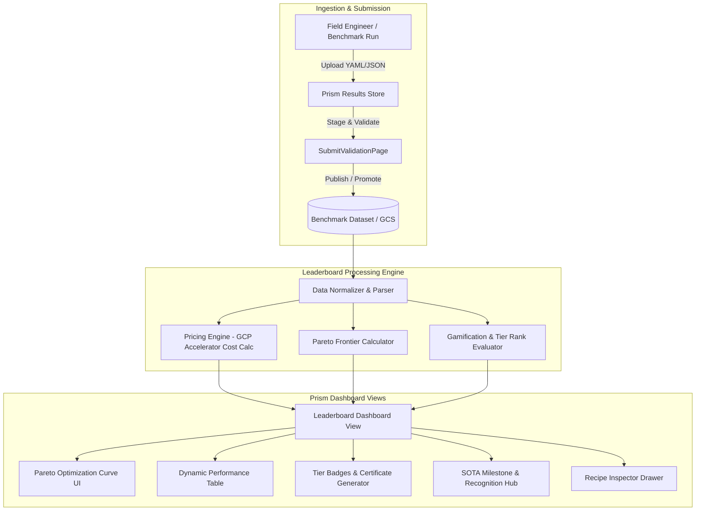
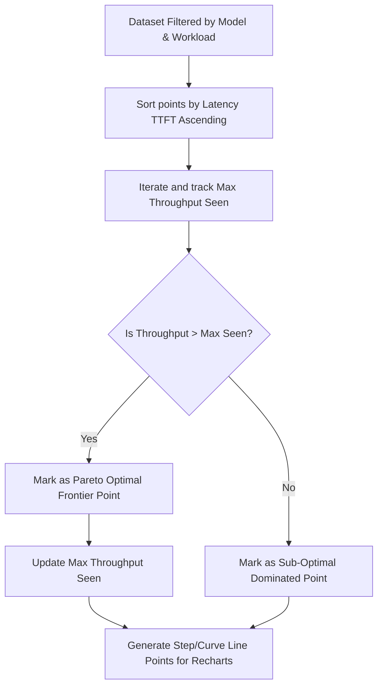

# Specification: Democratized & Gamified Model Benchmarking Leaderboard

## 1. Executive Summary & Vision

The **Prism Model Benchmarking Leaderboard** is a gamified, community-driven evaluation and ranking platform for LLM inference serving configurations ("recipes"). It enables Field Engineers, Solutions Architects, and ML Engineers to:
1. **Submit & Showcase Recipes**: Upload validated serving configurations and benchmark results directly via Prism's Results Store.
2. **Climb the Leaderboards & Earn Recognition**: Achieve competitive tier rankings (**Grandmaster**, **Master**, **Contender**, **Explorer**) and unlock verifiable achievement certificates, community badges, and SOTA milestone accolades.
3. **Analyze Multi-Metric Trade-offs**: Dynamically filter and compare Output Tokens/sec, TTFT (Mean/P50/P90/P99), Inter-Token Latency (ITL), and Request Throughput.
4. **Aggregate Cloud Costs**: Quantify performance against realistic GCP accelerator pricing (H100, A100, L4, TPU v5e/v5p/v6e) to determine **Cost per 1M Output Tokens** ($/M tokens) and **Tokens per Dollar**.
5. **Explore the Pareto Frontier**: Visually plot latency vs. throughput optimization curves to immediately discover non-dominated serving configurations for various SLA constraints.

---

## 2. Tech Stack & System Architecture

### 2.1 Core Stack
- **Frontend Framework**: React 19 (via Vite)
- **Styling & Design System**: Tailwind CSS v4 + Vanilla CSS glassmorphic aesthetic matching Prism's dark theme palette (`slate-950`, `cyan-500`, `amber-500`, `purple-500`).
- **Icons & UI Primitives**: Lucide React (`Trophy`, `Award`, `Flame`, `Zap`, `DollarSign`, `Activity`, `CheckCircle2`, `Share2`, `Download`, `TrendingUp`, `Sparkles`).
- **Charting & Visualizations**: Recharts (`ResponsiveContainer`, `ScatterChart`, `Scatter`, `LineChart`, `Line`, `XAxis`, `YAxis`, `Tooltip`, `Legend`, `ZAxis`, `Cell`).
- **Data Validation & Schemas**: Zod (`z`) runtime schema parsing for recipes, metric structures, and pricing matrices.
- **Backend & Storage**: Node.js / Express backend (`server/server.js`) with Google Cloud Storage (GCS) profile integration and GitHub OAuth authentication for user attribution.
- **Client State**: Integrated with Prism's `useDashboardState` and `useDashboardData` hooks.

### 2.2 Architectural Integration into Prism



---

## 3. Data Schema & Models (Zod & JSON Schema)

### 3.1 Benchmark Recipe & Leaderboard Entry Schema

```typescript
// Zod Schema Definition for Leaderboard Entry
import { z } from 'zod';

export const MetricDistributionSchema = z.object({
  mean: z.number().nullable().optional(),
  p50: z.number().nullable().optional(),
  p90: z.number().nullable().optional(),
  p99: z.number().nullable().optional(),
  min: z.number().nullable().optional(),
  max: z.number().nullable().optional(),
});

export const ServingStackConfigSchema = z.object({
  engine: z.enum(['llm-d', 'vllm', 'sglang', 'tensorrt-llm', 'tgi', 'other']),
  engine_version: z.string().default('latest'),
  tensor_parallel_size: z.number().int().min(1).default(1),
  pipeline_parallel_size: z.number().int().min(1).default(1),
  expert_parallel_size: z.number().int().min(1).default(1),
  quantization: z.enum(['none', 'fp8', 'awq', 'gptq', 'int4', 'smoothquant']).default('none'),
  kv_cache_dtype: z.enum(['auto', 'fp16', 'fp8', 'int8']).default('auto'),
  prefix_caching: z.boolean().default(true),
  speculative_decoding: z.object({
    enabled: z.boolean().default(false),
    draft_model: z.string().optional(),
    num_speculative_tokens: z.number().optional(),
  }).optional(),
  launch_args: z.record(z.any()).optional(),
});

export const HardwareSpecSchema = z.object({
  accelerator_type: z.enum([
    'nvidia-h100-80gb',
    'nvidia-a100-80gb',
    'nvidia-a100-40gb',
    'nvidia-l4',
    'nvidia-v100',
    'tpu-v5e',
    'tpu-v5p',
    'tpu-v6e-trillium',
    'other'
  ]),
  accelerator_count: z.number().int().min(1),
  machine_type: z.string().optional(),
  cloud_provider: z.enum(['gcp', 'aws', 'azure', 'on-prem']).default('gcp'),
  region: z.string().default('us-central1'),
});

export const AuthorProfileSchema = z.object({
  username: z.string(),
  display_name: z.string(),
  avatar_url: z.string().url().optional(),
  github_id: z.string().optional(),
  team: z.string().optional(),
  badge_tier: z.enum(['Grandmaster', 'Master', 'Contender', 'Explorer']).default('Explorer'),
  total_submissions: z.number().int().default(1),
  verified_recipes_count: z.number().int().default(0),
});

export const LeaderboardEntrySchema = z.object({
  id: z.string().uuid(),
  recipe_name: z.string(),
  model_name: z.string(),
  model_family: z.string(),
  author: AuthorProfileSchema,
  hardware: HardwareSpecSchema,
  stack: ServingStackConfigSchema,
  
  // Workload condition
  workload: z.object({
    input_tokens: z.number().int(),
    output_tokens: z.number().int(),
    concurrency: z.number().int(),
    target_qps: z.number().nullable().optional(),
    dataset_name: z.string().optional(),
  }),
  
  // Measured Performance Metrics
  metrics: z.object({
    output_tokens_per_sec: MetricDistributionSchema, // Per stream output token generation rate
    total_tokens_per_sec: MetricDistributionSchema,  // Aggregate server throughput
    ttft_ms: MetricDistributionSchema,               // Time to first token in ms
    itl_ms: MetricDistributionSchema,                // Inter-token latency in ms
    e2e_latency_ms: MetricDistributionSchema,        // End-to-end request duration in ms
    kv_cache_usage_pct: z.number().min(0).max(100).optional(),
    prefix_cache_hit_rate_pct: z.number().min(0).max(100).optional(),
  }),
  
  // Cost Aggregation (Derived & Overrideable)
  cost_analysis: z.object({
    hourly_rate_usd: z.number(),
    cost_per_1m_output_tokens_usd: z.number(),
    tokens_per_dollar: z.number(),
    is_custom_pricing: z.boolean().default(false),
  }),
  
  // Pareto & Ranking Metadata
  leaderboard_rankings: z.object({
    overall_rank: z.number().int().optional(),
    category_rank: z.number().int().optional(),
    is_pareto_optimal: z.boolean().default(false),
    pareto_dimensions: z.array(z.string()).default(['ttft_p50', 'total_tokens_per_sec']),
    tier: z.enum(['Grandmaster', 'Master', 'Contender', 'Explorer']),
  }),

  // Verification & Gamification
  verification: z.object({
    status: z.enum(['verified', 'community_validated', 'unverified']).default('community_validated'),
    reproduction_command: z.string().optional(),
    docker_image: z.string().optional(),
    helm_chart_values_url: z.string().optional(),
    verified_at: z.string().datetime().optional(),
    verifier_handle: z.string().optional(),
    raw_report_url: z.string().optional(),
  }),

  // SOTA Milestone & Recognition Tracking
  milestones: z.object({
    qualifies_for_milestone: z.boolean().default(false),
    milestone_track_id: z.string().optional(),
    milestone_title: z.string().optional(),
    recognition_status: z.enum(['none', 'unverified', 'verified_sota', 'hall_of_fame']).default('none'),
    certificate_id: z.string().optional(),
  }),

  created_at: z.string().datetime(),
  updated_at: z.string().datetime(),
});
```

---

## 4. Cost Aggregation Engine

### 4.1 Built-in Standard GCP Accelerator Pricing Matrix

The engine includes pre-calibrated baseline GCP hourly prices based on on-demand list pricing (in `us-central1` / `us-east4`), while empowering the user to toggle/override values dynamically.

| Accelerator Type | Base GCP VM Type | GPUs/Chips per VM | Standard Price per Unit ($/hr) | Full Node Base Price ($/hr) |
| :--- | :--- | :--- | :--- | :--- |
| **NVIDIA H100 (80GB SXM5)** | `a3-highgpu-8g` | 8 | $3.67 | $29.36 |
| **NVIDIA A100 (80GB SXM4)** | `a2-ultragpu-8g` | 8 | $2.93 | $23.44 |
| **NVIDIA A100 (40GB)** | `a2-highgpu-8g` | 8 | $2.00 | $16.00 |
| **NVIDIA L4 (24GB)** | `g2-standard-96` | 8 | $0.56 | $4.48 |
| **NVIDIA L4 (24GB single)**| `g2-standard-12` | 1 | $0.56 | $0.56 |
| **TPU v5e (Lite Pod)** | `ct5lp-hightpu-4t`| 4 | $1.20 | $4.80 |
| **TPU v5p** | `ct5p-hightpu-4t` | 4 | $4.20 | $16.80 |
| **TPU v6e (Trillium)** | `ct6e-standard-4t`| 4 | $1.90 | $7.60 |

### 4.2 Calculation Formulas

1. **Total Hourly Cluster Cost ($/hr)**:
   $$\text{Cluster Hourly Cost} = (\text{Accelerator Count} \times \text{Unit Cost per Hour}) + \text{Host VM Memory/CPU Overhead}$$
   *(Default: Host VM Overhead included in standard pricing bundle)*

2. **Cost per 1 Million Output Tokens ($/1M tokens)**:
   $$\text{Cost per 1M Tokens} = \frac{\text{Cluster Hourly Cost}}{\text{Aggregate Throughput (Tokens/sec)} \times 3600} \times 1,000,000$$

3. **Tokens Generated per Dollar**:
   $$\text{Tokens per Dollar} = \frac{\text{Aggregate Throughput (Tokens/sec)} \times 3600}{\text{Cluster Hourly Cost}}$$

4. **Normalized Cost Efficiency Score**:
   $$\text{Efficiency Index} = \frac{\text{Tokens per Dollar}}{\text{Baseline Target for Model Family}} \times 100$$

---

## 5. Pareto Optimization Curve Engine & UI

### 5.1 Pareto Frontier Algorithm (2D Non-Dominated Sorting)

A recipe configuration point $A = (\text{TTFT}_A, \text{Throughput}_A)$ **dominates** point $B = (\text{TTFT}_B, \text{Throughput}_B)$ if and only if:
1. $\text{TTFT}_A \le \text{TTFT}_B$ (Lower or equal latency), AND
2. $\text{Throughput}_A \ge \text{Throughput}_B$ (Higher or equal throughput), AND
3. At least one inequality is strict ($\text{TTFT}_A < \text{TTFT}_B$ OR $\text{Throughput}_A > \text{Throughput}_B$).

Configurations that are not dominated by any other configuration in the filtered dataset form the **Pareto Optimal Frontier**.



### 5.2 Pareto UI Visual Specifications
- **Interactive Chart Container**: Recharts `ScatterChart` with overlaid `Line` connecting Pareto Frontier nodes.
- **X-Axis (Latency)**:
  - Metric Switcher: `TTFT P50` | `TTFT P90` | `TTFT Mean` | `ITL P50` | `E2E Latency P50`.
  - Logarithmic / Linear scale toggle.
  - Formatted in milliseconds (`ms`).
- **Y-Axis (Throughput / Efficiency)**:
  - Metric Switcher: `Aggregate Throughput (Tokens/sec)` | `Output Tokens/sec per Stream` | `Tokens / $`.
  - Formatted with commas and SI units (`k tokens/s`).
- **Z-Axis (Bubble Size)**: Accelerator count or Cluster Hourly Cost.
- **Node Coloring**:
  - **Gold Glowing Border**: Pareto Frontier Points.
  - **Color Fill by Hardware**: Amber (H100), Cyan (L4), Violet (A100), Emerald (TPU v5e/v6e).
- **Interactive Tooltip**:
  - Author and GitHub avatar.
  - Recipe title and rank tier badge.
  - Engine + TP/PP/EP configuration.
  - Latency vs. Throughput numbers with delta against median.
  - "Inspect Recipe" and "Add to Comparison" direct action buttons.

---

## 6. Leaderboard & Gamification Engine

### 6.1 Ranking Tier System

Field Engineers and recipes earn status tiers based on performance thresholds and reproducibility:

```
+-------------------------------------------------------------------------+
|                               GRANDMASTER                               |
|   Rank #1 in Model Category or Pareto Frontier Gold Star               |
|   Verified Reproducible + 100% Validated Run Logs                      |
+-------------------------------------------------------------------------+
                                    ^
+-------------------------------------------------------------------------+
|                                 MASTER                                  |
|   Top 3 in Category / High Efficiency (Top 10% Pareto Curve)            |
|   Community Validated Recipe with launch scripts                       |
+-------------------------------------------------------------------------+
                                    ^
+-------------------------------------------------------------------------+
|                               CONTENDER                                 |
|   Top 10 Validated Benchmark Submission                                 |
+-------------------------------------------------------------------------+
                                    ^
+-------------------------------------------------------------------------+
|                                EXPLORER                                 |
|   Initial Benchmark Upload & Public Staged Recipe                       |
+-------------------------------------------------------------------------+
```

### 6.2 SOTA Milestone Tracks & Community Recognition Hub

Field teams and community contributors can unlock prestigious community recognition and verified badges for standard benchmark tracks:

1. **SOTA Milestone Tracks**:
   - **SOTA Breaker Track**: Breaking previous throughput record on Llama-3.1-70B on 8x L4 or 8x H100 with $\le 50\text{ms}$ TTFT P50.
   - **Cost Crusher Track**: Delivering $> 100,000 \text{ tokens/\$}$ on Mistral-Large / Qwen-72B.
   - **Prefix Cache Optimizer Track**: Achieving $> 80\%$ cache hit throughput speedup in agentic multi-turn workloads.
   - **Sub-20ms Flagship ITL Track**: Achieving $< 20\text{ms}$ Inter-Token Latency on 70B+ class model at concurrency $\ge 16$.
2. **Recognition Workflow & Audit**:
   - Upon submitting a qualifying run, the UI triggers a "🎉 SOTA Milestone Qualifying Result!" banner.
   - Contributor views qualifying track details in the **Milestone Recognition Drawer**.
   - Review status transitions: `Qualifying` $\rightarrow$ `Community Audit Submitted` $\rightarrow$ `Under Peer Reproduction` $\rightarrow$ `Verified SOTA & Hall of Fame Induction`.

### 6.3 Verifiable Achievement Certificates (SVG / High-Res PNG)

Contributors who reach Grandmaster or Master status, or set a Pareto record, can generate and download a cryptographic/verifiable Achievement Certificate:
- **Card Elements**:
  - Holographic badge with tier icon (`Grandmaster` / `Pareto SOTA`).
  - Author Name + GitHub Handle + Organization.
  - Benchmark Specification: Model, Hardware, TP Size, Quantization.
  - Verified Score: `Throughput: 4,820 tok/s`, `TTFT: 24.1 ms`, `Cost: $0.18 / 1M tok`.
  - Verification Hash & Timestamp.
- **Export Formats**:
  - One-click SVG / Canvas PNG download.
  - Markdown badge snippet for GitHub profile READMEs (`[]`).
  - Share to LinkedIn / X deep-link.

---

## 7. UI Components Architecture & Blueprint

### 7.1 Component Structure (`src/components/Leaderboard/`)

```
src/components/Leaderboard/
├── LeaderboardDashboard.jsx        # Main leaderboard orchestrator view
├── ParetoCurveChart.jsx             # Recharts-based 2D Pareto frontier graph
├── LeaderboardTable.jsx             # Main ranking table with expandable recipe drawer
├── MetricFiltersBar.jsx             # Dynamic filter controls (Model, Hardware, Engine, Latency metric)
├── PricingConfigModal.jsx          # GCP accelerator cost matrix & custom $/hr overrides
├── CertificateModal.jsx            # Dynamic SVG achievement certificate generator & exporter
├── MilestoneTracksDrawer.jsx        # SOTA milestone tracks and community audit drawer
├── RecipeDetailDrawer.jsx          # Quick-copy Docker/Helm launch command & full config inspector
├── RecipeComparisonModal.jsx        # Side-by-side recipe & architecture comparator
└── LeaderboardSummaryCards.jsx     # Top KPI metric cards (#1 Throughput, #1 Latency, Most Cost Efficient)
```

### 7.2 Component Breakdown & Layout Blueprint

```
+----------------------------------------------------------------------------------------------------+
|  HEADER: Prism Model Leaderboard [🏆 Grandmaster Tracks] [⚙️ Pricing Settings] [➕ Submit Recipe]   |
+----------------------------------------------------------------------------------------------------+
|  TOP KPI CARDS:                                                                                    |
|  [ 🚀 SOTA Throughput: 4.8k tok/s ] [ ⚡ Lowest TTFT: 18.2ms ] [ 💰 Best Value: 184k tok/$ ]      |
+----------------------------------------------------------------------------------------------------+
|  DYNAMIC FILTERS BAR:                                                                              |
|  Model: [ Llama-3.1-70B v ]  Hardware: [ All GCP Accelerators v ]  Stack: [ All v ]  Metric: [TTFT]|
+----------------------------------------------------------------------------------------------------+
|                                                                                                    |
|  PARETO OPTIMIZATION CURVE (Recharts Scatter + Convex Frontier Line)                                |
|  Throughput (tok/s)                                                                                |
|    ^                                                                                               |
|    |           * (Grandmaster - 8x H100)                                                           |
|    |          / \                                                                                  |
|    |         *---* (Master - 4x TPU v6e)                                                           |
|    |        /                                                                                      |
|    |       * (Contender - 8x L4)                                                                   |
|    |      . . . (Dominated configs)                                                                |
|    +---------------------------------------------> TTFT (ms, P50)                                  |
|                                                                                                    |
+----------------------------------------------------------------------------------------------------+
|  LEADERBOARD RANKINGS TABLE:                                                                       |
|  Rank | Author | Model | Hardware | Stack | TTFT P50 | Output tok/s | $/1M Tok | Tier | Actions  |
|  #1   | @alice | L3-70B| 8x H100  | llm-d |  22.4 ms |  4,820 tok/s |  $0.21   | 👑 GM| [View]   |
|  #2   | @bob   | L3-70B| 4x TPUv6e| vLLM  |  28.1 ms |  4,110 tok/s |  $0.18   | 🥈 M | [View]   |
|  #3   | @carol | L3-70B| 8x L4    | vLLM  |  49.0 ms |  2,450 tok/s |  $0.12   | 🥉 C | [View]   |
+----------------------------------------------------------------------------------------------------+
```

---

## 8. Persona-Tailored Capabilities & Workflows

### 8.1 llm-d Feature Developer Workflow
- **PR Markdown Summary Export**: In `RecipeComparisonModal.jsx`, one-click **"Copy PR Markdown Report"** converts side-by-side benchmark deltas into formatted GitHub Markdown tables ready to paste directly into Pull Request descriptions.
- **Git Commit Traceability**: In `RecipeDetailDrawer.jsx` and `LeaderboardTable.jsx`, each recipe links to its originating Git Commit SHA, branch, and Pull Request.
- **Benchmark Scope Filter**: Allows toggling between System E2E workloads (e.g. ShareGPT multi-turn) and Unit Microbenchmarks.
- **Regression Highlighting**: Tail latency (P99) and ITL regressions exceeding $+5\%$ against the active baseline are highlighted with warning indicators.

### 8.2 Solutions Architect & Config Tuner Workflow
- **SLA & Budget Sizing Wizard (`SizingWizardModal.jsx`)**: Inverse lookup matching target concurrency, maximum TTFT latency SLOs (e.g. $\le 35\text{ms}$), context length, and hourly budget ceilings to surface the #1 optimal cost/performance architecture.
- **Production Reference Architecture Export**: `RecipeDetailDrawer.jsx` includes full KubeRay `RayCluster` YAML and Helm manifests with GPU resource limits, node selectors, and environment configurations.

### 8.3 Stack Operator & DevOps Workflow
- **Stability & Headroom Telemetry**: Telemetry gauges track Peak VRAM %, Concurrency Headroom before OOM risk, and P99 Queue dwell times.
- **Enterprise CUD Presets**: `PricingConfigModal.jsx` provides one-click discount presets: On-Demand (0%), 1-Year CUD (37% off), 3-Year CUD (55% off), and Spot/Preemptible (65% off) with real-time recalculation of $/1M tokens and tokens/dollar across the leaderboard.
- **Production Baseline Pinning**: Set any verified recipe as the active baseline to instantly calculate live deltas across all recipes.

### 8.4 Benchmark Developer & PR Analyst Workflow
- **Apples-to-Apples Fairness Audit**: Modal check verification certifying identical dataset traces, tokenizers, and warmup conditions across compared engines (llm-d vs. vLLM vs. SGLang).
- **Presentation Export Toolkit**:
  - **Table CSV Export**: Download complete leaderboard and benchmark runs formatted for analysis.
  - **Pareto SVG Export**: Vector graphic export of the Pareto frontier curve for slides and publications.

---

## 9. Integration with Prism Navigation & Results Store

### 9.1 LeftNavigation Integration
Add to `MENU_GROUPS` under `"Well-lit paths"` or `"Utility suite"`:
```javascript
{
    id: 'model-leaderboard',
    label: 'Model leaderboard',
    icon: Trophy,
    view: 'model-leaderboard',
    badge: 'Gamified'
}
```

### 9.2 Results Store & Submit Validation Flow Integration
1. In `ResultsStore.jsx`, add a prominent action **"Publish to Leaderboard"** next to any staged/verified benchmark run.
2. Clicking **"Publish to Leaderboard"** runs the Zod validation and assigns initial rank tier.
3. If the result beats an existing record on the Pareto curve, Prism triggers an in-app celebration animation with the certificate claim modal.

---

## 10. Implementation Status

- [x] **Core Pricing Engine & Discount Presets** (`src/utils/pricingEngine.js`): GCP List rates + 1-Yr/3-Yr CUD & Spot presets.
- [x] **2D Pareto Frontier Math & Step Curve** (`src/utils/paretoFrontier.js`): Non-dominated sorting with linear & log scale rendering.
- [x] **Gamification & Milestone Tracks** (`src/utils/gamificationEngine.js`): Grandmaster tiers, SVG certificates, and 4 SOTA milestone tracks.
- [x] **SLA Sizing Wizard** (`src/components/Leaderboard/SizingWizardModal.jsx`): Inverse SLA and budget envelope exploration.
- [x] **GitHub PR Markdown Export** (`src/components/Leaderboard/RecipeComparisonModal.jsx`): Automated PR report generator with regression flags.
- [x] **Production Reference Architecture & Git Traceability** (`src/components/Leaderboard/RecipeDetailDrawer.jsx`): KubeRay manifest generator, Helm values, and Git metadata.
- [x] **Presentation Export (CSV & SVG)** (`src/components/Leaderboard/LeaderboardTable.jsx`, `src/components/Leaderboard/ParetoCurveChart.jsx`).

