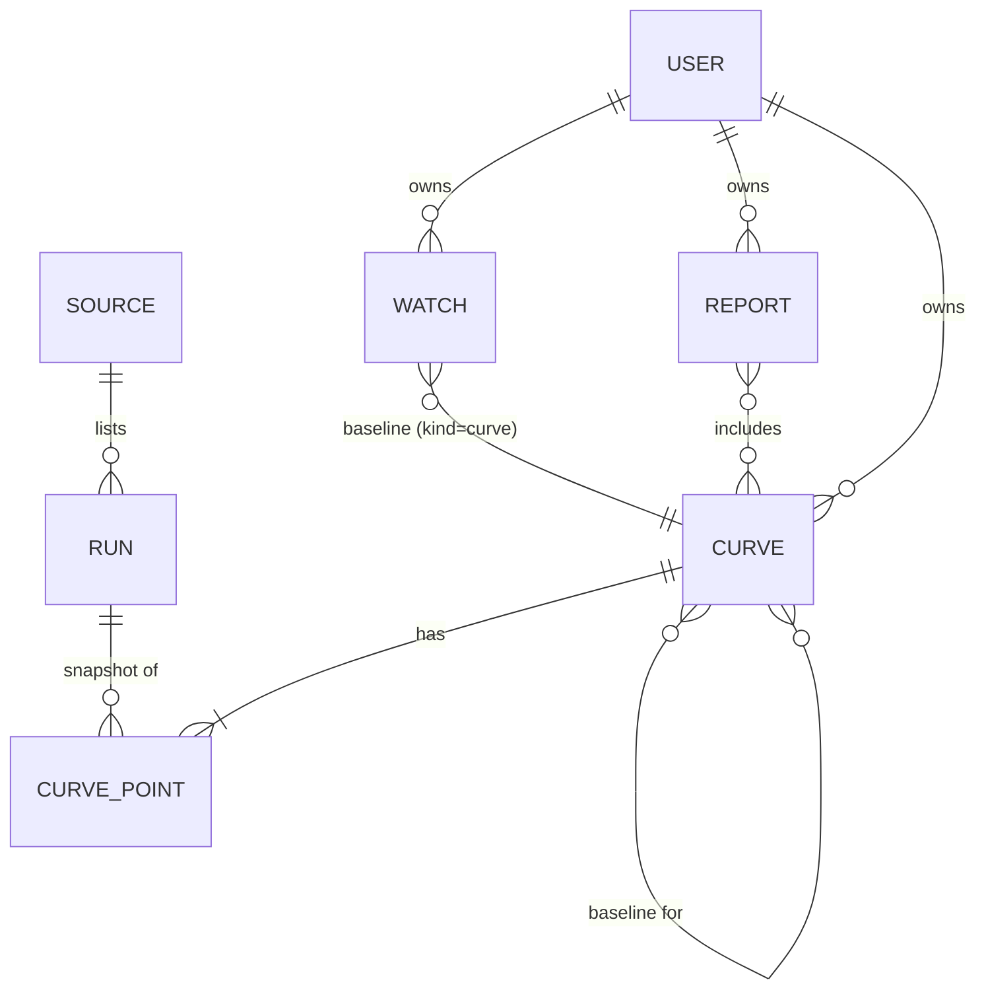
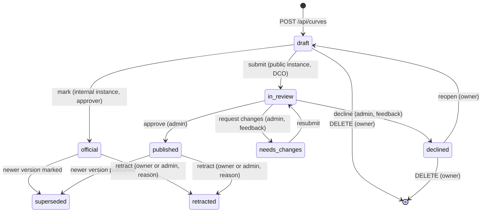

# Results store — Engineering design: server-side Results, Watches, Reports and Sources

- **Status**: Draft for review
- **Phase**: Engineering (the UI/UX phase is complete; see [ui_spec.md](ui_spec.md) and the [UX brief](../../../docs/results_store_ux_brief.md))
- **Product context**: [Prism 2.0 product spec](../prism2.0-home/product_spec.md) (persona entry flows) and UX brief §1–2, §10
- **Roadmap**: Q3 2026 *llm-d Results Store: Ingestion & UI* and *Results Store Scalability* ([roadmap.md](../../main/roadmap.md))
- **Builds on**: [results-api](../../main/completed/results-api/README.md) (runs, GCS object contexts, state machine), [iam.md](../../main/completed/results-api/iam.md), [routes.md](../../main/completed/results-api/routes.md)

---

## 1. Problem

The Results store UI creates four kinds of objects on top of raw runs: **Results** (curated curves), **Watches**, **Reports** and registered **Sources**. The backend stores **runs only** (`/api/results`). The four objects live in `localStorage` ([WorkspaceProvider.jsx](../../../src/components/ResultsStore/WorkspaceProvider.jsx), key `prism_results_workspace_v1`), so:

- a Result "submitted for review" never reaches a reviewer; reviewers see only the uploaded runs ([PublishDialog.jsx:136](../../../src/components/ResultsStore/PublishDialog.jsx#L136));
- a share link to a Result (`?curve=`) or a comparison containing one (`?compare=c:…`) fails for anyone but its author;
- a Watch helps only the person who created it; a Report can't be handed to a customer; a Source registered by one admin is invisible to the others.

This design adds a server record and API for each, keeps the UI contract unchanged, and migrates existing local data.

### Goals

1. Results, Watches, Reports and Sources persist on the server, scoped by owner and instance, with the same fields the UI already produces.
2. The **Result** becomes the unit of review on the public instance. What the reviewer sees is exactly what the author curated.
3. Share links work for everyone with access: `?curve=`, `?compare=c:…`, and a new `?report=<user>/<slug>`.
4. Retraction of a published Result (roadmap item), with a reason and an audit trail.
5. Zero changes to the UI's data shapes beyond IDs; one migration step for existing local data.

### Non-goals (this design)

- Notifications (email, Slack, GitHub issues) and server-side Watch evaluation. The schema leaves room; §9 sketches the follow-up.
- A server-side index of pipeline buckets (today the client lists GCS directly). Sources here are a shared **registry**, not an ingestion pipeline.
- The BigQuery/Spanner migration. This design uses the same GCS-object pattern as runs so both migrate together.
- Retracting raw runs, and the on-demand dashboards builder.

---

## 2. Entities



| Server record | UI name | Owner can… | Others can… | Notes |
| :--- | :--- | :--- | :--- | :--- |
| `curve` | Result | create, edit labels and point inclusion, submit (public), retract own, discard drafts | read per visibility; admins review (public) and mark Official (internal, §4.3) | Measured values are a **read-only snapshot**; the server rejects writes that change them (§4.2). |
| `watch` | Watch | create, rename, delete | admins read all | Evaluation stays client-side in this phase. |
| `report` | Report | create, edit, delete | read per visibility | Namespaced slug `/u/<user>/<slug>`, compatible with the on-demand dashboards spec. Holds results of any status (§4.5). |
| `source` | Source | — | admins: register, hide/show, remove, sync | Instance-wide, not per user. |

---

## 3. Storage

Same pattern as runs: one JSON object per record in the results-store prefix of the environment's bucket, state and filter keys in **GCS object contexts** so lists don't read bodies. This ships before the database migration and migrates with it.

```
gs://<bucket>/prism-results-store/
  <runId>.v1.json                         # existing: runs
  curves/<curveId>.v1.json
  watches/<watchId>.v1.json
  reports/<username>/<slug>.v1.json
  sources/<sourceId>.v1.json
```

- `<bucket>` follows the existing rule: `llm-d-benchmarks-staging` for dev/staging, `llm-d-benchmarks` for production. Production is never written from dev.
- IDs are **server-generated UUIDv4**, like runs. Client IDs (`curve-ab12cd34`) are kept in `clientId` for idempotent migration.
- Every record carries `instance: 'internal' | 'public'`. The server runs as one instance (`PRISM_INSTANCE`, §6.3) and only lists records of that instance; the field exists so a bucket can host both during the beta.
- Optimistic concurrency: writes send `If-Match: <etag>` (GCS generation). A stale write returns `409` and the client reloads the record. This prevents two tabs from silently overwriting each other's point exclusions.

### 3.1 Object contexts (list/filter keys)

| Record | Context keys (plain) | Base64url-encoded (`e` prefix, as for runs) |
| :--- | :--- | :--- |
| curve | `kind=curve`, `curve_id`, `owner`, `status`, `visibility`, `version`, `featured`, `supersedes` | `config_key`, `model_name`, `hardware_name`, `workload`, `name` |
| watch | `kind=watch`, `watch_id`, `owner`, `last_status` | `config_key`, `name` |
| report | `kind=report`, `report_id`, `owner`, `slug`, `visibility` | `name` |
| source | `kind=source`, `source_id`, `provider`, `hidden` | `name`, `bucket` |

All within the 50-key limit. `config_key` is the setup key the UI already computes (`curveConfigKey` / `configKeyOf` in [catalog.js](../../../src/components/ResultsStore/catalog.js)): model · accelerator · chips · workload · harness · deployment. It's what lets the review queue and Watches find "other Results of this setup" without reading bodies.

---

## 4. Record schemas

Schemas are Zod, next to `PrismResultPayloadSchema` in [server/results/api.ts](../../../server/results/api.ts), and are what the client already sends. Field names below are the client's today; nothing is renamed.

### 4.1 `curve` (Result)

```ts
Curve {
  id: uuid; clientId?: string; instance: 'internal'|'public';
  version: int ≥ 1; supersedes: uuid|null; supersededBy: uuid|null;
  name: string; autoName: boolean;
  status: 'draft'|'in_review'|'needs_changes'|'declined'|'official'|'published'|'superseded'|'retracted';
  visibility: 'private'|'reviewers'|'unlisted'|'public';
  owner: string (github login); attribution?: string;
  createdAt, updatedAt: ISO; markedBy?, markedAt?, submittedAt?, reviewedBy?, retractedAt?, retractedBy?;
  featured: boolean; feedback: string; retractReason?: string;
  meta: { model, modelFull, accelerator, accelCount, workload, harness, source, category, engine, setup, notes };
  original: { model, modelFull, accelerator, category };      // as parsed, for the audit trail
  points: CurvePoint[];                                         // snapshot, see below
  dropped: { runKey, conc, stage, idLabel }[];
  builtFrom: { runs: int, runKeys: string[], label: string };
  submissionRunIds: uuid[];                                     // runs in /api/results
  localRunIds: string[];                                        // runs only in the author's browser
  baselines: { id: uuid, name: string }[];
  history: { at: ISO, by: string, what: string }[];
}
CurvePoint {
  key, runKey, runId?, stage?, idLabel, model, hwLabel, workload,
  conc: number|null, output, total, chips, outputPerChip?, totalPerChip?,
  lat: { ttft|tpot|itl|e2e: { mean, p50, p99 } }, latStat: {…}, errRate?,
  included: boolean, reason: string                             // the only mutable fields
}
```

Visibility maps from the client's current values: `me → private`, `reviewers → reviewers`, `instance → public` (internal instance), `public → public`. `unlisted` is new: readable by anyone with the link, hidden from Browse. It's the Result-level twin of the run state `unlisted`.

### 4.2 Server-enforced invariants for `curve`

1. **Measured values never change.** `PATCH` may alter `name`, `meta.*`, `points[].included`, `points[].reason`, `baselines`, `featured` (admins). Any other difference in `points` (compared key-by-key against the stored snapshot) → `400 measured_values_immutable`. This is the server side of UX principle 3 ("measured data is read-only; labels are editable").
2. **Publish needs server-known runs.** A transition out of `draft` is refused while `localRunIds` is non-empty (`409 local_runs`), with the list, so the client can say "Upload these 2 runs first." Runs from registered sources are accepted on trust in this phase (the server can't HEAD arbitrary buckets); runs in `submissionRunIds` must exist in `/api/results` and be readable by the author.
3. **Chip count follows the label.** `outputPerChip`/`totalPerChip` are recomputed server-side from `meta.accelerator` on every write (same rule as `withChips` in the client), so a relabel from `×1` to `×8` can't leave stale per-chip values in the record.
4. **One live version per lineage.** When a curve with `supersedes` becomes `official`/`published`, the server sets the predecessor to `superseded` with `supersededBy` in the same request. Readers of the old ID get it with the pointer, so old share links still resolve.

### 4.3 State machine



- The instance decides which first transition exists; the server refuses the other (`internal` never has `in_review`; `public` never has `official`).
- **Only approvers mark a result official** (internal instance; decided 2026-10-19). The caller must be signed in, so `markedBy` is always a real GitHub login, and must be an approver. In this phase approvers are admins: llm-d org admins or people on the admin allowlist (`prism-iam/github-admin-allowlist.txt`, managed with `tools/prism-iam`; see [iam.md](../../main/completed/results-api/iam.md)). Anyone else gets `403 approver_required`. Everyone can still create and edit drafts and put them in reports (§4.5).
- **Approving a Result also publishes its runs**: each `submissionRunIds` run in `unlisted` or `submitted_pending_review` moves to `public` (same admin, same history entry). One review covers the curated curve and the evidence under it.
- `retracted` records stay readable by direct link with the reason, are excluded from Browse and from report cost tables by default, and keep their `history`. Watches whose baseline was retracted show the existing "The baseline is gone" empty state.

### 4.4 `watch`

```ts
Watch {
  id, clientId?, instance, owner, name, createdAt, updatedAt;
  configKey: string; setupLabel: string; filters: {};        // filters kept for old watches only
  ref: { kind: 'curve', id: uuid, name } | { kind: 'pinned', name, points: CurvePoint[] };
  metric: 'output';                                           // reserved: 'ttft'|'tpot'|'errors' with stat
  atConc: number|null; threshold: number (≤ 0, percent);
  lastEvaluatedAt?: ISO; lastStatus?: 'ok'|'flagged'|'waiting'; // written by the client for now (§9)
}
```

`metric` is a string today; the follow-up adds `{ kind, stat }` and a direction rule (higher latency is worse). Writing it as a string now keeps the client untouched.

### 4.5 `report`

```ts
Report {
  id, clientId?, instance, owner, name, slug, description?, createdAt, updatedAt;
  visibility: 'private'|'unlisted'|'public';                  // default 'private'; Share sets 'unlisted'
  curveIds: uuid[];                                            // results of any status (see below)
  priceAt: 1000|2000|5000|'peak';                              // TTFT limit in ms
  prices: { [accelType: string]: number|null };                // $ per chip-hour overrides
}
```

- `slug` is unique per owner, generated from the name, editable. The shareable URL is `/?view=results-store&report=<owner>/<slug>` now and `/u/<owner>/<slug>` once the SPA route from the on-demand dashboards spec exists. The client already computes this slug.
- **Results of any status (decided 2026-10-19).** A report can hold drafts and results in review as well as Official / Published ones, so a tuner can price candidate configs before anyone curates them. Results that aren't Official / Published are labelled **Unofficial** (internal) / **Unpublished** (public) in the cost table, chart legend, CSV `Status` column and Markdown, and a notice says their points and labels can still change. Adding runs or sweeps from Compare reuses the result already made from exactly those runs, or creates a draft owned by the report's author.
- **Private until shared.** A new report is `private`: only the owner can open its URL. The report's **Share** action does two things in one request: `PATCH { visibility: 'unlisted' }` and copy the link. `unlisted` reports open for anyone with the link and never appear in lists. The owner can set it back to `private` from the same control (the link then stops working for others). `public` (listed) is reserved for a later "publish" feature and isn't exposed in the UI in this phase.
- The typed-in `prices` are the one thing a report can leak (a customer's negotiated rate), which is why the default is `private` rather than `unlisted`. The ReportView header states who can open it (*Only you* / *Anyone with the link*), so a URL copied from the address bar instead of via Share is explained, not silently broken.
- A report's read response includes each curve the reader can see and a stub `{ id, visible: false }` for the rest, so a shared report that includes a private draft degrades to "1 result isn't visible to you" rather than an error. Because reports now take drafts, that case is common: see §10 Q6 for how Share handles drafts.
- Prices are overrides only; list prices come from `pricingEngine` at render time and aren't stored, so a GCP price change isn't frozen into old reports.

### 4.6 `source`

```ts
Source {
  id, instance, name, provider: 'gcs'|'s3', bucket, prefix?, harness?: string;
  hidden: boolean;                                             // "Show in Browse" off
  registeredBy, registeredAt, updatedAt;
  health?: { checkedAt, status: 'ok'|'empty'|'stale'|'offline', runCount, newestRunAt } // cached by sync
}
```

The built-in buckets (`DEFAULT_BUCKETS`) are not records; the client merges them with this registry as it merges config and custom sources today. `hidden` replaces the per-browser `hiddenSources` set in `useDashboardData` for admins; non-admins read the same registry, so a bucket hidden by one admin is hidden for everyone (today it's hidden only in that admin's browser).

---

## 5. API

All routes follow the existing conventions: `X-Prism-Github-Token` for auth, roles from [iam.md](../../main/completed/results-api/iam.md), `limit`/`pageToken` pagination over contexts, JSON errors `{ error, code, detail }`.

### 5.1 Results

| Route | Role | Notes |
| :--- | :--- | :--- |
| `GET /api/curves` | any | Filters: `status`, `own=true`, `configKey`, `featured`, `q` (name prefix). Visibility rules below. |
| `POST /api/curves` | user | Body: a draft curve. Server sets `id`, `owner`, `instance`, timestamps, per-chip fields. `clientId` dedupes retries. |
| `GET /api/curves/:id` | any | Per visibility. `superseded`/`retracted` return the record with pointers/reason. |
| `PATCH /api/curves/:id` | owner (drafts, `needs_changes`); admin (`featured` only) | §4.2 invariant 1. Requires `If-Match`. |
| `POST /api/curves/:id/status` | per §4.3 | Body `{ status, feedback?, reason?, attribution? }`. Same shape as `/api/results/:runId/status`. |
| `POST /api/curves/:id/versions` | owner | Creates a `draft` with `version+1`, `supersedes: id`. Returns the new record. |
| `DELETE /api/curves/:id` | owner | `draft` and `declined` only; otherwise `403` (use retract). |

**Read visibility** (mirrors runs): owner sees all their own; admins see all; others see `visibility ∈ {public, unlisted}`, where `unlisted` is excluded from unfiltered lists and reachable by ID; `reviewers` is admin-only. The review queue is `GET /api/curves?status=in_review` (admins), oldest first.

### 5.2 Watches and Reports

| Route | Role | Notes |
| :--- | :--- | :--- |
| `GET /api/watches` · `POST /api/watches` | user | Own watches; admins may pass `all=true`. |
| `PATCH /api/watches/:id` · `DELETE /api/watches/:id` | owner | Rename, change threshold/`atConc`, write `lastStatus`. |
| `GET /api/reports?own=true` · `POST /api/reports` | user | `slug` collision → `409 slug_taken`. |
| `GET /api/reports/:owner/:slug` | any | `404` unless owner, or `visibility ∈ {unlisted, public}`; includes resolvable curves (§4.5). |
| `PATCH /api/reports/:id` · `DELETE /api/reports/:id` | owner | `visibility` changes are logged with `by` and time. |

### 5.3 Sources

| Route | Role | Notes |
| :--- | :--- | :--- |
| `GET /api/sources` | any | Everyone needs the list to know what Browse shows and hides. |
| `POST /api/sources` | admin | Validates bucket name/prefix; for GCS, does one `HEAD`-style list with ADC to fill `health`. |
| `PATCH /api/sources/:id` | admin | `name`, `hidden`, `harness`. |
| `DELETE /api/sources/:id` | admin | Built-in buckets can't be deleted (`403`). |
| `POST /api/sources/:id/sync` | admin | Refreshes `health` (run count, newest run, status). Rate-limited per source (1/min). |

### 5.4 Client wiring

`WorkspaceProvider` keeps its public API (`createCurve`, `togglePoint`, `markOfficial`, `review`, `createWatch`, `setReportPrice`, …). Internally each mutation becomes optimistic local state + a request; on `409` it reloads and re-applies, on other errors it reverts and toasts. Reads happen once per tab on mount plus after each mutation; there is no live sync between tabs in this phase (the `If-Match` guard covers correctness).

The three share links resolve through these routes: `?curve=<id>` → `GET /api/curves/:id`; `?compare=…,c:<id>` → one `GET` per curve; `?report=<owner>/<slug>` → `GET /api/reports/:owner/:slug` (a `404` for a non-owner means the report is still private; the page says so). The "Results live in the browser that saved them" notice in `CompareView` goes away.

---

## 6. Cross-cutting

### 6.1 Review becomes Result-centred

Today the public queue mixes two things: locally stored curves `in_review` and server runs `submitted_pending_review` (`ResultsStore.jsx:1008`). After this change:

```mermaid
sequenceDiagram
    autonumber
    actor Author
    participant UI as Results store
    participant API as /api
    actor Reviewer

    Author->>API: POST /api/results (targetState=unlisted) ×N
    Author->>UI: Curate: exclude a point, fix the ×N label
    UI->>API: POST /api/curves (draft, submissionRunIds=[…])
    Author->>UI: Submit for review (DCO, attribution)
    UI->>API: POST /api/curves/:id/status {status: in_review}
    Reviewer->>API: GET /api/curves?status=in_review
    Reviewer->>UI: Opens ReviewDetail: curve vs published, checks, lineage
    Reviewer->>API: POST /api/curves/:id/status {status: published}
    API->>API: runs in submissionRunIds → public; predecessor → superseded
```

- The upload wizard's `submit-review` intent keeps working for raw runs (legacy and CI uploads). The UI steers people to `unlisted` + curate + submit, which is the only path that produces a reviewable curve.
- `ReviewDetail` gains the payload and manifest links the submit page already promises reviewers, read from the curve's `submissionRunIds` via `GET /api/results/:runId`.

> [!IMPORTANT]
> **Decided (2026-10-19):** *the Result is what gets reviewed; approving it publishes its runs.* It resolves the "submitted isn't what the reviewer sees" gap from the persona review. The alternative (runs must be `public` before a Result can be submitted) was rejected as worse for authors.

### 6.2 Roles

IAM has `admin | user | none`. The UI's *reviewer* is `admin` in this phase. If reviewers who aren't admins are needed, add a `reviewer` allowlist beside the existing two (`prism-iam/github-reviewer-allowlist.txt`) and a `PermissionLevel` between `user` and `admin` that may call `/api/curves/:id/status` with review transitions and nothing else. The route table above is written so that's the only change.

The internal instance's *approver*, the only role that may mark a result official (§4.3), is also `admin` in this phase (decided 2026-10-19). Approvers who aren't admins would get the same treatment: a `prism-iam/github-approver-allowlist.txt` and a permission that allows only the `draft → official` transition. The UI hides one-step **Mark official** from everyone else and, in the Result editor, says *"Only approvers can mark results official"* (with **Sign in** when signed out).

### 6.3 Instance

The client decides its instance from `VITE_PRISM_INSTANCE` plus the dev `PreviewBar`. The server must know it to enforce §4.3. Add `PRISM_INSTANCE=internal|public` to the server, surface it in `GET /api/config`, and have the client prefer the server's value when present. In development only (`NODE_ENV !== 'production'`), the server honours an `X-Prism-Preview-Instance` header so the PreviewBar still works against a local server.

### 6.4 Migration of local data

On first sign-in after deploy, if `prism_results_workspace_v1` has records for the current instance, the client shows one dialog: *"Move 3 results, 1 watch and 2 reports to your account?"*

1. `POST` curves oldest-first (so `supersedes` targets exist), sending `clientId`; build an `oldId → newId` map from the responses.
2. Rewrite `curve.supersedes/supersededBy`, `curve.baselines[].id`, `watch.ref.id`, `report.curveIds` through the map, then `POST` watches and reports.
3. On full success, delete the local key. On partial failure, keep the local copy and show which items didn't move; re-running is idempotent via `clientId`.
4. Local `official`/`published` curves keep their status **only on the internal instance, and only when the person migrating is an approver**. Otherwise they migrate as `draft` with a history entry saying so: on the public instance nobody reviewed them, and on the internal instance they may have been marked before only approvers could.

Signed-out users keep working locally as today; the migration dialog appears when they sign in.

### 6.5 Retraction

`POST /api/curves/:id/status { status: 'retracted', reason }` by the owner or an admin. Required reason, recorded in `history`. Retracted Results: hidden from Browse and from Watches' baseline pickers; still open by link with a banner; still counted in `builtFrom` lineage of newer versions. This covers the roadmap's "retract benchmarks" for Results; raw-run retraction stays with the results-api work.

---

## 7. Validation, limits, security

- **Schemas**: Zod on every write; unknown fields rejected (`strict()`), so a client bug can't smuggle measured-value edits in under a new key.
- **Sizes**: a curve with 12 points and full `lat` blocks is ~20 KB; a pinned watch baseline similar; reports and sources < 2 KB. Cap request bodies at 512 KB.
- **Lists**: contexts-based filtering as for runs; `limit ≤ 100`. The Browse tab already pages 40 at a time.
- **Authorization boundary**: `owner` is the GitHub login resolved server-side from the token, never taken from the body. Report slugs are namespaced by owner, so no cross-user collisions or overwrites (same boundary as `dashboards/<username>/` in the on-demand dashboards spec).
- **Injection**: names, notes and feedback are stored as given and escaped by React on render; CSV export already guards formulas client-side. Slugs are `[a-z0-9-]{1,64}`.
- **Audit**: every status change appends to `history` with `by` from the token. Deletions of drafts aren't logged (nothing public depended on them); retractions are.

---

## 8. Rollout

| Phase | Scope | Exit criteria |
| :--- | :--- | :--- |
| **0 (done)** | Local workspace; UI contract fixed | UI spec, UX brief, SSR checks green |
| **1** | `curves` + `reports` API, migration dialog, Result-centred review, `?report=` links, `PRISM_INSTANCE` | A Result submitted on staging is approved by a second account and its runs turn `public`; a report link opens in a private window only after Share, and stops opening when set back to private |
| **2** | `watches` + `sources` registry API; admin-shared hide/show; `sync` health | Two admins see the same source list; a watch created in one browser shows in another |
| **3** | Server-side source index and watch evaluation; notifications; `metric: {kind, stat}` | Out of scope here; ties to the *Regressions Analysis* roadmap item (§9) |

Each phase is behind a server flag (`RESULTS_WORKSPACE_API=1`); with the flag off the client stays on `localStorage` exactly as today, so the UI can ship ahead of the backend.

### Testing

- Contract tests for the state machine (every arrow in §4.3 allowed; every non-arrow refused with the right code and role).
- Invariant tests for §4.2: a `PATCH` that changes `points[].output` by 1 is refused; a relabel from `×1` to `×8` divides every `outputPerChip` by 8 in the stored record.
- Migration test: a fixture workspace with two versions, a watch on v1 and a report with both → all references rewritten, local key cleared.
- The existing SSR suites (`verify_results_fixes`, `verify_semantics`) stay unchanged: the UI contract doesn't move.

---

## 9. Follow-ups this design makes possible

1. **Watches that watch latency and errors, and tell someone.** `metric: { kind: 'ttft', stat: 'p99' }`, a direction rule, and `notify: { webhook?, github_issue? }`. Needs a server-side evaluator, which needs a server-side index of source buckets (Phase 3). This is the bridge to the nightly Regressions dashboard: one evaluator, two views.
2. **Reports as dashboards.** When on-demand dashboards ship, a report is one `kind` of dashboard under the same `/u/<user>/<slug>` route; the slug and owner namespace are already aligned.
3. **Reviewer role** (§6.2) once the public instance has non-admin reviewers.
4. **Database migration.** Records are flat JSON with a handful of filter keys; the BigQuery/Spanner move is a table per record kind plus the runs table, no schema change for the client.

---

## 10. Open questions

1. ~~**Approve-publishes-runs (§6.1).**~~ Decided: approving a Result publishes its runs (see §6.1).
2. ~~**Who can open a new report?**~~ Decided (2026-10-19): `private` until shared; **Share** sets `unlisted` and copies the link in one action (see §4.5). Chosen over `unlisted`-from-creation because typed-in prices may be a customer's negotiated rate.
3. **Sources: instance-wide vs org-scoped.** Proposed instance-wide, admin-managed. If teams need private pipeline buckets, that's a different feature (per-team sources with GCS IAM), not a flag on this one.
4. ~~**Internal instance, second pair of eyes.**~~ Decided (2026-10-19): only approvers mark a result official, and they must be signed in (§4.3, §6.2). Approvers are admins in this phase, which matches the roadmap's "AllowList of approvers". Everyone else saves drafts and can price them in reports.
5. **Retention.** Drafts never submitted: keep forever, or expire after N months with a warning in *My work*?
6. **Sharing a report that holds drafts.** Reports take results of any status (decided 2026-10-19, §4.5), and drafts are `private`, so a shared report would show them as "not visible to you". Proposed: **Share** lists the private drafts in the report and offers to make them `unlisted` in the same step; declining keeps the stubs. Alternative: a report shares read access to its own results, which is simpler but makes a report a back door to drafts.
