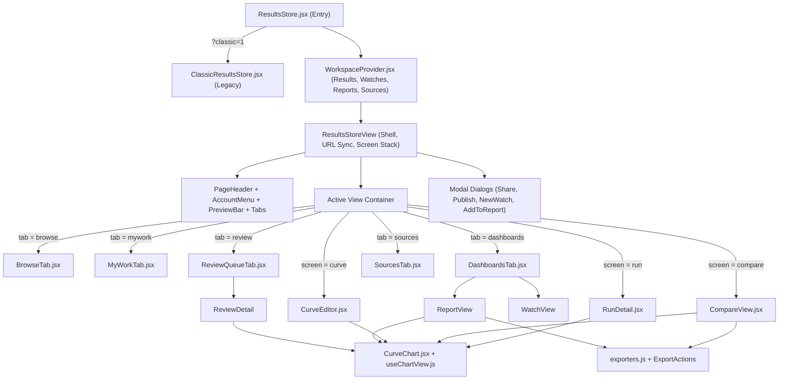
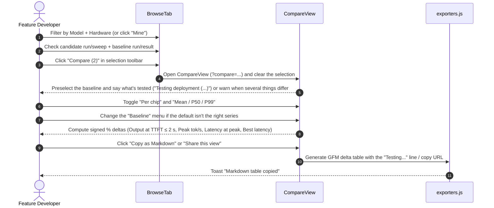
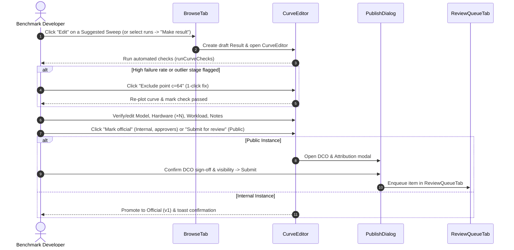

# Prism 2.0 — Results Store UI & CUJ Specification

- **Status**: Implemented on `prism2.0`
- **View ID**: `results-store` (`/?view=results-store`)
- **Entry & Modules**: [`src/components/ResultsStore.jsx`](../../../src/components/ResultsStore.jsx), [`src/components/ResultsStore/`](../../../src/components/ResultsStore/)

> Visual tokens (accent ramp, typography scale, surface classes, and the 7-series CVD-safe chart palette) are normative in [`skills/style.md`](../../../skills/style.md). This specification defines the domain objects, component architecture, screen-level UI contracts, and Core User Journeys (CUJs) of the Results Store.

---

## 1. Purpose & Domain Model

The **Results Store** is Prism's workspace for browsing raw benchmark runs, assembling multi-concurrency throughput–latency curves (**Results**), comparing runs side by side with baseline deltas, tracking nightly setups for regressions (**Watches**), and publishing cost-efficiency tables (**Reports**).

### 1.1 Core Entities

| UI Term | Code Identifier | Source / Storage | Mutability | Description |
| :--- | :--- | :--- | :--- | :--- |
| **Run** | `run` (`buildRuns` in [`catalog.js`](../../../src/components/ResultsStore/catalog.js)) | GCS buckets, `/api/results`, local IndexedDB (`staged`) | Read-only | A single measured benchmark execution (1 concurrency point or a multi-stage harness execution). Preserves separate `mean`, `p50`, and `p99` latency values per point. |
| **Sweep** | `row` with `kind: 'suggested'` (`buildRows` in [`catalog.js`](../../../src/components/ResultsStore/catalog.js)) | Derived automatically at runtime | Ephemeral until saved | A group of separate single-point runs that share `(model, hardware, workload, harness, deployment)` across ≥ 2 concurrency levels (`c=1, 8, 16…`). |
| **Result** | `curve` ([`WorkspaceProvider.jsx`](../../../src/components/ResultsStore/WorkspaceProvider.jsx)) | Workspace state (`localStorage` preview / server API target) | Editable (versioned) | A curated, named throughput–latency curve built from one multi-point run or a sweep of runs, with included/excluded points, clean labels, validation checks, and version history (`v1`, `v2`…). |
| **Watch** | `watch` ([`WorkspaceProvider.jsx`](../../../src/components/ResultsStore/WorkspaceProvider.jsx)) | Workspace state | Editable / Deletable | A regression monitor bound to a setup (`model · hardware ×N · workload · harness · deployment`, stored as `configKey`), a baseline (`Result` or pinned batch), a throughput target (`Output at TTFT ≤ 2 s` by default when the baseline has a point that fast, else `Peak`, or `at c=N`), and a drop threshold (`-3%` to `-15%`). Evaluated in the browser each time it's opened. |
| **Report** | `showcase` ([`WorkspaceProvider.jsx`](../../../src/components/ResultsStore/WorkspaceProvider.jsx)) | Workspace state | Editable / Deletable | A multi-result comparison and cost-sizing sheet that prices each result at a usable latency target (`TTFT ≤ 1s / 2s / 5s` or `Peak`) using GCP list prices or custom `$/chip-hr` rates. Holds results of any status; ones that aren't Official / Published are labelled `Unofficial` / `Unpublished`. |
| **Source** | `source` ([`SourcesTab.jsx`](../../../src/components/ResultsStore/SourcesTab.jsx)) | Workspace state + configured buckets | Admin-managed | A GCS or S3 bucket from which runs are ingested, tracked with health status (`ok`, `empty`, `stale`, `offline`) and Browse visibility. |

### 1.2 Instance Modes & Roles ([`instance.js`](../../../src/components/ResultsStore/instance.js))

The UI adapts its publishing workflow and terminology to the deployment mode (`VITE_PRISM_INSTANCE` or dev preview switcher):

| Aspect | **Internal Instance** (`internal`) | **Public Instance** (`public`) |
| :--- | :--- | :--- |
| **Published badge** | `Official` | `Published` |
| **Not yet published, in a report** | `Unofficial` | `Unpublished` |
| **Primary publish CTA** | `Mark official` (1-step promotion; **approvers only**: signed in and an admin, i.e. an llm-d org admin or on the admin allowlist). Everyone else sees *Only approvers can mark results official*, with `Sign in` when signed out | `Submit for review` (opens DCO & attribution dialog → moderator queue) |
| **Review Queue tab** | Hidden | Visible to reviewers and admins (`Review queue`) |
| **Visibility options** | `All of Prism` (`public`) or `Link only` (`unlisted`) |Reviewed public catalog (`public`) or direct share link (`unlisted`) |

---

## 2. Component Architecture & Navigation State

### 2.1 Navigation & Screen Stack

- **Five top-level tabs (`role="tablist"`)**:
  1. `Browse` (`browse`) — Default landing tab; houses the Sweeps strip, facet filters, and unified catalog list.
  2. `My results` / `My work` (`mywork`) — Personal drafts, uploaded runs, and review pipeline tracker.
  3. `Watches & reports` (`dashboards`) — Master-detail workspace for regression Watches and cost/throughput Reports.
  4. `Review queue` (`review`) — Moderator queue (shown only on the `public` instance for reviewers/admins).
  5. `Sources` (`sources`) — Cloud bucket registry and sync health (shown only for admins).
- **Stacked detail screens (`screen` + `screenStack`)**:
  - Opening a **Run** (`RunDetail`), **Compare** (`CompareView`), or **Result** (`CurveEditor`) replaces the active tab panel while keeping the origin tab highlighted in the tab bar.
  - Navigating from one detail screen to another (e.g., `Browse` → `Compare` → `Result Editor`, or `Result Editor` → `Run Detail`) pushes the prior screen onto `screenStack` so the top-left **Back** button pops back through the exact history trail.

### 2.2 URL & Deep-Link Contract

| Query Parameter | Values / Format | Behavior |
| :--- | :--- | :--- |
| `?view=results-store` | `'results-store'` | Mounts the Results Store view. |
| `?tab=` | `browse` \| `mywork` \| `dashboards` \| `review` \| `sources` | Selects the active top-level tab when no detail screen is open. |
| `?run=` | `<runKey>` | Opens `RunDetail` directly for the specified run. |
| `?curve=` | `<curveId>` | Opens `CurveEditor` directly for the specified Result. |
| `?compare=` | Comma-separated `r:<runKey>` and/or `c:<curveId>` tokens | Opens `CompareView` with the specified runs and/or Results loaded as series. |
| `?benchmarks=` | Compact URL-safe Base64 of `16 * N` UUID bytes | Legacy/compact share link support; resolves UUIDs and opens `CompareView`. |
| `?lat=` | `ttft` \| `tpot` \| `itl` \| `e2e` | Sets the plotted latency metric in `CompareView`. |
| `?stat=` | `mean` \| `p50` \| `p99` | Sets the plotted latency statistic in `CompareView`. |
| `?tp=` | `output` \| `total` | Sets the plotted throughput axis in `CompareView`. |
| `?q=` | Free-text string | Pre-fills the search box in `BrowseTab`. |
| `?classic=1` | `'1'` | Bypasses the Prism 2.0 workspace and mounts `ClassicResultsStore.jsx`. |

---

## 3. Screen & Component Specifications

### 3.1 Page Shell ([`ResultsStore.jsx`](../../../src/components/ResultsStore.jsx))

- **Header (`PageHeader`)**:
  - Kicker: `Prism toolkit` + instance badge (`Internal` or `Public`).
  - Title (`<h1>`): `Results store`.
  - Description: Dynamically summarizes catalog totals (`N runs · M official/published results across K models`).
  - Actions: `Glossary` (opens `GlossaryDialog`: *Words we use*, one sentence each for the things and numbers on these screens, plus a `How we measure` link that opens in a new tab), `AccountMenu` (GitHub sign-in or avatar/handle/role dropdown) and primary `Upload` CTA (routes to `submit-benchmarks` wizard).
- **Dev Preview Bar (`PreviewBar`, dev server only)**:
  - Two labelled `role="group"` toggles allowing instant testing of **Instance** (`Internal` vs `Public`) and **Role** (`Viewer`, `Contributor`, `Reviewer`, `Admin`) without redeploying.
- **Tab Bar (`Tabs`)**:
  - Keyboard-accessible `role="tablist"` (`←`/`→`/`Home`/`End`) with item count badges on `My results`, `Watches & reports`, `Review queue`, and `Sources`.
- **Toast Live Region**:
  - Top-right `aria-live="polite"` region, below the header, announcing asynchronous actions (`Share link copied`, `Marked official`, `Markdown table copied`, etc.). It sits clear of the bottom selection toolbar and the Result editor's action bar.

---

### 3.2 Browse Tab ([`BrowseTab.jsx`](../../../src/components/ResultsStore/BrowseTab.jsx))

Search and filters come first and narrow everything under them, the sweeps included.

1. **Search, Sort & Facet Bar (`
`)**:
   - Search input (`type="search"`, matches model, hardware, workload, harness, engine, deployment, notes, and run ID).
   - Sort dropdown: `Newest first`, `Oldest first`, `Highest throughput at TTFT ≤ 2 s` (rows that reach the limit first, then the rest by peak), `Highest peak throughput`, `Model A–Z`.
   - Multi-select `FilterPill` popovers (`role="listbox"`) for: **Source** (when >1 visible source), **Harness**, **Category**, **Model**, **Hardware**, **Workload**, and **Date** (`Last 24 hours`, `Last 7 days`, `Last 30 days`, `Last 12 months`).
   - `Mine` toggle button (`aria-pressed`) when signed in; `Clear filters` when any filter is active.
2. **Sweeps Strip (`<section aria-labelledby>` with an `<h2>`)**:
   - Highlights auto-detected multi-concurrency sweeps that match the search and filters and have not yet been saved as curated Results (a sweep that's Official, Published or In review leaves the strip). The heading reads `Sweeps`, or `Matching sweeps` while anything narrows the page.
   - Displays the 3 newest of them as `SuggestedCard` `<article>` cards. When there are more sweeps, `See all N sweeps` switches the list's kind filter to **Sweeps**, scrolls to the list and moves focus to it: the list is the one place that shows every sweep (there is no second, expanded grid).
   - Each card shows the title (`model · hardware ×N · workload · setup`), harness/source subtitle, a plain-SVG throughput–latency sparkline, `N runs · c=1–64`, the headline throughput (`6,099 tok/s at TTFT ≤ 2 s`, or `… tok/s peak` when TTFT wasn't recorded or every point is slower), and up to 3 actions: **Mark official / Submit for review** (only for people who may publish: approvers on the internal instance, the runs' owner on the public one), **Edit**, and **Compare with…**.
3. **Summary & Kind Bar**:
   - Live count (`N runs · K official results`, or `published` on the public instance). While a filter is active: `Watch this setup` when one setup is left (starts the watch directly), or `Watch a setup…` when several are (asks which).
   - Kind filter (`role="group"`): `All` · `Sweeps` · `Runs` · `Results`.
4. **Catalog Row List (`BrowseRow`)**:
   - Paginated in increments of 40 (`Show more`).
   - Each row renders: selection checkbox, title button (`model · hardware ×N · workload · setup`), kind badge (`Result`, `Sweep · N runs`, or `Run · N stages`), status chip (`Official`/`Published`, `Draft`, `In review`), meta line (`harness · source · category`), headline throughput with its label and load range (`6,099 tok/s` over `at TTFT ≤ 2 s · 1–9 req/s`), relative date, and repeat count (`×N`).
   - One control per action: the title opens a run or Result (and expands a sweep), so rows have no separate **Open** button; `×N` is a plain count and the chevron (`aria-expanded`) is the only expand control. Only sweep rows carry action buttons: **Edit** and **Mark official / Submit for review** for curators, **Open result** once it's a Result, otherwise **Compare with…**.
   - Under **All**, a sweep already published as a listed Result shows once, as that Result's row; one with other batches stays so they remain in reach. The **Sweeps** filter still lists every sweep, with its status chip.
   - Sweeps and repeated runs expand inline (`aria-expanded`) to show `RepeatsList` with individual concurrency stages or historical repeats.
5. **Sticky Bulk Selection Toolbar (`role="toolbar" aria-label="Selection actions"`)**:
   - Appears at the bottom of the viewport when ≥ 1 row is checked. Counts the selection, and how many checked rows the current filters hide (`4 selected · 3 hidden by filters`).
   - Actions: **Compare**, **Make result** (when selected runs form a concurrency sweep of one setup), and **Clear**. Opening Compare clears the selection; sharing happens there (**Share this view**), once the comparison has been seen. Publishing a sweep in one step clears it too.

---

### 3.3 My Results / My Work Tab ([`MyWorkTab.jsx`](../../../src/components/ResultsStore/MyWorkTab.jsx))

Organizes the signed-in user's items into up to 5 status sections (empty sections are omitted):
1. **Needs changes** *(Public instance)* — Items returned by a reviewer with a feedback note and a **Fix** action that opens `CurveEditor`.
2. **Drafts** — Unofficial/unpublished Results saved in the workspace, with **Edit** and **Mark official / Submit for review** actions.
3. **In review** *(Public instance)* — Submitted items displaying a 4-step `<ol>` `Timeline` (`Submitted` → `Automated checks` → `In review` → `Published`).
4. **Uploaded runs** — Raw runs staged locally (`IndexedDB`) or uploaded by the user, with **View run** and **Make result** actions.
5. **Official / Published by me** — Live Results credited to the user, each with who marked or approved it and when.

Rows don't repeat what their section already says: **Drafts** and **Uploaded runs** rows carry no status chip, and a draft shows a visibility chip only once it has been shared. Sections that mix statuses or audiences (**Needs changes**, **In review**, **Official / Published by me**) keep their chips, since those tell the rows apart.

---

### 3.4 Watches & Reports Tab ([`DashboardsTab.jsx`](../../../src/components/ResultsStore/DashboardsTab.jsx))

Uses a two-column layout: a left `<nav aria-label="Watches and reports">` navigation list (with `+ New` buttons for Watch and Report and `aria-current="true"` on the active item) and a right `<section>` detail pane.

#### 3.4.1 Watch View (`WatchView`)
- **Header**: Kicker `Watch`, `<h2>` title, setup badge (omitted when the Watch title already contains the setup label), baseline summary (`Baseline: <name> · Output at TTFT ≤ 2 s / Peak output throughput / Output throughput at c=N · flag drops of -X% or worse`, plus `· TTFT +20% & error ≥ 5% guard` when the guard is enabled), live status badge (`N flagged`, `No drops past threshold`, or `Waiting for the next batch`), **Edit** (toggles an inline editor for Watch name, baseline, metric, threshold, and latency/error-rate guard), and **Delete**. Its sidebar entry reads *Re-checks when you open it*: nothing runs in the background and nothing alerts yet.
- **Trend Chart (`Change vs. baseline`)**: Time-series chart plotting `%` change per date batch against a `0%` line and dashed `-X%` threshold line. While only the baseline batch exists, an `EmptyState` titled `No trend yet` explains how subsequent batches will be compared.
- **Batch History Table**: Columns for `Date`, `Runs` (clickable to open the batch in `RunDetail` or `CompareView`), `Output` (`Output at TTFT ≤ 2 s` on usable watches; a batch with no point that fast reads `none ≤ 2 s` and counts as a drop), `Baseline`, `Change` (signed `%`), `Status` (`Baseline batch`, `Flagged`, `OK`, with inline flag reasons such as `output -8.2% · TTFT +24.0% · 6.2% failed`), and **Compare with baseline** on every non-baseline batch (secondary style when flagged), which opens the batch beside its baseline in `CompareView`.

#### 3.4.2 Report View (`ReportView`)
- **Header**: Kicker `Report`, `<h2>` title, optional description, a visibility line (*Only you can open this report* / *Anyone with the link can open this report*), **Share** (sets the report to link-openable and copies the link in one action; a second control sets it back to private), **ExportActions** (`Download CSV`, `Copy as Markdown`), **Edit** (toggles inline inputs for Report name and description), and **Delete**. *(Share and the visibility line arrive with the server-side records; see [design.md §4.5](design.md).)*
- **Fairness Notice**: Warns automatically if the Results in the report use different models or workloads.
- **Unofficial Notice & labels**: A report can hold Results of any status. Ones that aren't Official / Published carry an `Unofficial` / `Unpublished` badge in the cost table (actual status in its tooltip), the same suffix in the chart legend, `Unofficial (Draft)` in the CSV `Status` column, and `(Unofficial)` plus a footnote in Markdown. A notice says their points and labels can still change.
- **Overlay Chart (`CurveChart`)**: Plots all Results in the report with `TTFT | TPOT | ITL | E2E`, `Mean | P50 | P99`, `Output | Total`, and `Per chip` controls.
- **Cost & Sizing Panel (`Cost at …`)**:
  - **Per chip switch & Price at selector (`role="group"`)**: A `Per chip` `Switch` toggles the cost table's throughput column (and Markdown export) between total `Output (tok/s)` and `Output per chip (tok/s)`, alongside `Price at` (`TTFT ≤ 1 s` · `TTFT ≤ 2 s` · `TTFT ≤ 3 s` · `TTFT ≤ 5 s` · `Peak`).
  - **Per-accelerator rate inputs**: One numeric input per distinct accelerator family in the report (`<Accel> $ per chip-hour`). Pre-populates from the user's Leaderboard custom rate (`prism_custom_prices`) or the shared `pricingEngine` GCP list price (e.g., `$3.67` for H100, `$2.93` for A100, `$0.70` for L4, `$2.70` for TPU v6e), stating the price source once in the input's helper text (`GCP list price for H100. Enter what you pay to override it.`) and `title`. Accelerators without a catalog list price (`B200`, `H200`, `MI300X`, `L40S`, `TPU7x`) leave the input blank until entered.
  - **Cost Table**: Columns for `Result`, `Accelerator`, `Chips` (derived from the Result's hardware label so relabelling `×1` → `×8` updates cost immediately), `Output (tok/s)` or `Output per chip (tok/s)`, `$/chip-hr`, `$/1M output tokens`, `Tokens per $`, and a remove action.

---

### 3.5 Review Queue Tab ([`ReviewQueueTab.jsx`](../../../src/components/ResultsStore/ReviewQueueTab.jsx))

Visible to reviewers and admins on the `public` instance.
- **Queue List**: Ordered oldest-first so submissions don't starve. Shows item title, submitter `@handle`, submission date, automated check summary (`All checks passed` or `N warnings`), and **Review** button.
- **Review Detail (`ReviewDetail`)**:
  - **Header**: Submitter attribution, DCO sign-off status, and 3 decision buttons: **Decline**, **Request changes**, and **Approve & publish**.
  - **Decision Drawer**: When `Decline` or `Request changes` is clicked, expands a panel with 5 quick-select reason chips (`Missing manifest`, `Outlier point included`, `Wrong hardware label`, `Duplicate submission`, `Incomplete sweep`) and a required/optional note `<textarea>`.
  - **Comparison Chart (`Against published results`)**: Overlays the submitted curve (solid line) against existing published Results for the same setup (dashed baseline lines) with full `CurveChart` metric/statistic/per-chip controls.
  - **Inspection Panels**: `Metadata` (`<dl>`), `Validation signals` (`CheckList`), and `Lineage & attribution` (`<ol>`).

---

### 3.6 Sources Tab ([`SourcesTab.jsx`](../../../src/components/ResultsStore/SourcesTab.jsx))

Visible to admins.
- **Registered Sources Table**: Lists each cloud bucket with `Source` name/URI, `Harness`, `Runs` count, `Newest run` date, `Health` chip (`Healthy`, `Stale`, `No runs`, `Sync failed`, `Not synced` from [`sourceHealth.js`](../../../src/components/ResultsStore/sourceHealth.js)), a `role="switch"` toggle (`Show in Browse`), and a remove button for custom sources.
- **Register a Source Panel**: Form with storage provider toggle (`GCS` | `S3`), `Name` input, `Bucket` input, and `Register` button with `role="status"` / `role="alert"` feedback scoped to registration attempts in the current session (so background sync errors already shown in the table's `Health` column aren't repeated under the form).

---

### 3.7 Detail Screens

#### 3.7.1 Run Detail ([`RunDetail.jsx`](../../../src/components/ResultsStore/RunDetail.jsx))
- **Header**: `BackButton` naming its destination (`Back to Browse`, `Back to the comparison`…), kicker `Run`, `<h2>` title (`model · hardware ×N · workload · setup`), provenance badges (`harness`, `source`, `category`, `date`, `run ID`), and actions (`Compare with…`, `Watch this setup`, `Share`, `Make result` / `Edit sweep`, and `Publish` for people who may publish).
- **Single-Point vs. Multi-Point Body**:
  - *Single-point run*: Renders a 5-tile KPI `<dl>` (`Output`, `TTFT <stat>`, `TPOT <stat>`, `E2E <stat>`, `Failed requests`) where every latency label explicitly names its underlying statistic (`mean` or `p50`). If the run belongs to a sweep, `CurveChart` draws the sweep with this run as its own series (*It's part of a sweep (c=1–64).*). If not, there's no chart, only a note: *This run measured one load level (c=N), so there's no curve to draw. Use Compare with… to see it next to other runs.*
  - *Multi-point run*: Renders `CurveChart` in load order (§3.8) with `TTFT | TPOT | ITL | E2E`, `Mean | P50 | P99`, `Output | Total`, and `Per chip` controls. The subtitle gives stages, load range, peak and usable throughput (`14 stages · 1–9 req/s · peak 6,363 tok/s · 6,099 tok/s at TTFT ≤ 2 s`). When `loadChecks` flags points, a warning `Notice` names them (*The 7 req/s stage looks overloaded: …*) and suggests making a result to exclude them, or, for people who can't curate, keeping it in mind before quoting the peak.
- **Run Details Tabbed Panel (`role="tablist"`)**:
  - `Metadata`: `<dl>` (`MetaGrid`) of model, accelerator, chip count, workload (`1000/1000 as configured · measured 3209/865 on average`, or `about 7200/1000 · measured …` when grouped from measurements), concurrency or stages, harness, deployment (the stack's full label where the report has one), and source path.
  - `Configs & logs`: Synthesized `Reproduce this run` CLI command block (`reproduceCommand(run)`) with a `Copy command` button, followed by the raw JSON report preview (`<pre>`) and direct link to the cloud bucket folder.
  - `Lineage`: 3-step `<ol>` (`Measured` → `Ingested` → `Grouped`) plus links to any curated Results that include this run.

#### 3.7.2 Compare View ([`CompareView.jsx`](../../../src/components/ResultsStore/CompareView.jsx))
- **Header**: Kicker `Compare`, `<h2> N series`, and actions (`Make result` when series form a valid sweep, `Share this view`, `Add to report`). `Add to report` is always available: Results go in as they are; runs and sweeps go in as the Result already made from exactly those runs, or a new draft (created only when the dialog adds them). Opening Compare clears the Browse selection.
- **Baseline menu** (`<label>Baseline</label>` + `<Select>`, shown with ≥ 2 series): Lists every series by title, followed by *Every Δ below is measured against it.* Default order: the series picked here, else the one added last via **Add baseline**, else an Official Result, else the series whose name reads most like a baseline (`baseline`, then `standard` / `vanilla` / `plain`, then `none` / `no scorer`, then `default` / `base`), else the first series.
- **Framing Notice** (`seriesParity` + `parityFraming`):
  - Compares 7 fields grouped into axes: `model`; serving (`accelerator`, `chip count`, `deployment`, `serving engine`, which usually change together); `workload (ISL/OSL)`; `harness`.
  - *Repeat* (nothing differs, info): `Same setup in every series (…), so the differences are run-to-run variation.`
  - *Test* (one axis differs, info): `Testing deployment (standard-k8s → precise-prefix-cache-routing). Same model, accelerator, chip count, workload (ISL/OSL) and harness.` The baseline's value comes first.
  - *Mixed* (several axes differ, warning): lists every difference, since no gap can be pinned on one of them.
  - Appends *Chip counts differ, so turn on Per chip to compare per accelerator.* while **Per chip** is off. A repeat or a test also names fields not recorded for every series. With a single series: *Add a baseline to see what changed.*
- **Chart (`CurveChart`)**:
  - Header includes `ExportActions` (`Download CSV`, `Copy as Markdown`; the Markdown carries the framing line) and an `Add baseline` combobox (`role="combobox"`) listing every run, sweep and Result, ranked by setup closeness (`rankBaselines`: same model, then hardware, chips, workload, harness) with a filter box. The pick is drawn dashed and becomes the Δ baseline.
  - Controls: `TTFT | TPOT | ITL | E2E` · `Mean | P50 | P99` · `Output | Total` · `Per chip`.
- **Against the Baseline Table**:
  - One series is the `baseline` (selected via the **Baseline** menu above).
  - Columns: `Series` (swatch, title, kind badge, `baseline` badge), `Points`, `<Throughput> at TTFT ≤ 2 s` + signed `%` delta, `Peak <throughput>` + signed `%` delta, `<Latency stat> at peak` + signed `%` delta, `Best <latency stat>` + signed `%` delta, and row action (`Remove`).
  - Delta semantics: Higher throughput or lower latency renders in emerald green; lower throughput or higher latency renders in rose red, with `.sr-only` `(better)` / `(worse)` annotations for screen readers.

#### 3.7.3 Result Editor (`CurveEditor.jsx`)
- **Lifecycle Banner**: Contextual banner when the Result is `In review`, `Needs changes` (showing reviewer feedback), or `Superseded` (with a button to jump to the newest version `vN`).
- **Header**: Status chip, visibility chip (shown when shared or public; omitted on private `Only me` drafts since `Draft` already implies private), version badge (`v1`, `v2`), `Featured` badge, last-saved time (`Saved HH:MM`), editable name `<input>` (with a visually hidden `<h2>` for heading hierarchy) or read-only `<h2>`, and attribution subtitle.
- **Points & Curve Grid**:
  - Left (`Points` panel): List of stages in load order (`c=1`, `c=8`, `c=16`… or `1 req/s`, `2 req/s`… for rate sweeps), with a subtitle naming the order. Each row shows `tok/s`, explicit latency statistic (`759 ms TTFT p50` or `TTFT mean`), error rate badge if `> 0%`, a link to inspect the underlying Run, and an include/exclude toggle button (requires ≥ 2 included points).
  - Right (`CurveChart`): Live curve preview updating immediately as points are toggled or labels edited, plus baseline overlay chips (`Baseline: <name>`). **Add baseline** ranks candidates by setup closeness (`rankBaselines`) and adds a filter box when there are more than 8.
- **Labels & Metadata Panel**:
  - When editable: inputs (with `<datalist>` autocomplete from catalog vocabulary) for `Model`, `Hardware` (editing `×N` immediately recomputes `tok/s/chip` across all points), `Workload (ISL/OSL)`, `Category`, and `Notes`, alongside a read-only `MetaGrid` of measured fields (`Harness`, `Deployment`, `Concurrency range`, `Workload (measured)`, `Source runs`).
  - When read-only (published/in-review Results): renders all labels, notes, and measured fields cleanly in a single `<dl>` (`MetaGrid`) instead of disabled form controls.
- **Validation Checks & Lineage Grid**:
  - Left (`Checks` panel): Runs `runCurveChecks(curve)` checking for minimum points, load order (`Points ordered by concurrency` / `by request rate`), request failure rate (`> 5%` offers a 1-click **Exclude point c=N** fix), overloaded and out-of-line points (§3.8, each with **Exclude point**), saturation/knee coverage, mixed models/workloads, and baseline presence.
  - Right (`Lineage` panel): `<ol>` version/audit history (`Created`, `Edited`, `Marked official`, `Approved`); individual source run links live in the `Points` list above.
- **Footer Action Bar** (sticky at the bottom of the viewport while the editor scrolls): `Discard draft` (with confirmation modal), `Edit as new version` (for already-official Results), `Watch this setup`, `Add to report` (any status, drafts included), `Feature on Browse` (admins), `Share`, and primary `Mark official` / `Submit for review`. On the internal instance only approvers see `Mark official`; everyone else sees *Only approvers can mark results official*, plus `Sign in` when signed out. On the public store, anyone can open a catalog sweep as a local sandbox draft; if the draft's runs aren't owned by the user, the footer shows *Catalog draft · only your own uploaded runs can be submitted for review* alongside `Submit results`.

---

### 3.8 Shared Chart & Data Layer Rules ([`catalog.js`](../../../src/components/ResultsStore/catalog.js), [`useChartView.js`](../../../src/components/ResultsStore/useChartView.js), [`exporters.js`](../../../src/components/ResultsStore/exporters.js))

1. **Honest Latency Statistics**:
   - Every point stores `lat: { ttft: { mean, p50, p99 }, tpot: { mean, p50, p99 }, itl: { mean, p50, p99 }, e2e: { mean, p50, p99 } }` plus legacy scalar fields (`ttft`, `tpot`, `itl`, `e2e`) and `latStat` (`{ ttft: 'p50' | 'mean', … }`).
   - **Corrupted alias scrubbing**: In v0.2 archives where `p50` was synthesized by copying `mean` (`p50 === mean`) or written as `0`, `p50` is treated as missing (`null`). Where `p99` is smaller than `p50` or `< 0.5 × mean` (seconds-vs-milliseconds unit mix-up), `p99` is dropped (`null`).
   - **Default statistic selection (`defaultLatencyStat`)**: A chart opens on `P50` **only** if every plotted series has genuine `p50` values for the active metric; otherwise it opens on `Mean` so a chart never silently mixes `p50` and `mean` across curves.
   - If a user explicitly selects a statistic (e.g. `P99`) that some series lack, `CurveChart` displays a warning notice naming the omitted series.
2. **Setup Identity: Chips, Workload, Deployment** (`buildRuns`, `reportChips`, `workloadOf`, `unifyWorkloads`, `reportSetupOf`):
   - **Chip count**: For benchmark reports, total chips = accelerators per replica × replicas, and a TPU slice counts its topology (`tpu7x-2x2x1` → 4). Otherwise `accelCount` is resolved once per run (`mostCommon(list.map(accelCountOf).filter(n => n > 1)) || accelCountOf(d0)`) and passed to every stage, so stages that omit `accelerator_count` don't fall back to `1` chip.
   - **Workload**: Configured lengths win: the archive `variant` (e.g. `1000/1000`), else the `run_<ISL>_<OSL>` treatment in the run ID, else, for benchmark reports, one group per load config (`scenario.load.metadata.cfg_id`) and model. Anything else groups near-equal measured means (ISL within 4%, OSL within 12%). A group's label is exact when every run agrees, else the median rounded to 2 significant figures. Run Metadata shows both (`1000/1000 as configured · measured 3209/865 on average`).
   - **Deployment**: A report's stack label becomes `setup` (the text before the first comma or parenthesis) with the full label in `setupDetail`; an unlabelled stack is named by its shape (`2 TP4`, `1P-TP4 3D-TP4`).
   - **Titles and keys**: Titles read `model · hardware ×N · workload · setup`. `configKeyOf` covers model, hardware, workload, harness and setup. Watches store it and re-match with `sameSetup` (workload within the same tolerance), falling back to their baseline runs' current key when labels change.
   - **Each stage once**: A report stage that arrives through two loaders is kept once.
3. **Load Order** (`loadOrder`): Points are ordered by concurrency, else by request rate (`workload.target_qps`, kept as `point.rate`), else by output throughput. `CurveChart` draws points in array order. Rate stages are named `7 req/s` in checks, the Points list and the run page.
4. **Usable Throughput** (`pricingPoint`, `OPERATING_TTFT_MS = 2000`): The highest output at TTFT ≤ 2 s leads Browse rows and cards (falling back to `peak`, labelled), is the first delta column in Compare, the default Watch metric, and report pricing at `TTFT ≤ 2s`. Browse can sort by it: rows that reach the limit first, then the rest by peak.
5. **Load Checks** (`loadChecks`): A point is *overloaded* when its TTFT (E2E when fewer than two points have TTFT) is ≥ 5× the last healthy point's for ≤ 1.25× its throughput. Each point is compared with the last healthy one, so every point past saturation is flagged, not just the first. In sweeps with a load order, a healthy point is *out of line* when it's > 1.5× and > 250 ms slower than the next heavier point. Both offer **Exclude point**; `RunDetail` warns about overloaded tails.
6. **Spreadsheet-Safe Exports (`exporters.js`)**:
   - `compareToCsv` and `reportToCsv` include UTF-8 BOM (`\uFEFF`), quote fields containing delimiters, and prefix formula-triggering characters (`=`, `+`, `-`, `@`, `\t`, `\r`) on text cells with `'` to prevent CSV formula injection while leaving negative numbers intact.

---

## 4. Core User Journeys (CUJs)

### CUJ 1: Feature Developer — Validate an Optimization Against a Baseline

> **Persona Goal**: Prove a new llm-d optimization beats or matches a baseline fairly and share the evidence in a PR.

1. **Discover**: In **Browse**, filter by `Model` and `Hardware` (or search for the feature branch/deployment tag). Titles end with the deployment, so the candidate and the baseline are easy to tell apart.
2. **Select & Compare**: Check the candidate sweep/run and the baseline run/Result, then click **Compare** in the bottom selection toolbar. The toolbar says how many checked rows the filters hide, and opening Compare clears the selection.
3. **Read the framing**: The line under the **Baseline** menu says what the comparison tests: `Same setup in every series (…), so the differences are run-to-run variation`; `Testing deployment (standard-k8s → precise-prefix-cache-routing). Same model, accelerator, chip count, workload (ISL/OSL) and harness.`; or a warning that lists several differences. When chip counts differ (e.g., `×4` vs `×16`), it suggests **Per chip**.
4. **Read Deltas**: The baseline is preselected (§3.7.2); change it in the **Baseline** menu if needed. In **Against the baseline**, read the green/red `%` deltas for output at TTFT ≤ 2 s, peak throughput, latency at peak, and best latency across `Mean`, `P50`, and `P99`.
5. **Share**: Click **Copy as Markdown** to paste the comparison table, with its "Testing…" line, into a GitHub PR, or **Share this view** to copy a deep link preserving the series, metric, and statistic.

---

### CUJ 2: Benchmark Developer — Curate a Sweep into an Official / Published Result

> **Persona Goal**: Turn raw single-concurrency runs or an auto-detected sweep into a validated, versioned throughput–latency curve.

1. **Start from a Sweep**: In **Browse**, locate an auto-grouped card in the **Sweeps** strip and click **Edit** (or select multiple single-point runs in the list and click **Make result**).
2. **Curate Points**: In **Result Editor (`CurveEditor`)**, inspect the **Points** list (in load order: `c=N` or `N req/s`) and the **Checks** panel. If a stage had `> 5%` failed requests, looks overloaded (latency up 5× or more for little extra throughput), or is out of line with the next heavier stage, click the 1-click **Exclude point** action in the check row.
3. **Refine Metadata**: Standardize the `Model`, `Hardware` (including `×N` chip count), `Workload`, and `Category` labels, and use **Add baseline** to overlay an existing published Result as a dashed curve.
4. **Publish**:
   - On an **Internal** instance: an approver (signed in and an admin) clicks **Mark official** to publish immediately (`v1`). Anyone else keeps a draft, which they can still compare and add to reports (marked `Unofficial`).
   - On a **Public** instance: click **Submit for review**, complete the **DCO v1.1** sign-off and visibility choice (`Public` vs `Link only`) in `PublishDialog`, and track progress in **My results**.

---

### CUJ 3: Solutions Architect / Config Tuner — Build a Price/Performance Sizing Report

> **Persona Goal**: Compare candidate serving stacks under a customer latency SLO (`TTFT ≤ 2s`) and produce a cost-per-million-tokens table.

1. **Assemble Report**: From **Compare** (any runs, sweeps or Results) or the **Result Editor** (any status), click **Add to report**. Nothing has to be published first: Results that aren't Official are marked `Unofficial` in the report. (`+ New` under **Report** creates an empty report to add to.)
2. **Set Latency SLO Target**: In **ReportView**, set **Price at** to `TTFT ≤ 1s`, `TTFT ≤ 2s`, `TTFT ≤ 5s`, or `Peak`. Each Result is evaluated at its highest-throughput concurrency point that satisfies the latency bound.
3. **Review or Override Hardware Rates**: Each accelerator's `$/chip-hr` input is pre-filled from the user's Leaderboard custom prices or the `pricingEngine` GCP list price (with source attribution). Override any rate to reflect customer committed-use discounts.
4. **Export Deliverable**: Inspect `$/1M output tokens` and `Tokens per $` across stacks, then click **Download CSV** or **Copy as Markdown** to include in a customer sizing document.

---

### CUJ 4: Stack Operator — Monitor a Setup for Nightly Regressions

> **Persona Goal**: Track a production setup across nightly batches and triage throughput drops against a known-good baseline.

1. **Create Watch**: Filter **Browse** until one setup is left and click **Watch this setup** (with several left, **Watch a setup…** asks which), or click **Watch this setup** on any `RunDetail` or `CurveEditor` page.
2. **Configure Threshold**: In `NewWatchDialog`, choose the baseline (an Official Result or the newest batch), the metric (`Output at TTFT ≤ 2 s`, the default when the baseline has a point that fast; `Peak output throughput`; or `Output at c=N`), and the threshold (`-3%`, `-5%`, `-10%`, `-15%`). A line under the metric says what it measures.
3. **Inspect Trend & Triage**: In **Watches & reports** → `WatchView`, inspect the `Change vs. baseline` trend line and batch table; the watch re-checks each time it's opened. Any batch dropping below `-X%` is badged `Flagged`. Click **Compare with baseline** on its row (emphasised when flagged) to open the batch beside its baseline in `CompareView`, or click its run count to open `RunDetail` / `CompareView`.

---

### CUJ 5: Community Reviewer — Moderate a Submitted Benchmark (Public Instance)

> **Persona Goal**: Verify that a community-submitted Result has clean telemetry, valid metadata, and DCO sign-off before promoting it to the public catalog.

1. **Open Queue**: Navigate to **Review queue** (`?tab=review`), which lists pending submissions oldest-first with automated check summaries.
2. **Inspect Submission**: Click **Review** to open `ReviewDetail`. Compare the submitted curve against existing published results on the overlay chart (toggling `Mean | P50 | P99` and `Per chip`), and review `Metadata`, `Validation signals`, and `Lineage & attribution`.
3. **Record Decision**:
   - Click **Approve & publish** to promote the Result to `Published`.
   - Or click **Request changes** / **Decline**, select one or more structured reason chips (`Outlier point included`, `Missing manifest`, etc.), add reviewer notes, and submit so the author sees the actionable feedback in **My results** → `Needs changes`.

---

### CUJ 6: Platform Admin — Manage Cloud Benchmark Sources

> **Persona Goal**: Connect GCS/S3 benchmark buckets, monitor ingestion health, and control which sources appear in Browse.

1. **Inspect Health**: Open **Sources** (`?tab=sources`) to view each bucket's run count, newest run timestamp, and health badge (`Healthy`, `Stale`, `Empty`, `Offline`).
2. **Control Visibility**: Toggle **Show in Browse** (`role="switch"`) on any source to hide noisy or staging buckets from the default catalog without deleting their runs.
3. **Register Bucket**: In **Register a source**, select `GCS` or `S3`, enter a display name and bucket/prefix URI, and click **Register**.

---

## 5. Semantic HTML & Accessibility Contract

Every screen in the Results Store enforces the following structural invariants (verified by `scratch/verify_semantics.mjs` and `scratch/verify_results_fixes.mjs`):

1. **Single `<main>` Landmark**: `App.jsx` provides the document `<main>`; `ResultsStoreView` renders its inner container as a `
` so `<main>` is never nested.
2. **Complete ARIA Tabs Contract**: Both the top-level navigation tabs and `RunDetail`'s sub-tabs wire `role="tablist"` → `role="tab"` (`id`, `aria-selected`, `aria-controls`, roving `tabIndex`) → `role="tabpanel"` (`id`, `aria-labelledby`).
3. **Strict Heading Hierarchy (`<h1>` → `<h2>` → `<h3>`)**:
   - `<h1>`: `Results store` in `PageHeader`.
   - `<h2>`: Every tab section (`Sweeps` / `Matching sweeps`, the visually hidden `Runs`, `My results` sections, `Watch` / `Report` title, `Review queue`, `Sources`) and every detail screen (`Run` title, `Compare` series count, `Result` name).
   - `<h3>`: Every `Panel`, `ChartContainer`, and `Modal` dialog title.
4. **Labelled Controls & Groups**:
   - Every `ToggleGroup` (`Latency metric`, `Latency statistic`, `Throughput metric`, `Filter by item kind`, `Price at latency target`, `Storage provider`) carries an explicit `aria-label`.
   - Every table action column uses `<th scope="col">Actions</th>`.
5. **Accessible Charts**:
   - Every `CurveChart` and `WatchView` trend chart renders an `.sr-only` `<table>` with a descriptive `<caption>` naming the plotted axes and units, so screen-reader users can inspect every concurrency point and series without relying on SVG paths.
6. **Live Announcements**:
   - Asynchronous status changes, form feedback (`SourcesTab`, `ReviewQueueTab`), and clipboard/export actions announce via `role="status"` / `role="alert"` / `aria-live="polite"`.
