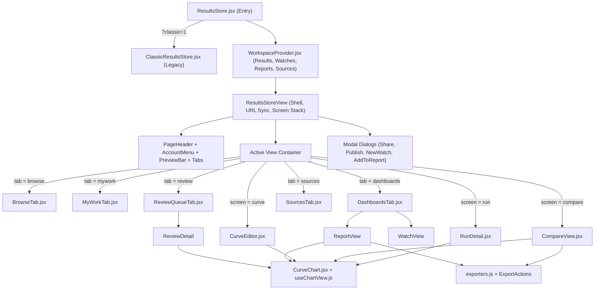
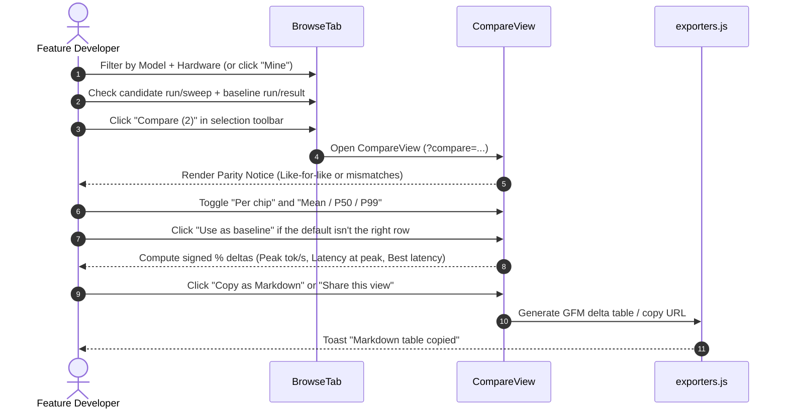

# Prism 2.0 — Results Store UI & CUJ Specification

- **Status**: Implemented on `prism2.0`
- **View ID**: `results-store` (`/?view=results-store`)
- **Entry & Modules**: [`src/components/ResultsStore.jsx`](../../../src/components/ResultsStore.jsx), [`src/components/ResultsStore/`](../../../src/components/ResultsStore/)

> Visual tokens (accent ramp, typography scale, surface classes, and the 7-series CVD-safe chart palette) are normative in [`skills/style.md`](../../../skills/style.md). This specification defines the domain objects, component architecture, screen-level UI contracts, and Core User Journeys (CUJs) of the Results Store.

---

## 1. Purpose & Domain Model

The **Results Store** is Prism's workspace for browsing raw benchmark runs, assembling multi-concurrency throughput–latency curves (**Results**), comparing runs side by side with baseline deltas, tracking nightly setups for regressions (**Watches**), and publishing cost-efficiency tables (**Reports**).

### 1.1 Core Entities

| UI Term | Code Identifier | Source / Storage | Mutability | Description |
| :--- | :--- | :--- | :--- | :--- |
| **Run** | `run` (`buildRuns` in [`catalog.js`](../../../src/components/ResultsStore/catalog.js)) | GCS buckets, `/api/results`, local IndexedDB (`staged`) | Read-only | A single measured benchmark execution (1 concurrency point or a multi-stage harness execution). Preserves separate `mean`, `p50`, and `p99` latency values per point. |
| **Sweep** | `row` with `kind: 'suggested'` (`buildRows` in [`catalog.js`](../../../src/components/ResultsStore/catalog.js)) | Derived automatically at runtime | Ephemeral until saved | A group of separate single-point runs that share `(model, hardware, workload, harness, deployment)` across ≥ 2 concurrency levels (`c=1, 8, 16…`). |
| **Result** | `curve` ([`WorkspaceProvider.jsx`](../../../src/components/ResultsStore/WorkspaceProvider.jsx)) | Workspace state (`localStorage` preview / server API target) | Editable (versioned) | A curated, named throughput–latency curve built from one multi-point run or a sweep of runs, with included/excluded points, clean labels, validation checks, and version history (`v1`, `v2`…). |
| **Watch** | `watch` ([`WorkspaceProvider.jsx`](../../../src/components/ResultsStore/WorkspaceProvider.jsx)) | Workspace state | Editable / Deletable | A regression monitor bound to a setup (`model · hardware · workload`), a baseline (`Result` or pinned batch), a throughput target (`Peak` or `at c=N`), and a drop threshold (`-3%` to `-15%`). |
| **Report** | `showcase` ([`WorkspaceProvider.jsx`](../../../src/components/ResultsStore/WorkspaceProvider.jsx)) | Workspace state | Editable / Deletable | A multi-result comparison and cost-sizing sheet that prices each result at a usable latency target (`TTFT ≤ 1s / 2s / 5s` or `Peak`) using GCP list prices or custom `$/chip-hr` rates. |
| **Source** | `source` ([`SourcesTab.jsx`](../../../src/components/ResultsStore/SourcesTab.jsx)) | Workspace state + configured buckets | Admin-managed | A GCS or S3 bucket from which runs are ingested, tracked with health status (`ok`, `empty`, `stale`, `offline`) and Browse visibility. |

### 1.2 Instance Modes & Roles ([`instance.js`](../../../src/components/ResultsStore/instance.js))

The UI adapts its publishing workflow and terminology to the deployment mode (`VITE_PRISM_INSTANCE` or dev preview switcher):

| Aspect | **Internal Instance** (`internal`) | **Public Instance** (`public`) |
| :--- | :--- | :--- |
| **Published badge** | `Official` | `Published` |
| **Primary publish CTA** | `Mark official` (1-step immediate promotion) | `Submit for review` (opens DCO & attribution dialog → moderator queue) |
| **Review Queue tab** | Hidden | Visible to reviewers and admins (`Review queue`) |
| **Visibility options** | `All of Prism` (`public`) or `Link only` (`unlisted`) |Reviewed public catalog (`public`) or direct share link (`unlisted`) |

---

## 2. Component Architecture & Navigation State

### 2.1 Navigation & Screen Stack

- **Five top-level tabs (`role="tablist"`)**:
  1. `Browse` (`browse`) — Default landing tab; houses the Sweeps strip, facet filters, and unified catalog list.
  2. `My results` / `My work` (`mywork`) — Personal drafts, uploaded runs, and review pipeline tracker.
  3. `Watches & reports` (`dashboards`) — Master-detail workspace for regression Watches and cost/throughput Reports.
  4. `Review queue` (`review`) — Moderator queue (shown only on the `public` instance for reviewers/admins).
  5. `Sources` (`sources`) — Cloud bucket registry and sync health (shown only for admins).
- **Stacked detail screens (`screen` + `screenStack`)**:
  - Opening a **Run** (`RunDetail`), **Compare** (`CompareView`), or **Result** (`CurveEditor`) replaces the active tab panel while keeping the origin tab highlighted in the tab bar.
  - Navigating from one detail screen to another (e.g., `Browse` → `Compare` → `Result Editor`, or `Result Editor` → `Run Detail`) pushes the prior screen onto `screenStack` so the top-left **Back** button pops back through the exact history trail.

### 2.2 URL & Deep-Link Contract

| Query Parameter | Values / Format | Behavior |
| :--- | :--- | :--- |
| `?view=results-store` | `'results-store'` | Mounts the Results Store view. |
| `?tab=` | `browse` \| `mywork` \| `dashboards` \| `review` \| `sources` | Selects the active top-level tab when no detail screen is open. |
| `?run=` | `<runKey>` | Opens `RunDetail` directly for the specified run. |
| `?curve=` | `<curveId>` | Opens `CurveEditor` directly for the specified Result. |
| `?compare=` | Comma-separated `r:<runKey>` and/or `c:<curveId>` tokens | Opens `CompareView` with the specified runs and/or Results loaded as series. |
| `?benchmarks=` | Compact URL-safe Base64 of `16 * N` UUID bytes | Legacy/compact share link support; resolves UUIDs and opens `CompareView`. |
| `?lat=` | `ttft` \| `tpot` \| `itl` \| `e2e` | Sets the plotted latency metric in `CompareView`. |
| `?stat=` | `mean` \| `p50` \| `p99` | Sets the plotted latency statistic in `CompareView`. |
| `?tp=` | `output` \| `total` | Sets the plotted throughput axis in `CompareView`. |
| `?q=` | Free-text string | Pre-fills the search box in `BrowseTab`. |
| `?classic=1` | `'1'` | Bypasses the Prism 2.0 workspace and mounts `ClassicResultsStore.jsx`. |

---

## 3. Screen & Component Specifications

### 3.1 Page Shell ([`ResultsStore.jsx`](../../../src/components/ResultsStore.jsx))

- **Header (`PageHeader`)**:
  - Kicker: `Prism toolkit` + instance badge (`Internal` or `Public`).
  - Title (`<h1>`): `Results store`.
  - Description: Dynamically summarizes catalog totals (`N runs · M official/published results across K models`).
  - Actions: `AccountMenu` (GitHub sign-in or avatar/handle/role dropdown) and primary `Upload` CTA (routes to `submit-benchmarks` wizard).
- **Dev Preview Bar (`PreviewBar`, dev server only)**:
  - Two labelled `role="group"` toggles allowing instant testing of **Instance** (`Internal` vs `Public`) and **Role** (`Viewer`, `Contributor`, `Reviewer`, `Admin`) without redeploying.
- **Tab Bar (`Tabs`)**:
  - Keyboard-accessible `role="tablist"` (`←`/`→`/`Home`/`End`) with item count badges on `My results`, `Watches & reports`, `Review queue`, and `Sources`.
- **Toast Live Region**:
  - Bottom-right `aria-live="polite"` region announcing asynchronous actions (`Share link copied`, `Marked official`, `Markdown table copied`, etc.).

---

### 3.2 Browse Tab ([`BrowseTab.jsx`](../../../src/components/ResultsStore/BrowseTab.jsx))

1. **Sweeps Strip (`<section aria-label="Sweeps">`)**:
   - Highlights auto-detected multi-concurrency sweeps that have not yet been saved as curated Results.
   - Displays 3 `SuggestedCard` `<article>` cards by default with an `aria-expanded` toggle (`Show all N sweeps`).
   - Each card shows `model · hardware`, workload/harness subtitle, a plain-SVG throughput–latency sparkline, concurrency range (`N points · c=1–64`), peak output throughput, and 3 actions: **Mark official / Submit for review**, **Edit**, and **Compare**.
2. **Search, Sort & Facet Bar (`
`)**:
   - Search input (`type="search"`, matches model, hardware, workload, harness, engine, deployment, notes, and run ID).
   - Sort dropdown: `Newest`, `Oldest`, `Peak throughput`, `Model A–Z`.
   - Multi-select `FilterPill` popovers (`role="listbox"`) for: **Source** (when >1 visible source), **Harness**, **Category**, **Model**, **Hardware**, **Workload**, and **Date** (`Any time`, `Last 7 days`, `Last 30 days`, `Last 90 days`).
   - `Mine` toggle button (`aria-pressed`) when signed in; `Reset` action when any filter is active.
3. **Summary & Kind Bar**:
   - Live count (`N sweeps · M runs · K results`) + contextual `Watch for regressions` button when filters narrow to a single setup.
   - Kind filter (`role="group"`): `All` · `Sweeps` · `Runs` · `Results`.
4. **Catalog Row List (`BrowseRow`)**:
   - Paginated in increments of 40 (`Show more`).
   - Each row renders: selection checkbox, title button, kind badge (`Result`, `Sweep · N pts`, or `Run · N pts`), status chip (`Official`/`Published`, `Draft`, `In review`), configuration subtitle (`model · hardware · workload · deployment · harness`), peak output `tok/s`, relative date, and repeat badge (`×N`).
   - Sweeps and repeated runs expand inline (`aria-expanded`) to show `RepeatsList` with individual concurrency stages or historical repeats.
5. **Sticky Bulk Selection Toolbar (`role="toolbar" aria-label="Selected items actions"`)**:
   - Appears at the bottom of the viewport when ≥ 1 row is checked.
   - Actions: **Compare (N)**, **Make result** (when selected runs form a concurrency sweep of one setup), **Share view**, and **Clear**.

---

### 3.3 My Results / My Work Tab ([`MyWorkTab.jsx`](../../../src/components/ResultsStore/MyWorkTab.jsx))

Organizes the signed-in user's items into up to 5 status sections (empty sections are omitted):
1. **Needs changes** *(Public instance)* — Items returned by a reviewer with a feedback note and a **Fix** action that opens `CurveEditor`.
2. **Drafts** — Unofficial/unpublished Results saved in the workspace, with **Edit** and **Mark official / Submit for review** actions.
3. **In review** *(Public instance)* — Submitted items displaying a 4-step `<ol>` `Timeline` (`Submitted` → `Automated checks` → `In review` → `Published`).
4. **Uploaded runs** — Raw runs staged locally (`IndexedDB`) or uploaded by the user, with **View run** and **Make result** actions.
5. **Official / Published by me** — Live Results credited to the user.

---

### 3.4 Watches & Reports Tab ([`DashboardsTab.jsx`](../../../src/components/ResultsStore/DashboardsTab.jsx))

Uses a two-column layout: a left `<aside aria-label="Saved watches and reports">` navigation list (with `+ New` buttons for Watch and Report, status dots, and `aria-current="true"` on the active item) and a right `<section>` detail pane.

#### 3.4.1 Watch View (`WatchView`)
- **Header**: Kicker `Watch`, `<h2>` title, setup badge, baseline summary (`Baseline: <name> · Peak output / Output at c=N · flags drops past -X%`), live status badge (`Regression`, `OK`, or `Waiting for runs`), and **Delete**.
- **Trend Chart (`Change vs. baseline`)**: Plain-SVG time-series chart plotting `%` change per date batch against a `0%` line and dashed `-X%` threshold line, plus an `.sr-only` data table.
- **Batch History Table**: Columns for `Date`, `Runs` (clickable to open the batch in `RunDetail` or `CompareView`), `Output`, `Baseline`, `Change` (signed `%`), and `Status` (`Baseline batch`, `Flagged`, `OK`).

#### 3.4.2 Report View (`ReportView`)
- **Header**: Kicker `Report`, `<h2>` title, description, a visibility line (*Only you can open this report* / *Anyone with the link can open this report*), **Share** (sets the report to link-openable and copies the link in one action; a second control sets it back to private), **ExportActions** (`Download CSV`, `Copy as Markdown`), and **Delete**. *(Share and the visibility line arrive with the server-side records; see [design.md §4.5](design.md).)*
- **Fairness Notice**: Warns automatically if the Results in the report use different models or workloads.
- **Overlay Chart (`CurveChart`)**: Plots all Results in the report with `TTFT | TPOT | ITL | E2E`, `Mean | P50 | P99`, `Output | Total`, and `Per chip` controls.
- **Cost & Sizing Panel (`Cost at …`)**:
  - **Price at selector (`role="group"`)**: `TTFT ≤ 1s` · `TTFT ≤ 2s` · `TTFT ≤ 5s` · `Peak (no limit)`. Picks the highest-throughput point on each Result whose latency meets the target.
  - **Per-accelerator rate inputs**: One numeric input per distinct accelerator family in the report (`<Accel> $ per chip-hour`). Pre-populates from the user's Leaderboard custom rate (`prism_custom_prices`) or the shared `pricingEngine` GCP list price (e.g., `$3.67` for H100, `$2.93` for A100, `$0.70` for L4, `$2.70` for TPU v6e), displaying the price source in `title` and helper text. Accelerators without a catalog list price (`B200`, `H200`, `MI300X`, `L40S`, `TPU7x`) leave the input blank until entered.
  - **Cost Table**: Columns for `Result`, `Accelerator`, `Chips` (derived from the Result's hardware label so relabelling `×1` → `×8` updates cost immediately), `Output (tok/s)` (with concurrency and latency subtitle), `$/chip-hr`, `$/1M output tokens`, `Tokens per $`, and a remove action.

---

### 3.5 Review Queue Tab ([`ReviewQueueTab.jsx`](../../../src/components/ResultsStore/ReviewQueueTab.jsx))

Visible to reviewers and admins on the `public` instance.
- **Queue List**: Ordered oldest-first so submissions don't starve. Shows item title, submitter `@handle`, submission date, automated check summary (`All checks passed` or `N warnings`), and **Review** button.
- **Review Detail (`ReviewDetail`)**:
  - **Header**: Submitter attribution, DCO sign-off status, and 3 decision buttons: **Decline**, **Request changes**, and **Approve & publish**.
  - **Decision Drawer**: When `Decline` or `Request changes` is clicked, expands a panel with 5 quick-select reason chips (`Missing manifest`, `Outlier point included`, `Wrong hardware label`, `Duplicate submission`, `Incomplete sweep`) and a required/optional note `<textarea>`.
  - **Comparison Chart (`Against published results`)**: Overlays the submitted curve (solid line) against existing published Results for the same setup (dashed baseline lines) with full `CurveChart` metric/statistic/per-chip controls.
  - **Inspection Panels**: `Metadata` (`<dl>`), `Validation signals` (`CheckList`), and `Lineage & attribution` (`<ol>`).

---

### 3.6 Sources Tab ([`SourcesTab.jsx`](../../../src/components/ResultsStore/SourcesTab.jsx))

Visible to admins.
- **Registered Sources Table**: Lists each cloud bucket with `Source` name/URI, `Harness`, `Runs` count, `Newest run` date, `Health` chip (`Healthy`, `Stale >14d`, `Empty`, `Offline` from [`sourceHealth.js`](../../../src/components/ResultsStore/sourceHealth.js)), a `role="switch"` toggle (`Show in Browse`), and a remove button for custom sources.
- **Register a Source Panel**: Form with storage provider toggle (`GCS` | `S3`), `Name` input, `Bucket / path` input, and `Register` button with `role="status"` / `role="alert"` feedback.

---

### 3.7 Detail Screens

#### 3.7.1 Run Detail ([`RunDetail.jsx`](../../../src/components/ResultsStore/RunDetail.jsx))
- **Header**: Kicker `Run`, `<h2>` title, provenance badges (`harness`, `source`, `category`, `date`, `run ID`), and actions (`Compare with…`, `Watch this setup`, `Share`, `Make result` / `Edit sweep`, `Publish`).
- **Single-Point vs. Multi-Point Body**:
  - *Single-point run*: Renders a 5-tile KPI `<dl>` (`Output throughput`, `TTFT <stat>`, `TPOT <stat>`, `E2E <stat>`, `Failed requests`) where every latency label explicitly names its underlying statistic (`mean` or `p50`), followed by a helper note explaining how to combine single-point runs into a curve.
  - *Multi-point run*: Renders `CurveChart` with `TTFT | TPOT | ITL | E2E`, `Mean | P50 | P99`, `Output | Total`, and `Per chip` controls.
- **Run Details Tabbed Panel (`role="tablist"`)**:
  - `Metadata`: `<dl>` (`MetaGrid`) of model, accelerator, chip count, workload (`ISL/OSL`), concurrency, harness, deployment, and source path.
  - `Configs & logs`: Raw JSON report preview (`<pre>`) and direct link to the cloud bucket folder.
  - `Lineage`: 3-step `<ol>` (`Measured` → `Ingested` → `Grouped`) plus links to any curated Results that include this run.

#### 3.7.2 Compare View ([`CompareView.jsx`](../../../src/components/ResultsStore/CompareView.jsx))
- **Header**: Kicker `Compare`, `<h2> N series`, and actions (`Save as result` when series form a valid sweep, `Share this view`, `Add to report`).
- **Parity & Fairness Banner (`assessParity`)**:
  - Inspects all plotted series across 6 dimensions: `model`, `accelerator`, `chip count`, `workload (ISL/OSL)`, `harness`, and `engine`.
  - When all match: displays a calm `Like-for-like comparison` note.
  - When dimensions differ: displays a warning `Notice` listing the exact mismatches (e.g., `chip count (16 vs 4)`) and recommends turning on **Per chip** when hardware counts differ.
- **Chart (`CurveChart`)**:
  - Header includes `ExportActions` (`Download CSV`, `Copy as Markdown`) and an `Add baseline` combobox (`role="combobox"`) to overlay any official/published Result, dashed; the added Result becomes the Δ baseline.
  - Controls: `TTFT | TPOT | ITL | E2E` · `Mean | P50 | P99` · `Output | Total` · `Per chip`.
- **Against the Baseline Table**:
  - Designates one series as the `baseline` (the Result added last via **Add baseline**, else series #1; any row can be promoted via **Use as baseline**).
  - Columns: `Series` (swatch, title, kind badge, `baseline` badge), `Points`, `Peak <throughput>` + signed `%` delta, `<Latency stat> at peak` + signed `%` delta, `Best <latency stat>` + signed `%` delta, and row actions (`Use as baseline`, `Remove`).
  - Delta semantics: Higher throughput or lower latency renders in emerald green; lower throughput or higher latency renders in rose red, with `.sr-only` `(better)` / `(worse)` annotations for screen readers.

#### 3.7.3 Result Editor (`CurveEditor.jsx`)
- **Lifecycle Banner**: Contextual banner when the Result is `In review`, `Needs changes` (showing reviewer feedback), or `Superseded` (with a button to jump to the newest version `vN`).
- **Header**: Status chip, visibility chip, version badge (`v1`, `v2`), `Featured` badge, last-saved timestamp, editable name `<input>` (with a visually hidden `<h2>` for heading hierarchy) or read-only `<h2>`, and attribution subtitle.
- **Points & Curve Grid**:
  - Left (`Points` panel): List of concurrency stages (`c=1`, `c=8`, `c=16`…). Each row shows `tok/s`, explicit latency statistic (`759 ms TTFT p50` or `TTFT mean`), error rate badge if `> 0%`, a link to inspect the underlying Run, and an include/exclude toggle button (requires ≥ 2 included points).
  - Right (`CurveChart`): Live curve preview updating immediately as points are toggled or labels edited, plus baseline overlay chips (`Baseline: <name>`).
- **Labels & Metadata Panel**:
  - Editable inputs (with `<datalist>` autocomplete from catalog vocabulary) for `Model`, `Hardware` (editing `×N` immediately recomputes `tok/s/chip` across all points), `Workload`, `Category`, and `Notes`, alongside read-only measured fields (`Harness`, `Deployment`, `Concurrency range`, `Source runs`).
- **Validation Checks & Lineage Grid**:
  - Left (`Checks` panel): Runs `runCurveChecks(curve)` checking for minimum points, monotonic concurrency, request failure rate (`> 5%` offers a 1-click **Exclude point c=N** fix), saturation/knee coverage, mixed models/workloads, and baseline presence.
  - Right (`Lineage` panel): Clickable chips for each constituent source Run and an `<ol>` version/audit history (`Created`, `Edited`, `Marked official`, `Approved`).
- **Footer Action Bar**: `Discard draft` (with confirmation modal), `Edit as new version` (for already-official Results), `Watch this setup`, `Add to report`, `Feature on Browse` (admins), `Share`, and primary `Mark official` / `Submit for review`.

---

### 3.8 Shared Chart & Data Layer Rules ([`catalog.js`](../../../src/components/ResultsStore/catalog.js), [`useChartView.js`](../../../src/components/ResultsStore/useChartView.js), [`exporters.js`](../../../src/components/ResultsStore/exporters.js))

1. **Honest Latency Statistics**:
   - Every point stores `lat: { ttft: { mean, p50, p99 }, tpot: { mean, p50, p99 }, itl: { mean, p50, p99 }, e2e: { mean, p50, p99 } }` plus legacy scalar fields (`ttft`, `tpot`, `itl`, `e2e`) and `latStat` (`{ ttft: 'p50' | 'mean', … }`).
   - **Corrupted alias scrubbing**: In v0.2 archives where `p50` was synthesized by copying `mean` (`p50 === mean`) or written as `0`, `p50` is treated as missing (`null`). Where `p99` is smaller than `p50` or `< 0.5 × mean` (seconds-vs-milliseconds unit mix-up), `p99` is dropped (`null`).
   - **Default statistic selection (`defaultLatencyStat`)**: A chart opens on `P50` **only** if every plotted series has genuine `p50` values for the active metric; otherwise it opens on `Mean` so a chart never silently mixes `p50` and `mean` across curves.
   - If a user explicitly selects a statistic (e.g. `P99`) that some series lack, `CurveChart` displays a warning notice naming the omitted series.
2. **Multi-Stage Chip Count Resolution**:
   - In `buildRuns`, `accelCount` is resolved once at the run level (`mostCommon(list.map(accelCountOf).filter(n => n > 1)) || accelCountOf(d0)`) and passed to `toPoint` across all concurrency stages, preventing stages that omit `accelerator_count` from falling back to `1` chip.
3. **Spreadsheet-Safe Exports (`exporters.js`)**:
   - `compareToCsv` and `reportToCsv` include UTF-8 BOM (`\uFEFF`), quote fields containing delimiters, and prefix formula-triggering characters (`=`, `+`, `-`, `@`, `\t`, `\r`) on text cells with `'` to prevent CSV formula injection while leaving negative numbers intact.

---

## 4. Core User Journeys (CUJs)

### CUJ 1: Feature Developer — Validate an Optimization Against a Baseline

> **Persona Goal**: Prove a new llm-d optimization beats or matches a baseline fairly and share the evidence in a PR.

1. **Discover**: In **Browse**, filter by `Model` and `Hardware` (or search for the feature branch/deployment tag).
2. **Select & Compare**: Check the candidate sweep/run and the baseline run/Result, then click **Compare** in the bottom selection toolbar.
3. **Verify Fairness**: Inspect the top parity banner (`Like-for-like comparison` or specific mismatches). If comparing across different replica/chip counts (e.g., `×4` vs `×16`), enable **Per chip**.
4. **Read Deltas**: In **Against the baseline**, set the baseline row via **Use as baseline** and inspect the green/red `%` deltas for peak throughput, latency at peak, and best latency across `Mean`, `P50`, and `P99`.
5. **Share**: Click **Copy as Markdown** to paste the comparison table into a GitHub PR, or **Share this view** to copy a deep link preserving the series, metric, and statistic.

---

### CUJ 2: Benchmark Developer — Curate a Sweep into an Official / Published Result

> **Persona Goal**: Turn raw single-concurrency runs or an auto-detected sweep into a validated, versioned throughput–latency curve.

1. **Start from a Sweep**: In **Browse**, locate an auto-grouped card in the **Sweeps** strip and click **Edit** (or select multiple single-point runs in the list and click **Make result**).
2. **Curate Points**: In **Result Editor (`CurveEditor`)**, inspect the **Points** list and **Checks** panel. If a high-concurrency stage had `> 5%` failed requests, click the 1-click **Exclude point** action in the check row.
3. **Refine Metadata**: Standardize the `Model`, `Hardware` (including `×N` chip count), `Workload`, and `Category` labels, and use **Add baseline** to overlay an existing published Result as a dashed curve.
4. **Publish**:
   - On an **Internal** instance: click **Mark official** to publish immediately (`v1`).
   - On a **Public** instance: click **Submit for review**, complete the **DCO v1.1** sign-off and visibility choice (`Public` vs `Link only`) in `PublishDialog`, and track progress in **My results**.

---

### CUJ 3: Solutions Architect / Config Tuner — Build a Price/Performance Sizing Report

> **Persona Goal**: Compare candidate serving stacks under a customer latency SLO (`TTFT ≤ 2s`) and produce a cost-per-million-tokens table.

1. **Assemble Report**: From **Compare** or **Result Editor**, click **Add to report** (or open **Watches & reports** → `+ New` under **Report** and pick Results).
2. **Set Latency SLO Target**: In **ReportView**, set **Price at** to `TTFT ≤ 1s`, `TTFT ≤ 2s`, `TTFT ≤ 5s`, or `Peak`. Each Result is evaluated at its highest-throughput concurrency point that satisfies the latency bound.
3. **Review or Override Hardware Rates**: Each accelerator's `$/chip-hr` input is pre-filled from the user's Leaderboard custom prices or the `pricingEngine` GCP list price (with source attribution). Override any rate to reflect customer committed-use discounts.
4. **Export Deliverable**: Inspect `$/1M output tokens` and `Tokens per $` across stacks, then click **Download CSV** or **Copy as Markdown** to include in a customer sizing document.

---

### CUJ 4: Stack Operator — Monitor a Setup for Nightly Regressions

> **Persona Goal**: Track a production setup across nightly batches and triage throughput drops against a known-good baseline.

1. **Create Watch**: Filter **Browse** to a specific `Model + Hardware + Workload` and click **Watch for regressions** (or click **Watch this setup** on any `RunDetail` or `CurveEditor` page).
2. **Configure Threshold**: In `NewWatchDialog`, choose the baseline (an Official Result or the newest batch), the metric (`Peak output` or `Output at c=N`), and the alert threshold (`-3%`, `-5%`, `-10%`, `-15%`).
3. **Inspect Trend & Triage**: In **Watches & reports** → `WatchView`, inspect the `Change vs. baseline` trend line and batch table. Any batch dropping below `-X%` is badged `Regression`. Click the flagged batch's run count to jump straight into `RunDetail` or `CompareView` for root-cause inspection.

---

### CUJ 5: Community Reviewer — Moderate a Submitted Benchmark (Public Instance)

> **Persona Goal**: Verify that a community-submitted Result has clean telemetry, valid metadata, and DCO sign-off before promoting it to the public catalog.

1. **Open Queue**: Navigate to **Review queue** (`?tab=review`), which lists pending submissions oldest-first with automated check summaries.
2. **Inspect Submission**: Click **Review** to open `ReviewDetail`. Compare the submitted curve against existing published results on the overlay chart (toggling `Mean | P50 | P99` and `Per chip`), and review `Metadata`, `Validation signals`, and `Lineage & attribution`.
3. **Record Decision**:
   - Click **Approve & publish** to promote the Result to `Published`.
   - Or click **Request changes** / **Decline**, select one or more structured reason chips (`Outlier point included`, `Missing manifest`, etc.), add reviewer notes, and submit so the author sees the actionable feedback in **My results** → `Needs changes`.

---

### CUJ 6: Platform Admin — Manage Cloud Benchmark Sources

> **Persona Goal**: Connect GCS/S3 benchmark buckets, monitor ingestion health, and control which sources appear in Browse.

1. **Inspect Health**: Open **Sources** (`?tab=sources`) to view each bucket's run count, newest run timestamp, and health badge (`Healthy`, `Stale`, `Empty`, `Offline`).
2. **Control Visibility**: Toggle **Show in Browse** (`role="switch"`) on any source to hide noisy or staging buckets from the default catalog without deleting their runs.
3. **Register Bucket**: In **Register a source**, select `GCS` or `S3`, enter a display name and bucket/prefix URI, and click **Register**.

---

## 5. Semantic HTML & Accessibility Contract

Every screen in the Results Store enforces the following structural invariants (verified by `scratch/verify_semantics.mjs` and `scratch/verify_results_fixes.mjs`):

1. **Single `<main>` Landmark**: `App.jsx` provides the document `<main>`; `ResultsStoreView` renders its inner container as a `
` so `<main>` is never nested.
2. **Complete ARIA Tabs Contract**: Both the top-level navigation tabs and `RunDetail`'s sub-tabs wire `role="tablist"` → `role="tab"` (`id`, `aria-selected`, `aria-controls`, roving `tabIndex`) → `role="tabpanel"` (`id`, `aria-labelledby`).
3. **Strict Heading Hierarchy (`<h1>` → `<h2>` → `<h3>`)**:
   - `<h1>`: `Results store` in `PageHeader`.
   - `<h2>`: Every tab section (`Sweeps`, `Runs and results`, `My results` sections, `Watch` / `Report` title, `Review queue`, `Sources`) and every detail screen (`Run` title, `Compare` series count, `Result` name).
   - `<h3>`: Every `Panel`, `ChartContainer`, and `Modal` dialog title.
4. **Labelled Controls & Groups**:
   - Every `ToggleGroup` (`Latency metric`, `Latency statistic`, `Throughput metric`, `Filter by item kind`, `Price at latency target`, `Storage provider`) carries an explicit `aria-label`.
   - Every table action column uses `<th scope="col">Actions</th>`.
5. **Accessible Charts**:
   - Every `CurveChart` and `WatchView` trend chart renders an `.sr-only` `<table>` with a descriptive `<caption>` naming the plotted axes and units, so screen-reader users can inspect every concurrency point and series without relying on SVG paths.
6. **Live Announcements**:
   - Asynchronous status changes, form feedback (`SourcesTab`, `ReviewQueueTab`), and clipboard/export actions announce via `role="status"` / `role="alert"` / `aria-live="polite"`.
