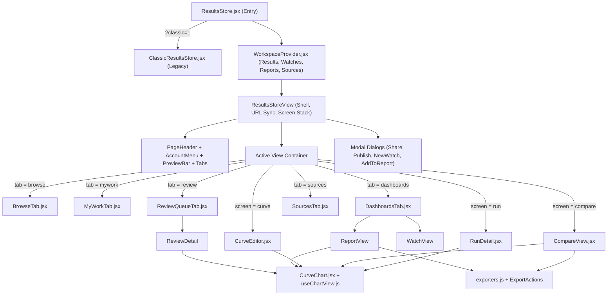
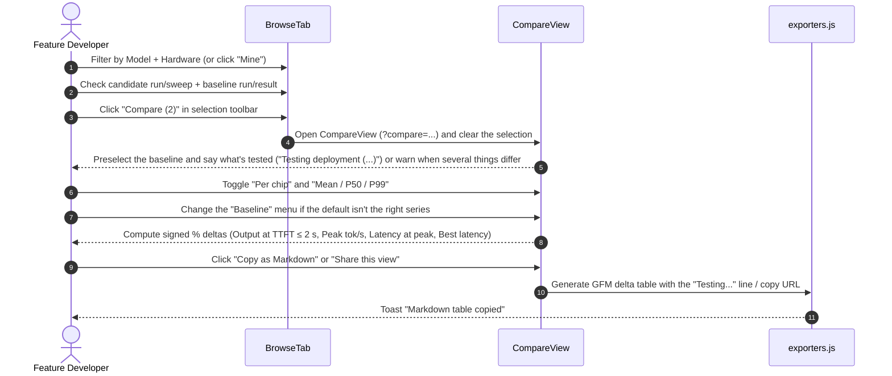
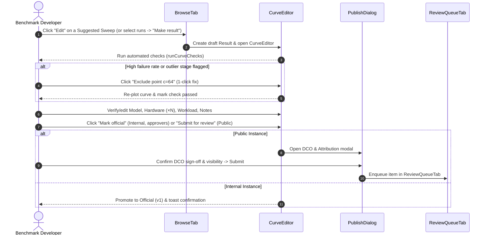

# Prism 2.0 — Results Store UI & CUJ Specification

- **Status**: Implemented on `prism2.0`
- **View ID**: `results-store` (`/?view=results-store`)
- **Entry & Modules**: [`src/components/ResultsStore.jsx`](../../../src/components/ResultsStore.jsx), [`src/components/ResultsStore/`](../../../src/components/ResultsStore/)

> Visual tokens (accent ramp, typography scale, surface classes, and the 7-series CVD-safe chart palette) are normative in [`skills/style.md`](../../../skills/style.md). This specification defines the domain objects, component architecture, screen-level UI contracts, and Core User Journeys (CUJs) of the Results Store.

---

## 1. Purpose & Domain Model

The **Results Store** is Prism's workspace for browsing raw benchmark runs, assembling multi-concurrency throughput–latency curves (**Results**), comparing runs side by side with baseline deltas, tracking nightly setups for regressions (**Watches**), and publishing cost-efficiency tables (**Reports**).

### 1.1 Core Entities

| UI Term | Code Identifier | Source / Storage | Mutability | Description |
| :--- | :--- | :--- | :--- | :--- |
| **Run** | `run` (`buildRuns` in [`catalog.js`](../../../src/components/ResultsStore/catalog.js)) | GCS buckets, `/api/results`, local IndexedDB (`staged`) | Read-only | A single measured benchmark execution (1 concurrency point or a multi-stage harness execution). Preserves separate `mean`, `p50`, and `p99` latency values per point. |
| **Sweep** | `row` with `kind: 'suggested'` (`buildRows` in [`catalog.js`](../../../src/components/ResultsStore/catalog.js)) | Derived automatically at runtime | Ephemeral until saved | A group of separate single-point runs that share `(model, hardware, workload, harness, deployment)` across ≥ 2 concurrency levels (`c=1, 8, 16…`). |
| **Result** | `curve` ([`WorkspaceProvider.jsx`](../../../src/components/ResultsStore/WorkspaceProvider.jsx)) | Workspace state (`localStorage` preview / server API target) | Editable (versioned) | A curated, named throughput–latency curve built from one multi-point run or a sweep of runs, with included/excluded points, clean labels, validation checks, and version history (`v1`, `v2`…). |
| **Watch** | `watch` ([`WorkspaceProvider.jsx`](../../../src/components/ResultsStore/WorkspaceProvider.jsx)) | Workspace state | Editable / Deletable | A regression monitor bound to a setup (`model · hardware ×N · workload · harness · deployment`, stored as `configKey`), a baseline (`Result` or pinned batch), a throughput target (`Output at TTFT ≤ 2 s` by default when the baseline has a point that fast, else `Peak`, or `at c=N`), and a drop threshold (`-3%` to `-15%`). Evaluated in the browser each time it's opened. |
| **Report** | `showcase` ([`WorkspaceProvider.jsx`](../../../src/components/ResultsStore/WorkspaceProvider.jsx)) | Workspace state | Editable / Deletable | A multi-result comparison and cost-sizing sheet that prices each result at a usable latency target (`TTFT ≤ 1s / 2s / 5s` or `Peak`) using GCP list prices or custom `$/chip-hr` rates. Holds results of any status; ones that aren't Official / Published are labelled `Unofficial` / `Unpublished`. |
| **Source** | `source` ([`SourcesTab.jsx`](../../../src/components/ResultsStore/SourcesTab.jsx)) | Workspace state + configured buckets | Admin-managed | A GCS or S3 bucket from which runs are ingested, tracked with health status (`ok`, `empty`, `stale`, `offline`) and Browse visibility. |

### 1.2 Instance Modes & Roles ([`instance.js`](../../../src/components/ResultsStore/instance.js))

The UI adapts its publishing workflow and terminology to the deployment mode (`VITE_PRISM_INSTANCE` or dev preview switcher):

| Aspect | **Internal Instance** (`internal`) | **Public Instance** (`public`) |
| :--- | :--- | :--- |
| **Published badge** | `Official` | `Published` |
| **Not yet published, in a report** | `Unofficial` | `Unpublished` |
| **Primary publish CTA** | `Mark official` (1-step promotion; **approvers only**: signed in and an admin, i.e. an llm-d org admin or on the admin allowlist). Everyone else sees *Only approvers can mark results official*, with `Sign in` when signed out | `Submit for review` (opens DCO & attribution dialog → moderator queue) |
| **Review Queue tab** | Hidden | Visible to reviewers and admins (`Review queue`) |
| **Visibility options** | `All of Prism` (`public`) or `Link only` (`unlisted`) |Reviewed public catalog (`public`) or direct share link (`unlisted`) |

---

## 2. Component Architecture & Navigation State

### 2.1 Navigation & Screen Stack

- **Five top-level tabs (`role="tablist"`)**:
  1. `Browse` (`browse`) — Default landing tab; houses the Sweeps strip, facet filters, and unified catalog list.
  2. `My results` / `My work` (`mywork`) — Personal drafts, uploaded runs, and review pipeline tracker.
  3. `Watches & reports` (`dashboards`) — Master-detail workspace for regression Watches and cost/throughput Reports.
  4. `Review queue` (`review`) — Moderator queue (shown only on the `public` instance for reviewers/admins).
  5. `Sources` (`sources`) — Cloud bucket registry and sync health (shown only for admins).
- **Stacked detail screens (`screen` + `screenStack`)**:
  - Opening a **Run** (`RunDetail`), **Compare** (`CompareView`), or **Result** (`CurveEditor`) replaces the active tab panel while keeping the origin tab highlighted in the tab bar.
  - Navigating from one detail screen to another (e.g., `Browse` → `Compare` → `Result Editor`, or `Result Editor` → `Run Detail`) pushes the prior screen onto `screenStack` so the top-left **Back** button pops back through the exact history trail.

### 2.2 URL & Deep-Link Contract

| Query Parameter | Values / Format | Behavior |
| :--- | :--- | :--- |
| `?view=results-store` | `'results-store'` | Mounts the Results Store view. |
| `?tab=` | `browse` \| `mywork` \| `dashboards` \| `review` \| `sources` | Selects the active top-level tab when no detail screen is open. A tab the current role can't see falls back to Browse and is dropped from the URL. |
| `?run=` | `<runKey>` | Opens `RunDetail` directly for the specified run. |
| `?curve=` | `<curveId>` | Opens `CurveEditor` directly for the specified Result. Results are saved in the browser that made them for now, so elsewhere the link opens *This result isn't in this browser* with what to do instead. |
| `?compare=` | Base64url JSON `{ v: 2, i: [[type, value, ref?], …], m: [latency, throughput, stat?], b? }`. Types: `u` one run (key), `s` a fixed set of runs (keys; sweeps travel this way so a link never drifts to the next nightly batch), `c` a Result (id), `r` a Browse row (links made before v2). `ref = 1` marks an added baseline (dashed). `m` carries the latency metric, throughput axis and statistic. `b` is the index in `i` of the series every Δ is measured against. | Opens `CompareView` with those series, metric, statistic and baseline. While Compare is open the address bar follows it: adding or removing a series, changing the metric or statistic, or picking another baseline rewrites `?compare=`, so a reload or a copied address reopens the same view. |
| `?benchmarks=` | Compact URL-safe Base64 of `16 * N` UUID bytes | Legacy/compact share link support. Waits until the catalog has loaded, fetches only the runs it doesn't hold, then opens `CompareView`. A fetched run whose review state the server doesn't return is treated as unlisted, never as public. |
| `?q=` | Free-text string | Search box in `BrowseTab`. Written back as you type. |
| `?sort=` | `oldest` \| `usable` \| `peak` \| `model` (`newest` is the default and is omitted) | Browse sort order. |
| `?kind=` | `suggested` \| `runs` \| `curves` (`all` is the default and is omitted) | Browse list kind (`Sweeps`, `Runs`, `Results`). |
| `?f.<facet>=` | `f.source`, `f.harness`, `f.category`, `f.model`, `f.hardware`, `f.workload`: one value each; `f.date` = `1d` \| `7d` \| `30d` \| `365d`; `f.mine=1` | Browse filters. The `f.` prefix keeps them apart from other views' parameters (the leaderboard reads `model`). Browse parameters are written only while Browse is showing with no detail screen open, and come back on **Back**. |
| `?classic=1` | `'1'` | Bypasses the Prism 2.0 workspace and mounts `ClassicResultsStore.jsx`. |

---

## 3. Screen & Component Specifications

### 3.1 Page Shell ([`ResultsStore.jsx`](../../../src/components/ResultsStore.jsx))

- **Header (`PageHeader`)**:
  - Kicker: `Prism toolkit` + instance badge (`Internal` or `Public`).
  - Title (`<h1>`): `Results store`.
  - Description: Dynamically summarizes catalog totals (`N runs · M official/published results across K models`).
  - Actions: `Glossary` (opens `GlossaryDialog`: *Words we use*, one sentence each for the things and numbers on these screens, plus a `How we measure` link that opens in a new tab), `AccountMenu` (GitHub sign-in or avatar/handle/role dropdown) and primary `Upload` CTA (routes to `submit-benchmarks` wizard).
- **Dev Preview Bar (`PreviewBar`, dev server only)**:
  - Two labelled `role="group"` toggles allowing instant testing of **Instance** (`Internal` vs `Public`) and **Role** (`Viewer`, `Contributor`, `Reviewer`, `Admin`) without redeploying.
- **Tab Bar (`Tabs`)**:
  - Keyboard-accessible `role="tablist"` (`←`/`→`/`Home`/`End`) with item count badges on `My results`, `Watches & reports`, `Review queue`, and `Sources`.
- **Toast Live Region**:
  - Top-right `aria-live="polite"` region, below the header, announcing asynchronous actions (`Share link copied`, `Marked official`, `Markdown table copied`, etc.). It sits clear of the bottom selection toolbar and the Result editor's action bar.
- **Share dialog (`ShareDialog`)**: The link to copy and what it carries (*The link opens the same runs, metric, statistic and baseline.* for Compare). Before sending anything nobody else can open, it warns:
  - Results (saved in this browser for now): *Nobody else can open this link yet.* / *N results in this view won't open for anyone else.*, and offers **Share source runs instead** (the Results' runs as fixed run sets, baselines kept as baselines and the chosen baseline kept on the same series), noting that the runs show every point, excluded ones included. When some of those source runs were uploaded only to this browser it says how many won't open for others; when all of them were, it doesn't offer the swap and says to upload them first.
  - Runs uploaded only to this browser: says nobody else can open them.

---

### 3.2 Browse Tab ([`BrowseTab.jsx`](../../../src/components/ResultsStore/BrowseTab.jsx))

Search and filters come first and narrow everything under them, the sweeps included.

1. **Search, Sort & Facet Bar (`
`)**:
   - Search input (`type="search"`, matches model, hardware, workload, harness, engine, deployment, notes, run ID and the uploader's run label).
   - Sort dropdown: `Newest first`, `Oldest first`, `Highest throughput at TTFT ≤ 2 s` (rows that reach the limit first, then the rest by peak), `Highest peak throughput`, `Model A–Z`.
   - Multi-select `FilterPill` popovers (`role="listbox"`) for: **Source** (when >1 visible source), **Harness**, **Category**, **Model**, **Hardware**, **Workload**, and **Date** (`Last 24 hours`, `Last 7 days`, `Last 30 days`, `Last 12 months`).
   - `Mine` toggle button (`aria-pressed`) when signed in; `Clear filters` when any filter is active.
2. **Sweeps Strip (`<section aria-labelledby>` with an `<h2>`)**:
   - Highlights auto-detected multi-concurrency sweeps that match the search and filters and have not yet been saved as curated Results (a sweep that's Official, Published or In review leaves the strip). The heading reads `Sweeps`, or `Matching sweeps` while anything narrows the page.
   - Displays the 3 newest of them as `SuggestedCard` `<article>` cards. When there are more sweeps, `See all N sweeps` switches the list's kind filter to **Sweeps**, scrolls to the list and moves focus to it: the list is the one place that shows every sweep (there is no second, expanded grid).
   - Each card shows the title (`model · hardware ×N · workload · setup`), harness/source subtitle, a plain-SVG throughput–latency sparkline, `N runs · c=1–64`, the headline throughput (`6,099 tok/s at TTFT ≤ 2 s`, or `… tok/s peak` when TTFT wasn't recorded or every point is slower), and up to 3 actions: **Mark official / Submit for review** (only for people who may publish: approvers on the internal instance, the runs' owner on the public one), **Edit**, and **Compare with…**.
3. **Summary & Kind Bar**:
   - Live count reflects the active kind toggle (`N runs · M sweeps · K official results` under `All`, `N sweeps (M runs)` under `Sweeps`, `N run rows (M runs)` under `Runs`, or `N official/published results` under `Results`). While search or a filter narrows the list: `Watch this setup` when one setup is left (starts the watch directly), or `Watch a setup…` when several are (asks which, listing only the setups that match the same search and filters, Category and Date included).
   - Kind filter (`role="group"`): `All` · `Sweeps` · `Runs` · `Results`.
   - Honest empty states: When `Results` has 0 items and no search/filter is active, shows `No official/published results yet` with a `Show all runs and sweeps` action instead of `Nothing matches`. When `Sweeps` has 0 items and no search/filter is active, shows `No multi-stage sweeps yet`.
4. **Catalog Row List (`BrowseRow`)**:
   - Paginated in increments of 40 (`Show more`).
   - Each row renders: selection checkbox, title button (`model · hardware ×N · workload · setup`), kind badge (`Result`, `Sweep · N runs`, or `Run · N stages`), status chip (`Official`/`Published`, `Draft`, `In review`), meta line (`harness · source · category`), headline throughput with its label and load range (`6,099 tok/s` over `at TTFT p50 ≤ 2 s · 1–9 req/s`), relative date, and repeat count (`×N`).
   - One control per action: the title opens a run or Result (and expands a sweep), so rows have no separate **Open** button; `×N` is a plain count and the chevron (`aria-expanded`) is the only expand control. Only sweep rows carry action buttons: **Edit** and **Mark official / Submit for review** for curators, **Open result** once it's a Result, otherwise **Compare with…**.
   - Under **All**, a sweep already published as a listed Result shows once, as that Result's row; one with other batches stays so they remain in reach. The **Sweeps** filter still lists every sweep, with its status chip. Results published as **Link only** (§3.7.3) aren't listed; they open from their link and from My work.
   - Sweeps and repeated runs expand inline (`aria-expanded`) to show `RepeatsList` with individual concurrency stages or historical repeats.
5. **Sticky Bulk Selection Toolbar (`role="toolbar" aria-label="Selection actions"`)**:
   - Appears at the bottom of the viewport when ≥ 1 row is checked. Counts the selection, and how many checked rows the current filters hide (`4 selected · 3 hidden by filters`).
   - Actions: **Compare**, **Make result** (only when the selected runs form one curve: one setup, each load level once, at least two points; mixed models, hardware or batches get **Compare** only), and **Clear**. Opening Compare clears the selection; sharing happens there (**Share this view**), once the comparison has been seen. Publishing a sweep in one step clears it too.

---

### 3.3 My Results / My Work Tab ([`MyWorkTab.jsx`](../../../src/components/ResultsStore/MyWorkTab.jsx))

Organizes the signed-in user's items into up to 5 status sections (empty sections are omitted). Results saved in this browser before signing in stay listed after sign-in.
1. **Needs changes** *(Public instance)* — Items returned by a reviewer with a feedback note: **Fix** opens `CurveEditor`. Declined Results are listed here too, with **Open** (the editor offers **Reopen as draft** or **Discard**); the subtitle says so when any are present.
2. **Drafts** — Unofficial/unpublished Results saved in the workspace, with **Edit** and **Mark official / Submit for review** actions.
3. **In review** *(Public instance)* — Submitted items displaying a 4-step `<ol>` `Timeline`. Server submissions: `Submitted` → `Checks running` / `Checks passed` → `In review` → `Published`. Results saved in this browser say what actually happened: `Saved in this browser` → `Checks passed` (or `Checks: N need attention` / `N failed`) → `Reviewers see its N uploaded runs` (only runs that reached the server queue when it was submitted) or `Reviewers can't see it yet` → `Published`.
4. **Uploaded runs** — Raw runs staged locally (`localStorage`) or uploaded by the user, with **View run**, **Edit** and, for people who may publish, **Mark official / Submit for review**.
5. **Official / Published by me** — Live Results credited to the user, each with who marked or approved it and when.

Rows don't repeat what their section already says: **Drafts** and **Uploaded runs** rows carry no status chip, and a draft shows a visibility chip only once it has been shared. Sections that mix statuses or audiences (**Needs changes**, **In review**, **Official / Published by me**) keep their chips, since those tell the rows apart.

---

### 3.4 Watches & Reports Tab ([`DashboardsTab.jsx`](../../../src/components/ResultsStore/DashboardsTab.jsx))

Uses a two-column layout: a left `<nav aria-label="Watches and reports">` navigation list (with `+ New` buttons for Watch and Report, status badges on watches with regressions/health warnings sorted to the top, and `aria-current="true"` on the active item) and a right `<section>` detail pane.

#### 3.4.1 Watch View (`WatchView`)
- **Header**: Kicker `Watch`, `<h2>` title, setup badge (omitted when the Watch title already contains the setup label), baseline summary (`Baseline: <name> · Output at TTFT p50 ≤ 2 s / Peak output throughput / Output throughput at c=N · flag drops of -X% or worse`, plus `· TTFT +20% & error ≥ 5% guard` when the guard is enabled), live status badge (`N regressed`, `N unhealthy (failed requests)`, `No regressions`, or `Waiting for the next batch`), **ExportActions** (`Download CSV`, `Copy as Markdown`), **Edit** (toggles an inline editor for Watch name, baseline, metric, threshold, and latency/error-rate guard), and **Delete** (asks first: *Delete this watch?* · `Keep it` / `Delete`; nothing brings it back). Its sidebar entry reads *Re-checks when you open it*: nothing runs in the background and nothing alerts yet.
- **Trend Chart (`Change vs. baseline`)**: Time-series chart plotting `%` change per date batch against a `0%` line and dashed `-X%` threshold line. While only the baseline batch exists, an `EmptyState` titled `No trend yet` explains how subsequent batches will be compared. The tooltip names the batch like the table does.
- **Batch History Table**: Columns for `Date` (the day; with the time too when two batches share a day, so no two rows look the same), `Runs` (clickable to open the batch in `RunDetail` or `CompareView`), `Output` (`Output at TTFT p50 ≤ 2 s` on usable watches; a batch with no point that fast reads `none ≤ 2 s` and counts as a drop), `Baseline`, `Change` (signed `%`; coloured rose red **only** when throughput or latency actually regressed, never when a positive throughput change is accompanied by failed requests), `Status` (`Baseline batch`, `Regressed` in red for throughput drops or TTFT spikes, `Unhealthy` in amber for request-failure spikes without throughput/latency regression, or `OK`), and **Compare with baseline** on every non-baseline batch (secondary style when regressed or unhealthy), which opens the batch beside its baseline in `CompareView`.
- **New watch dialog (`NewWatchDialog`)**: `Setup` select grouped by model. Opened from Browse, it lists only the setups matching Browse's search and filters (*Showing setups that match your Browse search and filters.*). `Baseline` select: Official / Published Results of the same setup (plus the draft Result it was opened from, labelled `(Draft)`), `Pin the median earlier batch (<date, time> · <tok/s>)` (the default when no Official Result exists and ≥ 2 batches exist, so a regressed newest batch isn't silently pinned as its own baseline), `Pin the newest batch (<date, time> · <tok/s>)` (with a warning notice when selected while older batches exist), and `Pin the batch of <date, time> (<tok/s>)` for every batch. `Metric`, `Flag drops of`, the `Also flag TTFT spikes (+20% at the watched point) and failed requests (≥ 5%)` checkbox (on by default; can be turned off here and in **Edit**), and an optional name. Turning a source's **Show in Browse** off (§3.6) changes what Browse lists, not what a watch checks, so its watches keep their batches and trend. **Edit** on a watch offers the same baselines and shows the current one as itself (a draft Result by name, a pinned batch by its date and time, or *… (no longer in this browser)* when that Result was discarded).

#### 3.4.2 Report View (`ReportView`)
- **Header**: Kicker `Report`, `<h2>` title, optional description, a visibility line (*Only you can open this report* / *Anyone with the link can open this report*), **Share** (sets the report to link-openable and copies the link in one action; a second control sets it back to private), **ExportActions** (`Download CSV`, `Copy as Markdown`), **Edit** (toggles inline inputs for Report name and description), and **Delete** (asks first: *Delete this report?* · `Keep it` / `Delete`). *(Share and the visibility line arrive with the server-side records; see [design.md §4.5](design.md).)*
- **Fairness Notice**: Warns automatically if the Results in the report use different models or workloads.
- **Unofficial Notice & labels**: A report can hold Results of any status. Ones that aren't Official / Published carry an `Unofficial` / `Unpublished` badge in the cost table (actual status in its tooltip), the same suffix in the chart legend, `Unofficial (Draft)` in the CSV `Status` column, and `(Unofficial)` plus a footnote in Markdown. A notice says their points and labels can still change. Official / Published rows export the plain label (`Official` / `Published`), without the on-screen *only in this browser* note, since exports go into customer documents.
- **Overlay Chart (`CurveChart`)**: Plots all Results in the report with `TTFT | TPOT | ITL | E2E`, `Mean | P50 | P99`, `Output | Total`, and `Per chip` controls, cycling marker shapes (`circle`, `diamond`, `square`, `triangle`) and dash styles so 7+ series stay visually distinct.
- **Cost & Sizing Panel (`Cost at …`)**:
  - **Per chip switch, Price at selector & P50/P99 toggle (`role="group"`)**: A `Per chip` `Switch` toggles the cost table's throughput column (and Markdown export) between total `Output (tok/s)` and `Output per chip (tok/s)`, alongside `Price at` (`TTFT p50 ≤ 1 s` · `TTFT p50 ≤ 2 s` · `TTFT p50 ≤ 3 s` · `TTFT p50 ≤ 5 s` · `Peak`) and a `P50 | P99` latency statistic selector when pricing at a TTFT target.
  - **Per-accelerator rate inputs**: One numeric input per distinct accelerator family in the report (`<Accel> $ per chip-hour`). Pre-populates from the user's Leaderboard custom rate (`prism_custom_prices`) or the shared `pricingEngine` GCP list price (e.g., `$3.67` for H100, `$2.93` for A100, `$0.70` for L4, `$2.70` for TPU v6e), stating the price source once in the input's helper text (`GCP list price for H100. Enter what you pay to override it.`) and `title`. Accelerators without a catalog list price (`B200`, `H200`, `MI300X`, `L40S`, `TPU7x`) leave the input blank until entered.
  - **Cost Table & Exports**: Columns for `Result`, `Accelerator`, `Chips` (derived from the Result's hardware label so relabelling `×1` → `×8` updates cost immediately), `Output (tok/s)` or `Output per chip (tok/s)` with both `TTFT p50` and `p99` at the priced stage, `$/chip-hr`, `$/1M output tokens`, `Tokens per $`, and a remove action. CSV and Markdown exports include `Deployment`, `Model ID`, `Workload (ISL/OSL)`, `Harness`, `Serving engine`, `Measured`, `Run IDs`, `TTFT p50/p99`, `TPOT p50`, `E2E p50`, and caveats.

---

### 3.5 Review Queue Tab ([`ReviewQueueTab.jsx`](../../../src/components/ResultsStore/ReviewQueueTab.jsx))

Visible to reviewers and admins on the `public` instance.
- **Queue List**: Ordered oldest-first so submissions don't starve. Shows item title, submitter `@handle`, submission date, automated check summary (`All checks passed` or `N warnings`), badges when `Labels edited` or `Duplicate runs` are present, and **Review** button. Displays a post-approval banner with **Undo approval** for local items so an accidental 1-click approval can be reverted immediately.
- **Review Detail (`ReviewDetail`)**:
  - **Header**: Submitter attribution and check summary, and 3 decision buttons: **Decline**, **Request changes**, and **Approve…**. Self-approval is blocked when the signed-in reviewer is the author (`You can't approve your own submission`); in dev preview mode a warning banner explains why self-approval is only allowed for previewing.
  - **Approve Confirmation & Decision Drawers**: Clicking `Approve…` opens a confirmation panel (*Confirm approval & publication*) summarizing DCO status, check warnings, and catalog visibility before publishing. Clicking `Request changes` or `Decline` opens distinct drawers with tailored titles, subtitles, quick-select reason chips, and submit buttons (`Send back for changes` vs `Decline submission`).
  - **Comparison Chart (`Against published results`)**: Overlays the submitted curve (solid line) against existing published Results for the same setup (dashed baseline lines) with full `CurveChart` metric/statistic/per-chip controls.
  - **Inspection Panels**: `Metadata` (`<dl>`; edited labels, Workload included, show `edited · was …`), `Validation signals` (`CheckList`), `Lineage & attribution` (`<ol>`), and `Configs & logs`: the files uploaded with the source runs (`Attachments`, §3.7.1), labelled by run when there are several, so *Configs or logs missing* can be judged on the screen.
  - **Decision toasts**: Server submissions say what the contributor sees (`Declined. The contributor sees your note in My work.`) and also transition any matching local `in_review` Result for that run ID to `published`. Results saved in this browser say the decision is only here for now (`Approved. It shows as published in this browser only for now.`, `Declined. Your note is saved with the result in this browser.`).

---

### 3.6 Sources Tab ([`SourcesTab.jsx`](../../../src/components/ResultsStore/SourcesTab.jsx))

Visible to admins.
- **Registered Sources Table**: Lists each cloud bucket with `Source` name/URI, `Harness`, `Runs` count, `Newest run` date, `Health` chip from [`sourceHealth.js`](../../../src/components/ResultsStore/sourceHealth.js) with a note under it: `Syncing`; `Sync failed` (`access denied · last good sync <date>`); `Not synced` (static files); `No runs` (it answered but held no benchmark reports Prism can read: usually the wrong bucket or folder, never a green chip); `Stale` (no new runs in 7 days); `Synced`. Then a `role="switch"` toggle (`Show in Browse`) and a remove button for custom sources.
- **Register a Source Panel**: Form with storage provider toggle (`GCS` | `S3`), `Name` input, `Bucket` input, and `Register` button with `role="status"` / `role="alert"` feedback scoped to registration attempts in the current session (so background sync errors already shown in the table's `Health` column aren't repeated under the form). Each attempt clears the previous message. Registering a bucket that turns out to hold no readable runs says so in amber (*Registered <name>, but Prism found no benchmark reports in it. Check the bucket name and that it holds report files; remove it if it's the wrong one.*) instead of `Added bucket`.

---

### 3.7 Detail Screens

Navigating to any detail screen (`RunDetail`, `CompareView`, `CurveEditor`) or switching top-level tabs resets the window scroll position to the top (`0, 0`).

#### 3.7.1 Run Detail ([`RunDetail.jsx`](../../../src/components/ResultsStore/RunDetail.jsx))
- **Header**: `BackButton` naming its destination (`Back to Browse`, `Back to the comparison`…), kicker `Run`, `<h2>` title (`model · hardware ×N · workload · setup`), provenance badges (`harness`, `source`, `category`, harness measurement `date` plus `uploaded <date>` when the upload timestamp differs by >24h, `run ID`), and actions (`Compare with…`, `Watch this setup`, `Share`, `Make result` / `Edit sweep`, and `Publish` for people who may publish).
- **Single-Point vs. Multi-Point Body**:
  - *Single-point run*: Renders a 5-tile KPI `<dl>` (`Output`, `TTFT <stat>`, `TPOT <stat>`, `E2E <stat>`, `Failed requests`) where every latency label explicitly names its underlying statistic (`mean` or `p50`). If the run belongs to a sweep, `CurveChart` draws the sweep with this run as its own series (*It's part of a sweep (c=1–64).*). If not, there's no chart, only a note: *This run measured one load level (c=N), so there's no curve to draw. Use Compare with… to see it next to other runs.*
  - *Multi-point run*: Renders `CurveChart` in load order (§3.8) with `TTFT | TPOT | ITL | E2E`, `Mean | P50 | P99`, `Output | Total`, and `Per chip` controls. The subtitle gives stages, load range, peak and usable throughput (`14 stages · 1–9 req/s · peak 6,363 tok/s · 6,099 tok/s at TTFT p50 ≤ 2 s`). When `loadChecks` flags points, a warning `Notice` names them (*The 7 req/s stage looks overloaded: …*) and suggests making a result to exclude them, or, for people who can't curate, keeping it in mind before quoting the peak.
- **Run Details Tabbed Panel (`role="tablist"`)**:
  - `Metadata`: `<dl>` (`MetaGrid`) of model, accelerator, chip count, workload (`1000/1000 as configured · measured 3209/865 on average`, or `about 7200/1000 · measured …` when grouped from measurements), concurrency or stages, harness, deployment (the stack's full label where the report has one, or *…, named from the run label*), source, `Measured` (harness start/end timestamp) and `Uploaded` (when `submitted_at` differs from `Measured` by >24h), run ID, the uploader's `Run label`, and who submitted it.
  - `Configs & logs`:
    - **Command**: when the report recorded its harness arguments (`run_metadata.harness_args`), the heading is `Command this run used` (*As the harness recorded it.*), e.g. `inference-perf --config_file /requests/…/h100_knee_ladder.yaml`, with a comment naming the attached config when the paths point into the run's own environment. Otherwise it's `Reproduce this run`, rebuilt from the recorded harness, model, workload and load stages and labelled *Approximate* in both the subtitle and the command's header. Both have `Copy command`.
    - **Attached files** (`Attachments` in `parts.jsx`): what was uploaded with the run, grouped as `Manifests and configs` and `Evidence and logs`. A file stored in the upload (a `data:` URL) shows its size, **Preview** (text files, read in place) and **Download**; an `http(s)` link has **Open** (new tab); anything else (a `gs://` path) is shown as text with **Copy path** and never becomes a link.
    - Report file name, **Open source folder** (only for `http(s)` or this site's own `/…` paths), and the `Raw benchmark report` preview (`<pre>`). With no attached files and no raw report: *No configs, logs or raw report were attached to this run.*
  - `Lineage`: 3-step `<ol>` (`Measured` → `Ingested` → `Grouped`) plus links to any curated Results that include this run.

#### 3.7.2 Compare View ([`CompareView.jsx`](../../../src/components/ResultsStore/CompareView.jsx))
- **Header**: Kicker `Compare`, `<h2> N series`, and actions (`Make result` when the compared series form one curve: one setup, each load level once, at least two points; `Share this view`; `Add to report`). `Add to report` is always available: Results go in as they are; runs and sweeps go in as the Result already made from exactly those runs, or a new draft (created only when the dialog adds them). Opening Compare clears the Browse selection. The address bar follows what's on screen (§2.2), and **Share this view** carries the series, metric, statistic and baseline.
- **Baseline menu** (`<label>Baseline</label>` + `<Select>`, shown with ≥ 2 series): Lists every series by title, followed by *Every Δ below is measured against it.* Default order: the series picked here (or named by the link that opened Compare), else the one added last via **Add baseline**, else an Official Result, else the series whose name reads most like a baseline (`baseline`, then `standard` / `vanilla` / `plain`, then `none` / `no scorer`, then `default` / `base`), else the first series. Two series with the same title (two batches of one setup, a batch and its baseline) get their kind line in brackets (`Sweep · 6 runs · Sep 23`, `Run 1a2b · Sep 24`, `Result · v2`), in the menu, legend and table alike.
- **Framing Notice** (`seriesParity` + `parityFraming`):
  - Compares 7 fields grouped into axes: `model`; serving (`accelerator`, `chip count`, `deployment`, `serving engine`, which usually change together); `workload (ISL/OSL)`; `harness`.
  - *Repeat* (nothing differs, info; or warning when throughput drops ≤ -5% or latency spikes ≥ +20%, noting that a gap of that size usually reflects a regression or unrecorded change rather than run-to-run variation): `Same setup in every series (…), so the differences are run-to-run variation.`
  - *Test* (one axis differs, info): `Testing deployment (standard-k8s → precise-prefix-cache-routing). Same model, accelerator, chip count, workload (ISL/OSL) and harness.` The baseline's value comes first.
  - *Mixed* (several axes differ, warning): lists every difference, since no gap can be pinned on one of them.
  - Appends *Chip counts differ, so turn on Per chip to compare per accelerator.* while **Per chip** is off. A repeat or a test also names fields not recorded for every series. With a single series: *Add a baseline to see what changed.*
- **Chart (`CurveChart`)**:
  - Header includes `ExportActions` (`Download CSV`, `Copy as Markdown`; when only 1 series is loaded, prompts for confirmation before exporting a table with no baseline deltas; the Markdown carries the share link, full framing + unrecorded-field caveats, directional `(better)`/`(worse)` labels, and a **Provenance** table) and an `Add baseline` combobox (`role="combobox"`) that excludes any option sharing the same item key or underlying `runKeys` signature as an already-loaded series.
  - Controls: `TTFT | TPOT | ITL | E2E` · `Mean | P50 | P99` · `Output | Total` · `Per chip`, plus an automatic `Focus` vs `All points` y-axis clipping toggle when extreme tail points would flatten the usable curve, and a horizontal dashed `TTFT p50 ≤ 2 s` SLO reference line on TTFT charts.
  - Series the chosen metric and statistic can't plot are named in a warning notice above the chart (*2 series can't be plotted with TTFT p99 and output throughput: … Try another statistic or metric.*), not in the chart subtitle.
- **Against the Baseline Table**:
  - One series is the `baseline` (selected via the **Baseline** menu above).
  - Columns: `Series` (swatch, title, kind badge, `baseline` badge), `Points`, `<Throughput> at TTFT p50 ≤ 2 s` + signed `%` delta, `<Throughput> at TTFT p99 ≤ 2 s` + signed `%` delta (when any series recorded `ttftP99`), `Peak <throughput>` + signed `%` delta (computed on healthy stages only; overloaded tail peaks are annotated `overloaded peak (… at c=N) not comparable`), `<Latency stat> at peak` + signed `%` delta (at the healthy peak), `Best <latency stat>` + signed `%` delta, and row action (`Remove`).
  - Delta semantics: Changes within `±1%` render in neutral grey; larger improvements render in emerald green with visible `better` text; larger regressions render in rose red with visible `worse` text.

#### 3.7.3 Result Editor (`CurveEditor.jsx`)
- **Lifecycle Banner**: Contextual banner when the Result is:
  - `In review`: submitted date, `Checks passed` or `N checks need attention`, and who can see it. If uploaded runs reached the server queue: *Waiting for a reviewer. Reviewers can see its N uploaded runs; the curated result itself stays in this browser for now.* Otherwise: *Saved for review in this browser only. Reviewers can't see it until results are stored on the server.*
  - `Needs changes`: the reviewer's feedback.
  - `Declined` (red): `Declined by @reviewer`, the reason (or *The reviewer didn't leave a reason.*), and *Reopen it as a draft to fix it and submit again, or discard it.* A declined Result reopened as a draft keeps the note (*The reviewer's note from when it was declined*) until it's submitted again.
  - `Superseded`: with a button to jump to the newest version `vN`.
- **Not in this browser**: A `?curve=` link to a Result this browser doesn't hold opens *This result isn't in this browser*: Results are saved in the browser that made them until they're stored on the server, so ask for its source runs instead (**Share → Share source runs instead**), or check whether it was discarded.
- **Header**: Status chip, visibility chip (shown when shared or public; omitted on private `Only me` drafts since `Draft` already implies private), version badge (`v1`, `v2`), `Featured` badge, last-saved time (`Saved HH:MM`), editable name `<input>` (with a visually hidden `<h2>` for heading hierarchy) or read-only `<h2>`, and attribution subtitle.
- **Points & Curve Grid**:
  - Left (`Points` panel): List of stages in load order (`c=1`, `c=8`, `c=16`… or `1 req/s`, `2 req/s`… for rate sweeps), with a subtitle naming the order. Each row shows `tok/s`, explicit latency statistic (`759 ms TTFT p50` or `TTFT mean`), error rate badge if `> 0%`, a link to inspect the underlying Run, and an include/exclude toggle button (requires ≥ 2 included points).
  - Right (`CurveChart`): Live curve preview updating immediately as points are toggled or labels edited, plus baseline overlay chips (`Baseline: <name>`). **Add baseline** ranks candidates by setup closeness (`rankBaselines`), filters out candidates sharing the Result's own `runKeys`, and adds a filter box when there are more than 8.
- **Labels & Metadata Panel**:
  - When editable: inputs (with `<datalist>` autocomplete from catalog vocabulary) for `Model`, `Hardware` (editing `×N` immediately recomputes `tok/s/chip` across all points), `Workload (ISL/OSL)`, `Category`, and `Notes`, alongside a read-only `MetaGrid` of measured fields (`Harness`, `Deployment`, `Concurrency range`, `Workload (measured)`, `Source runs`).
  - When read-only (published/in-review Results): renders all labels, notes, and measured fields cleanly in a single `<dl>` (`MetaGrid`) instead of disabled form controls. A label changed from what the runs recorded, Workload included, reads `edited · was "…"`.
- **Validation Checks & Lineage Grid**:
  - Left (`Checks` panel): Runs `runCurveChecks(curve)` checking for minimum points, load order (`Points ordered by concurrency` / `by request rate`), request failure rate (`> 5%` offers a 1-click **Exclude point c=N** fix), overloaded and out-of-line points (§3.8, each with **Exclude point**), saturation/knee coverage, mixed models/workloads, and baseline presence.
  - Right (`Lineage` panel): `Version N`, then `Replaces vN` (a link that opens the version it replaces) and the `<ol>` audit history: created, `Renamed`, `Edited accelerator / model / category / workload / notes` (one entry per field while the same person keeps editing it within 10 minutes), `Excluded c=64 (overloaded)` / `Included c=64 again`, `Submitted for review · DCO 1.1 signed`, `Marked official`, `Approved and published`, `Declined`, `Reopened as a draft`. Individual source run links live in the `Points` list above.
- **Footer Action Bar** (sticky at the bottom of the viewport while the editor scrolls): `Discard draft` (with confirmation modal), `Edit as new version` (for already-official Results), `Compare with…` (opens Compare with this Result, drafts included, ready for **Add baseline**), `Watch this setup` (any draft, in-review or published Result; a draft can be the watch's baseline), `Add to report` (any status, drafts included), `Feature on Browse` (admins), `Share`, and primary `Mark official` / `Submit for review`. A declined Result has `Reopen as draft` (primary) and `Discard` (*Discard this declined result?* · `Keep it` / `Discard result`). On the internal instance only approvers see `Mark official`; everyone else sees *Only approvers can mark results official*, plus `Sign in` when signed out. On the public store, anyone can open a catalog sweep as a local sandbox draft; if the draft's runs aren't owned by the user (only runs uploaded from this browser or submitted under their GitHub account count; community-catalog submissions don't, though they are uploads too), the footer shows *Catalog draft · only your own uploaded runs can be submitted for review* alongside `Submit results`.
- **Publish dialog (`PublishDialog`)**:
  - *Internal (approvers)*: *It becomes Official, with @approver recorded as the approver today.* When some of its runs were uploaded only to this browser, an amber note says nobody else can check them, and that once Results are stored on the server those runs must be uploaded before a Result can be marked official.
  - *Public*: `Attribution` (pre-filled with the signed-in handle), a `Once approved` toggle (`Listed in the store` · `Link only`, with a line saying what each means), and the *I certify these results under the Developer Certificate of Origin 1.1.* checkbox. Submitting records the sign-off with the Result (`{ version: '1.1', by, at }`), shown to reviewers (§3.5) and in Lineage; on approval the Result is published with the visibility chosen here. With runs only in this browser the primary action is `Continue to upload` instead: *Continue to upload opens the upload wizard, which sends the runs themselves for review. This result stays a draft in this browser.* (no visibility choice, since the Result itself isn't submitted).
  - The closing line says where the Result lives: *For now the result itself is saved in this browser. Reviewers see the runs you uploaded.* only when it has runs on the server, else *For now the result is saved in this browser only, so reviewers can't see it yet.*
  - The toast after submitting only claims what reached reviewers: *Submitted: reviewers can see its N uploaded runs. The curated result itself stays in this browser until results are stored on the server.*, or *Saved for review in this browser only. Reviewers can't see it until results are stored on the server.* If sending the runs fails, nothing changes and the toast says so.

---

### 3.8 Shared Chart & Data Layer Rules ([`catalog.js`](../../../src/components/ResultsStore/catalog.js), [`useChartView.js`](../../../src/components/ResultsStore/useChartView.js), [`exporters.js`](../../../src/components/ResultsStore/exporters.js))

1. **Honest Latency Statistics**:
   - Every point stores `lat: { ttft: { mean, p50, p99 }, tpot: { mean, p50, p99 }, itl: { mean, p50, p99 }, e2e: { mean, p50, p99 } }` plus legacy scalar fields (`ttft`, `tpot`, `itl`, `e2e`) and `latStat` (`{ ttft: 'p50' | 'mean', … }`).
   - **Corrupted alias scrubbing**: In v0.2 archives where `p50` was synthesized by copying `mean` (`p50 === mean`) or written as `0`, `p50` is treated as missing (`null`). Where `p99` is smaller than `p50` or `< 0.5 × mean` (seconds-vs-milliseconds unit mix-up), `p99` is dropped (`null`).
   - **Default statistic selection (`defaultLatencyStat`)**: A chart opens on `P50` **only** if every plotted series has genuine `p50` values for the active metric; otherwise it opens on `Mean` so a chart never silently mixes `p50` and `mean` across curves.
   - If a user explicitly selects a statistic (e.g. `P99`) that some series lack, `CurveChart` displays a warning notice naming the omitted series.
2. **Setup Identity: Chips, Workload, Deployment, Timestamps** (`buildRuns`, `reportChips`, `workloadOf`, `unifyWorkloads`, `reportSetupOf`, `entryTs`):
   - **Chip count**: For benchmark reports, total chips = accelerators per replica × replicas, and a TPU slice counts its topology (`tpu7x-2x2x1` → 4). Otherwise `accelCount` is resolved once per run (`mostCommon(list.map(accelCountOf).filter(n => n > 1)) || accelCountOf(d0)`) and passed to every stage, so stages that omit `accelerator_count` don't fall back to `1` chip.
   - **Workload**: Configured lengths win: the archive `variant` (e.g. `1000/1000`), else the `run_<ISL>_<OSL>` treatment in the run ID, else, for benchmark reports, one group per load config (`scenario.load.metadata.cfg_id`) and model. Anything else groups near-equal measured means (ISL within 4%, OSL within 12%). A group's label is exact when every run agrees, else the median rounded to 2 significant figures. Run Metadata shows both (`1000/1000 as configured · measured 3209/865 on average`).
   - **Deployment**: A report's stack label becomes `setup` (the text before the first comma or parenthesis) with the full label in `setupDetail`. An unlabelled stack is only a shape (`2 TP4`, `1P-TP4 3D-TP4`), so the uploader's run label names the deployment when it can (`variantFromRunLabel`: explicit colon-separated variants like `"Gemma-4-26B-A4B 1k-1k: llm-d-KV-Events"` → `"llm-d-KV-Events"`, or `run-20260831-h100-optimized-baseline` → `optimized-baseline (1 TP1)`; tokens with digits such as dates, hardware and random suffixes, a leading `run` and the model's own words are dropped). When multiple runs in the same `(model, hardware, workload, harness, setup)` slot carry distinct explicit variants in their run labels, `buildRuns` disambiguates their `setup` (`<setup> · <variant>`) so distinct feature variants are never silently merged into a single repeat row.
   - **Timestamps (`entryTs`)**: `run.ts` prioritizes the harness measurement timestamp (`run_metadata.harness_start`, `run_metadata.harness_end`, `rawReport.metadata.timestamp`, `rawReport.scenario.metadata.timestamp`) over the upload timestamp (`submitted_at`), while preserving `run.submittedAt` so `RunDetail` can show both when they differ.
   - **Total throughput**: input + output tokens per second. When a run didn't record its input rate, Total is unknown (`null`), not equal to Output, so the `Total` toggle leaves those series out instead of mislabelling them.
   - **Titles and keys**: Titles read `model · hardware ×N · workload · setup`. `configKeyOf` covers model, hardware, workload, harness and setup. Watches store it and re-match with `sameSetup` (workload within the same tolerance), falling back to their baseline runs' current key when labels change.
   - **Each stage once**: A report stage that arrives through two loaders is kept once.
3. **Load Order** (`loadOrder`): Points are ordered by concurrency, else by request rate (`workload.target_qps`, kept as `point.rate`), else by output throughput. `CurveChart` draws points in array order. Rate stages are named `7 req/s` in checks, the Points list and the run page.
4. **Usable Throughput** (`pricingPoint`, `OPERATING_TTFT_MS = 2000`, `limitLabel`): Always names the latency statistic (`TTFT p50 ≤ 2 s` or `TTFT p99 ≤ 2 s`). The highest output at `TTFT p50 ≤ 2 s` leads Browse rows and cards (falling back to `peak`, labelled), is paired with `TTFT p99 ≤ 2 s` in Compare and Reports, is the default Watch metric, and powers Report pricing.
5. **Load Checks & Healthy Peaks** (`loadChecks`, `healthyPoints`): A point is *overloaded* when its TTFT (E2E when fewer than two points have TTFT) is ≥ 5× the last healthy point's for ≤ 1.25× its throughput. Each point is compared with the last healthy one, so every point past saturation is flagged, not just the first. In sweeps with a load order, a healthy point is *out of line* when it's > 1.5× and > 250 ms slower than the next heavier point. Both offer **Exclude point**; `RunDetail` warns about overloaded tails, and `CompareView` computes `Peak` and `Latency at peak` on `healthyPoints` so overloaded tail stages are marked `"not comparable"`.
6. **Spreadsheet-Safe & Reproducible Exports (`exporters.js`)**:
   - Every CSV download (`downloadText`, used by `pointsCsv`, `ReportView` and `WatchView`) starts with a UTF-8 BOM (`\uFEFF`) so Excel reads `×`, `≤` and `·` correctly; other text types are written as is. Exports quote fields containing delimiters, and prefix formula-triggering characters (`=`, `+`, `-`, `@`, `\t`, `\r`) on text cells with `'` to prevent CSV formula injection while leaving negative numbers intact. Point, Compare, and Report exports include provenance columns (`Run ID`, `Measured`, `Model ID`, `Hardware`, `Deployment`, `Workload (ISL/OSL)`, `Harness`, `Serving engine`, `Stage status`, `Caveats`, and `Share link`).

---

## 4. Core User Journeys (CUJs)

### CUJ 1: Feature Developer — Validate an Optimization Against a Baseline

> **Persona Goal**: Prove a new llm-d optimization beats or matches a baseline fairly and share the evidence in a PR.

1. **Discover**: In **Browse**, filter by `Model` and `Hardware` (or search for the feature branch/deployment tag). Titles end with the deployment, so the candidate and the baseline are easy to tell apart.
2. **Select & Compare**: Check the candidate sweep/run and the baseline run/Result, then click **Compare** in the bottom selection toolbar. The toolbar says how many checked rows the filters hide, and opening Compare clears the selection.
3. **Read the framing**: The line under the **Baseline** menu says what the comparison tests: `Same setup in every series (…), so the differences are run-to-run variation`; `Testing deployment (standard-k8s → precise-prefix-cache-routing). Same model, accelerator, chip count, workload (ISL/OSL) and harness.`; or a warning that lists several differences. When chip counts differ (e.g., `×4` vs `×16`), it suggests **Per chip**.
4. **Read Deltas**: The baseline is preselected (§3.7.2); change it in the **Baseline** menu if needed. In **Against the baseline**, read the green/red `%` deltas for output at TTFT ≤ 2 s, peak throughput, latency at peak, and best latency across `Mean`, `P50`, and `P99`.
5. **Share**: Click **Copy as Markdown** to paste the comparison table, with its "Testing…" line, into a GitHub PR, or **Share this view** to copy a deep link preserving the series, metric, statistic and baseline (the address bar already holds the same view, §2.2).

---

### CUJ 2: Benchmark Developer — Curate a Sweep into an Official / Published Result

> **Persona Goal**: Turn raw single-concurrency runs or an auto-detected sweep into a validated, versioned throughput–latency curve.

1. **Start from a Sweep or Uploaded Runs**: In **Browse**, locate an auto-grouped card in the **Sweeps** strip and click **Edit** (or select multiple single-point runs in the list and click **Make result**). In **My work**, contributors can also click **Combine N runs into 1 Result** directly from the `Uploaded runs` header, and see an upfront 3-step progression (`1. Upload runs → 2. Curate result → 3. Submit for review`) and GitHub sign-in prompt before starting curation.
2. **Curate Points & Export Curves**: In **Result Editor (`CurveEditor`)**, inspect the **Points** list (in load order: `c=N` or `N req/s`) and the **Checks** panel. If a stage had `> 5%` failed requests, looks overloaded (latency up 5× or more for little extra throughput), or is out of line with the next heavier stage, click the 1-click **Exclude point** action in the check row. Use the chart's **SVG** or **PNG** download actions (`CurveChart`) to export a self-contained figure with title, target SLO subtitle, legend, and provenance footer.
3. **Refine Metadata**: Standardize the `Model`, `Hardware` (including `×N` chip count), `Workload`, and `Category` labels, and use **Add baseline** to overlay an existing published Result as a dashed curve.
4. **Publish**:
   - On an **Internal** instance: an approver (signed in and an admin) clicks **Mark official** to publish immediately (`v1`). Anyone else keeps a draft, which they can still compare and add to reports (marked `Unofficial`).
   - On a **Public** instance: click **Submit for review**, complete the **DCO 1.1** sign-off and the `Once approved` choice (`Listed in the store` vs `Anyone with the link`) in `PublishDialog`, and track progress in **My results**. Until Results are stored on the server, reviewers see only the uploaded runs that reached the server queue; the toast, the editor's In review banner and the My work timeline all say which (§3.7.3). A declined Result can be reopened as a draft, fixed and submitted again.

---

### CUJ 3: Solutions Architect / Config Tuner — Build a Price/Performance Sizing Report

> **Persona Goal**: Compare candidate serving stacks under a customer latency SLO (`TTFT p50 ≤ 2 s`) and produce a cost-per-million-tokens table.

1. **Compare & Inspect Inline Cost / Diff**: In **Compare (`CompareView`)**, inspect the **Sweep-space decision summary** card (`Best output`, `Best per-chip`, `Lowest cost (Cheapest)`), inline `$/1M tok` column with editable `$/chip-hr` rates, repeat batch sample size (`n=k`) and throughput `spread min–max tok/s`, and the **Configuration & harness diff** panel (`Differences` vs `All fields`, plus line-by-line YAML/JSON config diff against the baseline).
2. **Assemble Report**: From **Compare** (including **Add all N to report**) or the **Result Editor** (any status), click **Add to report**. Nothing has to be published first: Results that aren't Official are marked `Unofficial` in the report. (`+ New` under **Report** creates an empty report to add to.)
3. **Set Latency & TPOT SLO Targets**: In **ReportView**, set **Price at** to `TTFT p50 ≤ 1 s`, `≤ 2 s`, `≤ 3 s`, `≤ 5 s`, or `Peak`, and optionally apply a secondary **TPOT limit** (`Any TPOT`, `TPOT p50 ≤ 25 ms`, `≤ 50 ms`, `≤ 100 ms`). Each Result is evaluated at its highest-throughput concurrency point that satisfies both bounds.
4. **Review or Override Hardware Rates & Sort**: Each accelerator's `$/chip-hr` input is pre-filled from the user's Leaderboard custom prices or the `pricingEngine` GCP on-demand list price (`GCP on-demand list (us-central1)` vs `Custom override`). Sort by any column (`Result`, `Chips`, `Output`, `$ / chip-hour`, `$ / 1M output tokens`, `Tokens per $`), inspect the `<Badge tone="success">Cheapest</Badge>` callout, and click **Download CSV** or **Copy as Markdown** to include in a customer sizing document.

---

### CUJ 4: Stack Operator — Monitor a Setup for Nightly Regressions

> **Persona Goal**: Track a production setup across nightly batches and triage throughput drops against a known-good baseline.

1. **Create Watch**: Search or filter **Browse** until one setup is left and click **Watch this setup** (with several left, **Watch a setup…** asks which, offering only the setups that match), or click **Watch this setup** on any `RunDetail` page or `CurveEditor` page (drafts included).
2. **Configure Threshold**: In `NewWatchDialog`, choose the baseline (an Official / Published Result, the median of earlier batches, any older batch pinned as known-good, or the newest batch with an explicit self-comparison warning), the metric (`Output at TTFT p50 ≤ 2 s`, the default when the baseline has a point that fast; `Peak output throughput`; or `Output at c=N`), the threshold (`-3%`, `-5%`, `-10%`, `-15%`), and whether to also flag TTFT p50 spikes (`+20%`) and failed requests (`≥ 5%`).
3. **Inspect Trend & Triage**: The top-level `Watches & reports` tab displays the count of regressed watches (`Watches & reports (N regressed)`), and the sidebar lists each watch with its status, latest batch delta (`Latest -28.4%`), `"Checked against loaded runs"` freshness line, and a **Copy all watches summary** digest button. In `WatchView`, inspect the `Change vs. baseline` trend line and batch table; click **Compare with baseline** on any row to open the batch beside its baseline in `CompareView`.

---

### CUJ 5: Community Reviewer — Moderate a Submitted Benchmark (Public Instance)

> **Persona Goal**: Verify that a community-submitted Result has clean telemetry, valid metadata, and DCO sign-off before promoting it to the public catalog.

1. **Open Queue**: Navigate to **Review queue** (`?tab=review`), which lists pending submissions oldest-first with automated check summaries.
2. **Inspect Submission**: Click **Review** to open `ReviewDetail`. Check the DCO line (who signed and when, and whether it will be listed or link-only), compare the submitted curve against existing published results on the overlay chart (toggling `Mean | P50 | P99` and `Per chip`), and review `Metadata` (edited labels flagged), `Validation signals`, `Lineage & attribution`, and `Configs & logs` (the files uploaded with the runs, previewable in place).
3. **Record Decision**:
   - Click **Approve** to promote the Result to `Published`, listed or link-only as the author chose (with an **Undo approval** banner immediately after approving).
   - Or click **Request changes** / **Decline**, select one or more structured reason chips (`Configs or logs missing`, `Failed requests over 5%`, etc.), add reviewer notes, and submit so the author sees the actionable feedback in **My results** → `Needs changes`. A declined author can reopen the Result as a draft and resubmit.

---

### CUJ 6: Platform Admin — Manage Cloud Benchmark Sources

> **Persona Goal**: Connect GCS/S3 benchmark buckets, monitor ingestion health, and control which sources appear in Browse.

1. **Inspect Health & Manage Sources**: Open **Sources** (`?tab=sources`) to view each bucket's run count, newest run timestamp, and health badge (`Synced`, `Stale`, `No runs`, `Sync failed`, `Syncing`, `Not synced`; §3.6). Each row provides **Retry** (when failed), **Edit**, and **Remove** actions for registered sources, plus inline IAM guidance when a bucket returns `403 / access denied`.
2. **Control Visibility**: Toggle **Show in Browse** (`role="switch"`) on any source to hide noisy or staging buckets from the default catalog without deleting their runs. Watches that use its runs keep working.
3. **Register or Edit Bucket with IAM Guidance**: In **Register a source** (or **Edit source**), select `GCS` or `S3`, enter a display name and bucket/prefix URI, review the **Required bucket permissions** box (`roles/storage.objectViewer` / `gcloud storage buckets add-iam-policy-binding` for GCS; `s3:ListBucket` & `s3:GetObject` for S3), and click **Register** / **Save source**.

---

## 5. Semantic HTML & Accessibility Contract

Every screen in the Results Store enforces the following structural invariants (verified by `scratch/verify_semantics.mjs` and `scratch/verify_results_fixes.mjs`):

1. **Single `<main>` Landmark**: `App.jsx` provides the document `<main>`; `ResultsStoreView` renders its inner container as a `
` so `<main>` is never nested.
2. **Complete ARIA Tabs Contract**: Both the top-level navigation tabs and `RunDetail`'s sub-tabs wire `role="tablist"` → `role="tab"` (`id`, `aria-selected`, `aria-controls`, roving `tabIndex`) → `role="tabpanel"` (`id`, `aria-labelledby`).
3. **Strict Heading Hierarchy (`<h1>` → `<h2>` → `<h3>`)**:
   - `<h1>`: `Results store` in `PageHeader`.
   - `<h2>`: Every tab section (`Sweeps` / `Matching sweeps`, the visually hidden `Runs`, `My results` sections, `Watch` / `Report` title, `Review queue`, `Sources`) and every detail screen (`Run` title, `Compare` series count, `Result` name).
   - `<h3>`: Every `Panel`, `ChartContainer`, and `Modal` dialog title.
4. **Labelled Controls & Groups**:
   - Every `ToggleGroup` (`Latency metric`, `Latency statistic`, `Throughput metric`, `Filter by item kind`, `Price at latency target`, `Storage provider`) carries an explicit `aria-label`.
   - Every table action column uses `<th scope="col">Actions</th>`.
5. **Accessible Charts**:
   - Every `CurveChart` and `WatchView` trend chart renders an `.sr-only` `<table>` with a descriptive `<caption>` naming the plotted axes and units, so screen-reader users can inspect every concurrency point and series without relying on SVG paths.
6. **Live Announcements**:
   - Asynchronous status changes, form feedback (`SourcesTab`, `ReviewQueueTab`), and clipboard/export actions announce via `role="status"` / `role="alert"` / `aria-live="polite"`.
